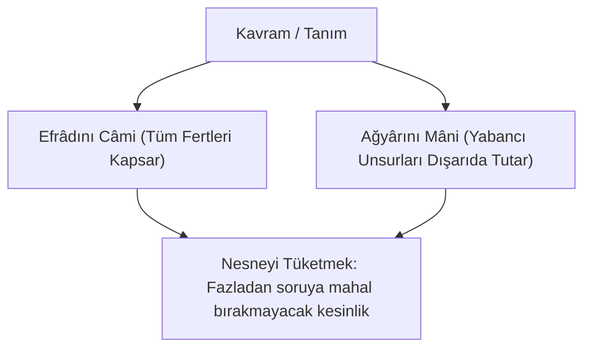
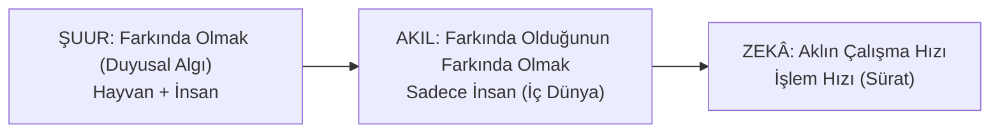
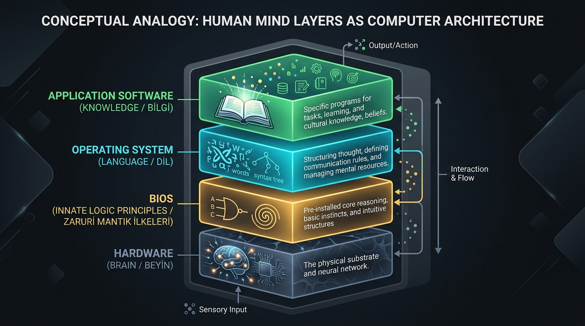

# Bölüm 1: Düşünmenin Temel Taşları — Kavram, Zihin ve Dil

> *"İnsan zihni kavramlarla düşünür, kavramlar kadar düşünür."*

---

## 1. Tanımın Tanımı ve "Nesneyi Tüketmek"

Herhangi bir konuda ilmi bir tartışma yürütmenin, fikir üretmenin veya bir problemi çözmenin ilk adımı; tartışılan konunun ana kavramlarını **doğru bilmektir**. Bilmek, otomatik olarak doğru bilmek anlamına gelmez; düşünmek de doğru düşünmek demek değildir. İnsanların ekseriyeti ağzından çıkan kelimelerin içeriğini ve hesabını daha önce hiç vermemiş, duyduğu ilk şablonla kabul etmiştir.

Klasik mantıkta ve İslam düşünce geleneğinde tanımın tanımı şu veciz ifadeyle özetlenir:

> ### **"Efrâdını câmi, ağyârını mâni."**
> 
> - **Efrâdını câmi:** Tanımlanan konuya ait bütün unsurları ve fertleri içine alır (Eksiksiz kapsayıcılık / Doğrulama).
> - **Ağyârını mâni:** Tanımlanan konunun dışındaki, onunla alakasız bütün unsurların içeri girmesine engel olur (Sınır çekme / Yanlışlama).



Bir şeyin tanımı öyle yapılmalıdır ki; o şeyle ilgili her unsuru içine almalı, ilgisiz her unsuru dışarıda bırakmalıdır. Aksi takdirde ortaya çıkan şey ilmi bir tanım değil, körü körüne bir **inanç** veya **kanaat** olur.

### "Nesneyi Tüketmek" İlkesi
Felsefede *"nesneyi tüketmek"*, bir kavram tarif edilirken o nesne hakkında söylenebilecek başka muğlak hiçbir noktanın bırakılmamasıdır.
- Birine *"Dışarıdan şu demiri getir"* derseniz dışarıda milyonlarca demir parçası vardır.
- *"Ağır olanı getir"* deseniz; demirlerin hepsi ağırdır.
- *"Köşeli olanı getir"* deseniz; yuvarlak olmayanların tümü köşelidir.
- Ancak ne zaman ki *"Altı yüzeyi, 12 ayrıtı olan, küp biçiminde, parlak ve yeşil boyalı demiri getir"* derseniz, bütün yabancı unsurları dışarıda bırakmış (ağyârını mâni kılmış) ve aranan nesneyi tüketmiş olursunuz.

> [!IMPORTANT]
> **Zıtlarıyla Bilinme Kuralı:** Bir şeyin sadece ne olduğunu bilmek, o şeyi bilmek demek değildir. Bir şey ancak ne olmadığını da bildiğinizde tam olarak bilinir. Zıddı bilinmeyen bir bilgi, akli bilgi değil taklidi inançtır.

---

## 2. İnsan Zihninin Çalışma Mekanizması ve Kelime Dağarcığı

İnsan zihni kelimelerle çalışır. Zihindeki kelime ve kavram sayısı ne kadarsa, insanın düşünme menzili de tam olarak o kadardır.

```
┌─────────────────────────────────────────────────────────────┐
│ Kelime Sayısı Az    ==> Düşünme Kapasitesi Sınırlı          │
│ Kelime Sayısı Zengin ==> Derinleşme, Analiz ve Yüksek Zekâ  │
└─────────────────────────────────────────────────────────────┘
```

Günümüz insanının ve üniversite gençliğinin en temel problemi **kelime haznesinin tükenmiş olmasıdır**. Günlük hayatta 150-200 kelimeyle (*"Aynen, valla, oha, yani, şey..."*) iletişim kuran bir zihin, bu dar kelime dağarcığıyla derin felsefi, matematiksel veya mühendislik analizleri yapamaz. 

Zekâ muazzam bir potansiyel olsa bile, o zekâyı sahaya sürecek olan vasıta **kavramlardır**. Einstein kadar dâhi bir zekânız olsa, zihninizdeki kavram havuzu 150 kelimeden ibaretse o zekâ çalışamaz; tıpkı son model bir süper bilgisayara sadece 1 KB'lık program yüklemeye benzer.

---

## 3. Ön Bilgilerin Önemi ve Anlama Usulü

İnsan zihni boşluk kabul etmez. Bir konunun anlaşılabilmesi için o konunun temelini oluşturan **ön bilgilerin (öncüllerin)** eksiksiz olması şarttır.

### Matematik Dersi Örneği (Sayının Karesi Yanılgısı)
Bir öğrenci okulda ne kadar zeki olursa olsun, matematik sınavında sürekli başarısız olabilir. Örneğin derste hoca *"Sayının karesi"* dediğinde, öğrenci kafasında "kare = 4 kenar" eşleştirmesi yaptığı için her karesi lafını gördüğünde sayıyı 4 ile çarpıyorsa, sonuç hep yanlış çıkacaktır. Öğrenci *"Ben doğru yaptım, hoca yanlış okudu"* diyecektir çünkü zihnindeki ön bilginin yanlış olduğunun farkında değildir.

Benzer şekilde tahtaya kalkan ve hiçbir soruyu çözemeyen bir öğrencinin sorunu zekâ geriliği değil; zincirleme geriye doğru gidildiğinde 5 adım önceki bir kavramın eksik olmasıdır. O eksik kavram yerine oturtulduğunda zincir kendiliğinden çözülür.

### Hans-Georg Gadamer ve "Ön Bilgi / Ön Yargı" (*Vorurteil*)
Hermeneutik felsefesinin kurucularından Hans-Georg Gadamer, insanın dünyayı anlama sürecinde ön bilginin kaçınılmaz olduğunu ortaya koymuştur:
1. **Olumlu Yönü:** İnsanın anlamaya başlayabilmesi için zihninde mutlaka bir ön kabule, kavram şablonuna ihtiyacı vardır. Ön bilgi olmadan düşünce eylemi başlayamaz.
2. **Olumsuz Yönü:** İnsan, anlamayı ancak o kavramın çizdiği sınırlar kadar yapabilir. Zihindeki kavram darsa, kavrayış da o darlıkta hapsolur.

### Dâhi Çoban: Prof. Dr. Hüseyin Yılmaz Örneği
1930'lu yıllarda Denizli kırsalında piknik yapan öğretmenler, 11-12 yaşlarında çobanlık yapan bir çocukla tanışırlar. Çocuğun akıl almaz bir kavrayışa sahip olduğunu fark ederler. Çocuğa sahip çıkılır, lise dışarıdan hızla bitirtilir, İTÜ ve ardından ABD'ye gönderilir.
- Bu çocuk, Einstein’ın Genel Görelilik Kuramı'ndaki matematiksel eksikliği tamamlayan (*Yılmaz Görelilik Teorisi*) ve konuşmayı algılayan ilk bilgisayarların mucidi olan **Prof. Dr. Hüseyin Yılmaz**'dır.
- Bu deha köyde çobanlık yaparken zekâsı neye yetiyordu? *"En iyi ot şuradadır, kurt bu saatte gelir, koyun şu derede yayılır."* Zekâ aynı zekâydı; fakat kelime dünyasına diferansiyel denklemler, tensörler, kuantum fiziği kavramları girince o deha bir dünya dâhisine dönüştü.

---

## 4. Şuur, Akıl ve Zekâ Arasındaki Keskin Sınırlar

Ders boyunca birbirine en çok karıştırılan üç kavramın sınırları kesin çizgilerle çizilmiştir:

| Kavram | Etimolojik Köken | Tanım | Varlık Düzeyi |
| :--- | :--- | :--- | :--- |
| **Şuur** | Arapça *şa'ara* (hissetmek, varlığını fark etmek) | **Farkında Olmak.** Dış dünyayı ve çevreyi algılama yetisi. | Hayvanlarda ve İnsanda vardır. (Hatta hayvanların duyusal şuuru insandan keskindir). |
| **Akıl** | Arapça *'akl* (bağlamak, zapt etmek) | **Farkında olduğunun farkında olmak.** Kendi bilincinin bilincinde olma; iç dünya kurabilme. | **Sadece İnsana özgüdür.** Hayvanlarda akıl yoktur. |
| **Zekâ** | Arapça keskinlik, çabuk parlayış | **Aklın çalışma hızı (sürati).** Bilgiyi işleme ve çıktı üretme hızı. | İnsanda, hayvanda ve makinelerde (Bilgisayar/Yapay Zekâ) farklı düzeylerde bulunur. |



### Bilgisayar mı İnsandan Daha Zekidir, İnsan mı?
Hocanın sınıfa sorduğu bu kilit sorunun cevabı şudur:
- **Bilgisayar insandan daha zekidir!** Çünkü zekâ aklın çalışma hızıdır ve bilgisayar veriyi ışık hızıyla işler, trilyonlarca olasılığı saliseler içinde eler.
- **Lâkin bilgisayarın aklı yoktur!** Bilgisayar var olduğunun farkında değildir; düşünemez, anlamlandıramaz, içsel bir muhakeme kuramaz.
- *"Yapay Zekâ"* denilebilir ama *"Yapay Akıl"* denemez; çünkü akıl ontolojik ve fıtridir.

### Soruların Gücü: Zekâ vs. Çalışkanlık
İnsanın kapasitesi ve zihinsel derinliği **verdiği cevaplardan değil, sorduğu sorulardan** anlaşılır.
- **Cevap:** Yalnızca kişinin ezberini veya o konuya çalışıp çalışmadığını gösterir.
- **Soru:** Zihnin arka planındaki derinliği, neden-sonuç arayışını ve kavrayış sınırlarını gösterir.
*(Okulda sıfır çeken, "aptal" damgası vurulan fakat sorduğu sorularla dehası fark edilip aynı yıl Türkiye Satranç Şampiyonu olan öğrenci örneği).*

---

## 5. Dil: Zihnin İşletim Sistemi

İnsan zihni bir bilgisayar mimarisine benzetildiğinde ortaya çıkan 4 temel katman şudur:



```
┌─────────────────────────────────────────────────────────────┐
│ 1. DONANIM (Hardware)    : BEYİN (Biyolojik Çip ve Nöronlar)│
│ 2. BIOS (Temel Yazılım)  : ZARURİ AKIL İLKELERİ (Fıtri)     │
│ 3. İŞLETİM SİSTEMİ (OS)  : DİL (Zihnin Formatı / Türkçe vb.)│
│ 4. UYGULAMA PROGRAMLARI  : BİLGİ, MESLEK, KÜLTÜR            │
└─────────────────────────────────────────────────────────────┘
```

1. **Beyin Donanımdır:** Fiziksel alt yapıdır.
2. **Akıl İlkeleri BIOS'tur:** İnsanın doğuştan getirdiği, öğretilmeyen fıtri mantık kodlarıdır (Ördeğin yumurtadan çıkar çıkmaz suya atlaması gibi).
3. **Dil İşletim Sistemidir (Windows / Linux):** Dil, zihne atılan formattır. Bilgisayara format attığınızda anakart değişmez, işletim sistemi değişir. İnsanın karakterinin ve algısının %60'ından fazlasını konuştuğu dilin yapısı belirler.
4. **Bilgi Uygulama Yazılımıdır:** Dil işletim sistemi ne kadar gelişmişse, üzerine kurulacak bilim ve fikir uygulamaları o kadar güçlü çalışır.

### Dilin Zihni Formatlamasına Dair Örnekler:
- **Küfür / Sövme Kültürü:** 
  - *Türkçede* en ağır küfürler aileye, anneye, namusa edilir. Bilinçaltına küçük yaştan *"Namus kutsaldır, dokunulmazdır"* kodu formatlanır.
  - *Almancada* küfürler şahsın karakterine ve hayvana yöneliktir (*"Schwein"* - domuz, *"Hund"* - köpek). Anasına bir şey desen umursamaz, *"Annemle konuş"* der; ama domuz dersen kavga çıkar.
- **Kore Savaşı ve "Kaçmak" Kavramı:** Amerikalı subayın hatıratında geçen olayda, Çin ordusu kuşatmasında cephanesi bitince süngü takıp 1700 Çinliyi öldüren Türk tugayının bu refleksi dilden gelir. Çünkü Türk kültüründe ve dilinde *"kaçtı"* denmesi dayak yemekten ve ölümden daha ağır bir zül kabul edilir; zihin bu seçeneği kapatmıştır.
- **Coğrafya ve Dil Metaforları:**
  - Arapçada çöl sıcağı kavurucu ve felaket olduğu için gecenin serinliği huzurdur. Bu yüzden sevgiliye veya peygambere *"Ay / Dolunay"* benzetmesi yapılır (*"Tal‘a’l-bedru ‘aleynâ"*).
  - Ilıman kuşakta yaşayan Türkler için ise Güneş bereket ve hayattır; biz *"Güneş gibi doğdun"* deriz. Kimse sevdiğine *"Ay gibi doğdun"* demez.

---

## 6. Kavramlarla Manipülasyon ve Toplum Mühendisliği

İnsan zihni kavramlarla düşündüğü için, kavramlar üzerinden çok kolay manipüle edilir. Buna felsefede ve siyasette **toplum mühendisliği** denir.

- **Kavram Üretimi:** Batı tarihi boyunca milyonlarca insan katledilmişken (Amerika'da yerliler, Almanya'da Yahudiler, Rusya'da Stalin, Belçika'da Kral Leopold, İngiliz sömürgeleri); Batı öyle bir kavram üretir ki: **"İslâmî Terör!"** Katledilen, hastanesi bombalanan Müslüman olduğu halde, zihinlere bu şablon yerleştirildiği için terör denince akla doğrudan Müslüman gelir.
- **Coğrafi İsimlendirme:** *"Orta Doğu"*, *"Uzak Doğu"*... Kime göre orta, kime göre uzak? Avrupa kendini merkeze koyduğu için! Çin Seddi'nden Hazar'a kadar olan kadim coğrafyanın adı tarihte **Türkistan** iken; sömürgeciler cetvelle sınır çizip Özbek, Türkmen, Kazak, Kırgız diyerek zihinleri formatlamışlardır.
- **Analiz Prensibi (*Cui Bono?*):** Bir cinayette veya siyasi olayda tetiği kimin çektiğinin önemi yoktur. Asıl mantık sorusu şudur: **"Bu olay kimin işine yaradı?"** Toplum mühendisliği bu soru sorulmadığında kitleleri hipnoz eder.
