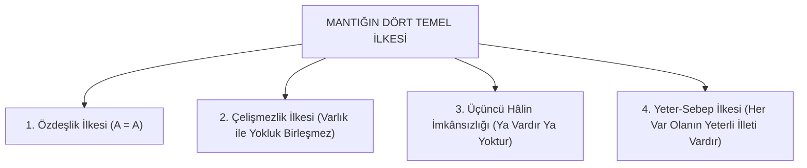
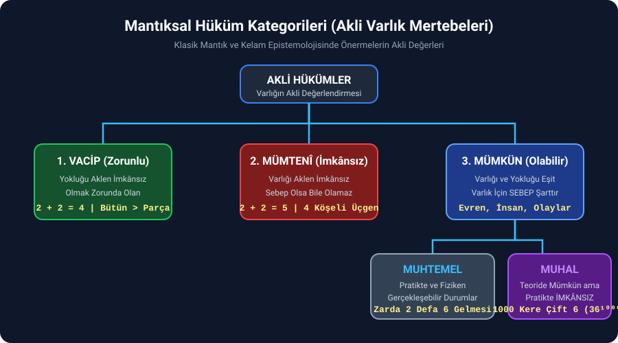
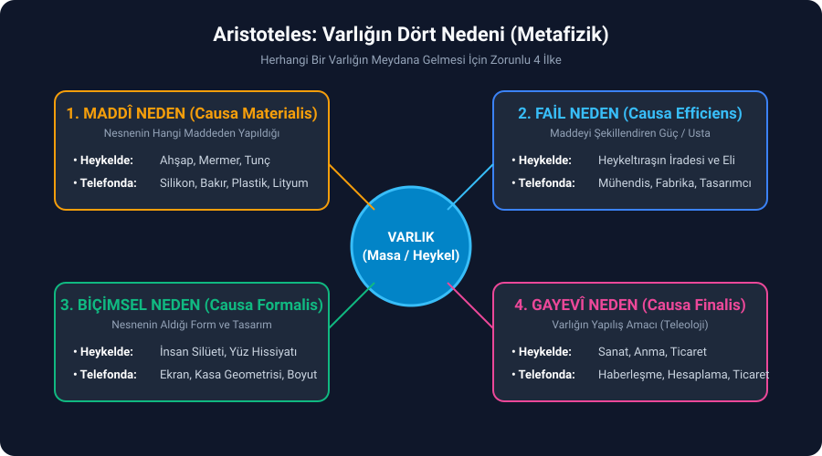

# Bölüm 2: Mantığın Dört Temel İlkesi ve Düşünce Sistematiği

> *"Matematikte nasıl ki tüm işlemler dört işlem üzerine bina edilir; insan zihninde de bütün düşünmeler mantık ilkeleri ve kavramlar üzerine inşa edilir."*

---

## 1. Zihnin Dört İşlemi: Mantık İlkelerinin Doğası

Matematikte dört işlemde hata yapan birinin en karmaşık integral veya diferansiyel hesabının doğru çıkması nasıl imkânsızsa; mantığın temel ilkelerinde hata yapan bir zihnin ulaştığı felsefi veya bilimsel sonuçların da doğru olması imkânsızdır.

Büyük İslam filozofu ve bilgini **İmâm Gazâlî** (*Mustasfâ* adlı eserinin mukaddimesinde) mantığın ilimler için hayati rolünü şöyle formüle etmiştir:

> ### **"Mantık bilmeyenin ilmine itimat olunmaz."**

Mantık kuralları insan zihnine sonradan yapıştırılmış yapay icatlar değildir; **evrenin fıtratında var olan değişmezliklerin zihindeki yansımasıdır**. Matematik ve mantık laboratuvara ihtiyaç duymaz; çünkü mantık icat etmez, var olan evrensel yasaları **keşfeder**.

---

## 2. Mantığın Dört Temel İlkesi

Mantık felsefesi klasik olarak dört ana aksiyom üzerinde yükselir:

---

### 2.1. Özdeşlik İlkesi ($A = A$)

Bir şey ne ise odur. Bir kavram, kendi bütün özellikleriyle ancak ve ancak kendisine eşittir.
- *"Demir demirdir, insan insandır."*

Kulağa son derece basit gelse de retorikte, siyasette ve teolojide en büyük aldatmacalar özdeşlik ilkesinin ihlali üzerinden kurulur.

#### Felsefi ve Teolojik Uygulama: $İnsan \neq Tanrı$
Hocanın ders boyunca üzerinde durduğu en keskin özdeşlik analizi şudur:

| Nitelik | İnsan | Taş | Tanrı |
| :--- | :--- | :--- | :--- |
| **Hayat Sahibi (Canlı)** | Evet | Hayır | Evet (Hayy) |
| **İrade / Şuur** | Evet | Hayır | Evet |
| **Madde Olma** | **Evet** | **Evet** | **HAYIR** |
| **Yer Kaplama** | **Evet** | **Evet** | **HAYIR** |
| **Zaman ve Mekâna Tâbi Olma** | **Evet** | **Evet** | **HAYIR** |

- İnsan zaman ve mekân içindedir. Zaman ve mekânı yoktan var eden ise zaman ve mekânın içinde olamaz (Yaratan yaratılana tâbi olamaz).
- Bu durumda: $\text{İnsan} = \text{Tanrı}$ veya $\text{İsa} = \text{Tanrı}$ önermesi kurulduğunda, sistem daha mantığın birinci kuralı olan **Özdeşlik İlkesinde ($A = A$) çöker**.
- Batı teolojisinde *"Dinin akılla ne alakası var, akıl ayrı iman ayrıdır"* sloganının yayılmasının sebebi budur; çünkü akıl devreye girdiğinde özdeşlik kuralı inanç sistemlerini çürütmektedir. İslam'da ise akıl imanın şartıdır; aklı olmayanın mükellefiyeti yoktur.

---

### 2.2. Çelişmezlik İlkesi

> **"Bir şey aynı anda, aynı şartlar altında hem kendisi hem de zıddı olamaz."**  
> Varlık ile yokluk bir araya gelemez: $\sim(A \land \sim A)$

- Bir insan aynı anda hem evli hem bekâr olamaz.
- Bir sayı aynı anda hem tek hem çift olamaz.
- Bir şey ya siyahtır ya da siyah değildir.
- Bir anne aynı anda, aynı kişiye karşı hem mutlak merhametli hem mutlak zalim olamaz.

> [!IMPORTANT]
> **Kilit Mantık Kuralı:** *"Bir şeyi kabul etmek, onun zıddını reddetmektir."*  
> Bir kimse *"Allah vardır"* dediği anda mantıken:
> 1. Maddenin ezeliyetini reddetmiştir.
> 2. Hareketin ezeliyetini reddetmiştir (hareketin bir başlangıcı vardır).
> 3. Şuursuz atomların gayeli birleşebileceği fikrini reddetmiştir.

---

### 2.3. Üçüncü Hâlin İmkânsızlığı

> **"Bir şey ya vardır ya yoktur; üçüncü bir ara durum söz konusu olamaz."** ($A \lor \sim A$)

Bu ilke, günümüz bilgisayar mühendisliğinin ve dijital elektronin temelidir:
- **Boole Cebri ve İkili Sistem (Binary):** Bilgisayar devrelerinde ya akım vardır ($1$) ya da yoktur ($0$). Eşik geriliminin üstü $1$, altı $0$'dır; ortası yoktur.

#### Mantık Kapıları ve Devre Eşleşmesi:
1. **VE (AND) Devresi (Seri Bağlantı):** 1. anahtar VE 2. anahtar kapatılırsa ($1 \land 1$) lamba yanar.
2. **VEYA (OR) Devresi (Paralel Bağlantı):** 1. anahtar VEYA 2. anahtar kapatılırsa ($1 \lor 0$ ya da $0 \lor 1$) lamba yanar.

Mantık ilkeleri ile evrenin ve fiziğin kanunları birebir örtüşür; bilgisayar çipleri bu mantıksal zorunluluk üzerine inşa edilmiştir.

---

### 2.4. Yeter-Sebep İlkesi (Leibniz)

Tarih boyunca sezgisel olarak kullanılsa da bu ilkeyi felsefede sistemleştiren Alman filozof ve matematikçi **Gottfried Wilhelm Leibniz**'dir.

> ### **Yeter-Sebep İlkesinin Tanımı:**
> Bir olgunun var olabilmesi veya bir sebebin bir sonucu meydana getirebilmesi için; o sebebin, ortaya çıkan sonucu meydana getirebilecek **kabiliyet, güç, ilim ve yeterliliğe** sahip olması şarttır.

#### Güneş ve Mum Örneği:
- **Güneş:** Isı vardır, ışık vardır, renk vardır $\rightarrow$ *"Güneş varsa gündüzdür"* önermesi doğrudur.
- **Mum:** Isı vardır, ışık vardır, renk vardır $\rightarrow$ *"Mum varsa gündüzdür"* önermesi **yanlıştır**.
- **Sebep:** Mumdaki ışık yeryüzünü aydınlatacak yeter sebebe sahip değildir; Güneş ise bu yeterliliğe sahiptir.

#### Göz ve Fotoğraf Makinesi Analojisi:
Tahtaya çizilen optik düzenekte: İnce kenarlı mercek, odak mesafesi, ışık miktarını ayarlayan diyafram, zifiri karanlık hazne ve kavisli algılayıcı yüzey vardır.
- Bu düzenek bir **fotoğraf makinesidir**.
- Aynı zamanda insan ve hayvan **gözünün yapısıdır**.
- Işığın dalga boyunu, kırılma indisini bilmeyen kör bir kimsenin tesadüfen fotoğraf makinesi yapması yeter-sebep ilkesine göre imkânsızdır. O halde fotoğraf makinesinden milyarlarca kat üstün, canlı, kendini tamir eden gözün şuursuz atomların tesadüfüyle ortaya çıktığını savunmak zihinsel bir iflastır. Gözü dokumak için ışığı bilmek, kulağı dokumak için sesi bilmek, ciğeri dokumak için atmosferi bilmek şarttır.

---

## 3. Hukukta ve Mantıkta İspat Kuralı: "Yokluğun İspatı Olmaz"

Mantığın ve dünya hukuk sistemlerinin en temel aksiyomu şudur:

> ### **"Varlık ispat edilir, yokluk ispat edilmez."**
> *(Delil getirmek davacıya, yemin ise inkâr edene düşer).*

- Bir kimseye mahkemede *"Katil olmadığını, suçsuzluğunu ispat et!"* denilemez; çünkü suçsuzluk bir yokluk halidir. Cinayeti iddia eden, varlığa ait delil getirmek zorundadır.
- Mantıkta **tümel olumsuzlar (genel yokluk iddiaları)** ispatlanamaz.
  - *"Dünyada 14 köşeli bir taş yoktur"* önermesini ispatlamak için evrenin her noktasını aynı anda taramak gerekir ki bu imkânsızdır.
  - Ancak *"Vardır"* diyen kimsenin tek bir numune göstermesi iddiayı ispatlamaya yeterlidir.
- Dolayısıyla *"Tanrı yoktur"* iddiası mantıksal açıdan geçersiz, temelsiz ve ispata kapalı bir lafazanlıktan ibarettir.

---

## 4. Mantıksal Hüküm Kategorileri (Akli Değerler)

Klasik mantık ve kelam epistemolojisinde bir önermenin akli değeri üç temel kategoriye ayrılır:

1. **VACİP (Zorunlu):** Olmak zorunda olan, yokluğu aklen tasavvur edilemeyen hakikatlerdir. İspata ve iknaya ihtiyaç duymaz ($2 + 2 = 4$; bütün, parçasından büyüktür).
2. **MÜMTENÎ (İmkânsız):** Varlığı aklen imkânsız olan, sebep olsa dahi gerçekleşemeyecek durumlardır ($2 + 2 = 5$; dört köşeli üçgen).
3. **MÜMKÜN (Olabilir / Olmayabilir):** Varlığı da yokluğu da eşit derecede mümkün olan alandır. Mümkünün var olabilmesi için **mutlaka bir sebep (illet)** gereklidir. İkiye ayrılır:
   - **Muhtemel:** Şartlar ve zaman-mekân sınırları müsait olduğu için fiziken ve pratikte gerçekleşebilen durumlar (Tavla oynarken üste üste iki kez çift altı gelmesi: $\frac{1}{36} \times \frac{1}{36}$).
   - **Muhal:** Teorik/matematiksel olarak bir olasılık hesaplansa dahi, zaman-mekân sınırları ve evrenin ömrü buna asla izin vermediği için **pratikte imkânsız** olan durumlar.

### 1000 Kere Üst Üste Çift Altı Gelmesi ve DNA Yazılımı
- İki zarı 1000 defa üst üste atıp 1000 defasında da çift altı gelme olasılığı: $36^{1000}$'de birdir.
- Evrendeki toplam atom sayısı: $\mathbf{10^{80}}$
- Evrenin varoluşundan bu yana geçen süre: $\mathbf{10^{17}\text{ saniye}}$
- Kâinattaki her atomun üzerinde evrenin başından beri saniyede 1 katrilyon kere zar atılsa dahi bu durum gerçekleşemez; yani **muhaldir**.
- Tek bir hücremizdeki DNA yazılımı **3 milyar 200 milyon karakterdir**. 4 farklı renkteki 3,2 milyar bilyeyi bir kuleden aşağı döküp yere düştüklerinde kusursuz bir kütüphane oluşturmasını beklemek muhalin fersah fersah ötesidir.

---

## 5. Aristoteles’in Metafiziğinde "Dört Neden"

Aristoteles, *Metafizik* eserinde bir varlığın meydana gelebilmesi için 4 temel nedenin bir arada bulunması gerektiğini ortaya koymuştur:

| Neden Türü | Açıklama | Heykel Örneği | Akıllı Telefon Örneği |
| :--- | :--- | :--- | :--- |
| **1. Maddî Neden** (*Causa Materialis*) | Varlığın hangi ham maddeden yapıldığı. | Ahşap, Mermer, Tunç | Silikon, Bakır, Plastik |
| **2. Fail Neden** (*Causa Efficiens*) | Maddeye şekil veren irade ve güç. | Heykeltıraş | Mühendis, Tasarımcı |
| **3. Biçimsel Neden** (*Causa Formalis*) | Nesnenin kazandığı form ve tasarım. | İnsan Silüeti | Telefon formu, Kasa |
| **4. Gayevî Neden** (*Causa Finalis*) | Nesnenin hangi amaçla yapıldığı. | Sanat, Estetik | İletişim, Veri İşleme |

### Ateizmin Temel Mantık Yanılgısı
Aristoteles'in bu tablosuna göre materyalist/ateist düşünce:
> **"Fail neden ile Maddî nedeni bir sayma hatasına düşmektedir."**

Mermer heykelin yapıcısını mermerin kendi atomik çekimine bağlamak ne kadar akıl dışıysa; hidrojen, karbon, oksijen ve azottan meydana gelen insanın varlığını da o atomların kendi kendine birleşmesine bağlamak aynı mantıksal cehalettir.
