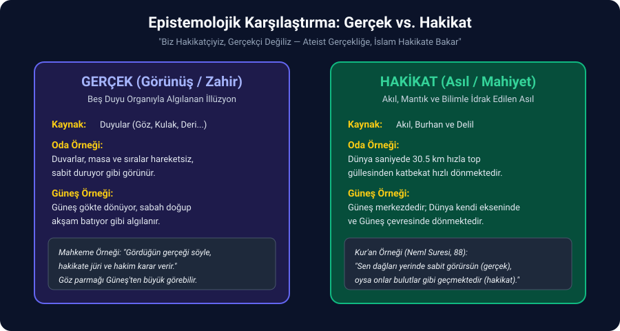
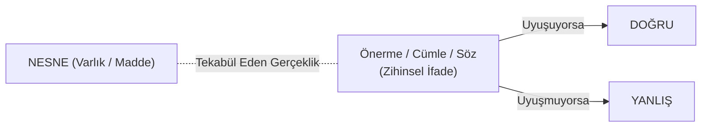

# Bölüm 3: Epistemoloji — Doğru, Hakikat ve Bilimsellik

> *"Doğruluk ve yanlışlık nesnelere ait değildir; nesneler hakkındaki ifadelere, sözlere ve önermelere aittir."*

---

## 1. Bilgi ve Malumat Ayrımı

Modern çağın ve dijital dünyanın en büyük yanılgısı, malumat kalabalığını bilgi zannetmektir.
- **İlim / Bilgi:** Aynı şartlar altında test edilebilen, tekrarlanabilen, gerekçelendirilmiş ve nesnesine tekabül eden kesin akli/deneysel veridir.
- **Malumat:** Sosyal medyadan, kaydırmalı videolardan veya kulaktan dolma duyumlardan zihne yığılan, teyit edilmemiş kanaatler ve iddialar yığınıdır.

İnsanın kavram dünyası eksik olduğunda, zihin malumatı bilgi zanneder ve sorgulama yeteneğini bütünüyle kaybeder.

---

## 2. Gerçek ile Hakikat Arasındaki Keskin Ayrım

Günlük konuşma dilinde *"Gerçekten mi?"* ile *"Hakikaten mi?"* kelimeleri birbirinin eş anlamlısı gibi kullanılır; oysa felsefi ve mantıksal düzlemde bu iki kavram birbirine zıttır:



```
┌────────────────────────────────────────────────────────┐
│ GERÇEK  : Beş duyu organıyla algılanandır (Görünüş).   │
│ HAKİKAT : Akıl, mantık ve burhanla ulaşılandır (Asıl). │
└────────────────────────────────────────────────────────┘
```

### Örneklerle Gerçek vs. Hakikat Analizi:

1. **Odanın ve Duvarların Durumu:**
   - **Gerçek:** Şu anda içinde oturduğumuz odanın duvarları kımıldamıyor, sıralar sabit, masa hareket etmiyor. Duyularımız bize odanın hareketsiz olduğu gerçeğini söyler.
   - **Hakikat:** Aslında hepimiz bir top güllesinden katbekat daha korkunç bir süratle uzayda fırlatılmış durumdayız. Bir top güllesinin namlu çıkış hızı $1.5 - 2\text{ km/sn}$ iken; Dünya'nın Güneş etrafındaki dönüş hızı saniyede **$30.5\text{ km}$**'dir. Hakikat, muazzam bir hızla hareket ettiğimizdir.

2. **Güneş'in Hareketi:**
   - **Gerçek:** Başımızı kaldırıp baktığımızda sabah doğan, öğlen tepeye çıkan ve akşam batan bir Güneş görürüz (Güneş dönüyor gibi algılanır).
   - **Hakikat:** Güneş merkezdedir; hareket eden ve kendi ekseninde dönen Dünya'dır.

3. **Göz Yanılsamaları:**
   - Başparmağınızı gözünüzün önüne getirdiğinizde parmağınız Güneş'i tamamen kapatır; duyusal olarak parmak Güneş'ten büyüktür (**gerçek**). Akıl ise Güneş'in parmaktan trilyonlarca kat büyük olduğunu bilir (**hakikat**).

4. **Mahkeme Yemini ve Şahitlik:**
   - Amerikan mahkemelerinde şahide: *"Gerçeği ve sadece gerçeği söyleyeceğine yemin eder misin?"* denir; *"Hakikati söyleyeceksin"* denmez. Çünkü şahit sadece gözüyle gördüğü gerçeği anlatır. Şahidin gördüğü yanıltıcı olabilir; olayın arkasındaki asıl hakikate ise akıl yürüterek hâkim ve jüri karar verir.

> [!NOTE]
> **Hocanın Kilit Vurgusu:**
> *"Biz hakikatçiyiz, gerçekçi değiliz. Ateist duyusal gerçekliğe takılır kalır; İslam düşüncesi ise aklın ulaştığı hakikate bakar."*

### Kur'an'dan Epistemolojik Delil: Neml Suresi 88. Ayet
Kur'an-ı Kerim, gerçeklik ile hakikat arasındaki bu zıtlığı asırlar öncesinden haber vermiştir:

> *"Sen dağları görürsün de onları yerinde donmuş/sabit sanırsın; oysa onlar bulutların geçişi gibi geçip gitmektedirler."*  
> *(Neml Suresi, 88. Ayet)*

- Ayette **"görürsün"** ifadesi duyusal algıyı (gerçeği) ifade eder.
- Eğer bir cisim bakan kişiye göre hareketsiz gözüküyor ama hakikatte hareket ediyorsa; **üzerinde bulunduğu zemin hareket ediyor** demektir. Tıpkı saatte 100 km hızla giden bir trenin kompartımanında oturan iki kişinin birbirini hareketsiz görmesi gibi. Ayet doğrudan Dünya'nın döndüğünü ispatlar.

---

## 3. Doğru ve Yanlış Kavramları

Felsefede en çok tahrif edilen kavramların başında "doğru" ve "yanlış" gelir.



> ### **Doğrunun Kesin Tanımı:**
> **Sözün, cümlenin veya önermenin; yöneldiği nesnesine (gerçekliğe) uyumudur.**

### En Kritik Sınav Kuralı:
> [!CAUTION]
> **"Doğruluk ve yanlışlık; yalnızca ve yalnızca SÖZE / CÜMLEYE aittir."**  
> **Nesnelerin kendisi 'doğru' veya 'yanlış' OLAMAZ!**

- Masa doğru veya yanlış olabilir mi? Olamaz; masa sadece bir nesnedir.
- *"Masa ahşaptır"* dediğimde kurduğum **cümle** masanın nesnesine uyuyorsa bu cümle **doğrudur**; masa demir olduğu halde ahşap dediysem bu cümle **yanlıştır**.

### Sınavda Puan Kırdıracak "Yasaklı İfadeler":
Hoca mantık ve bilim felsefesinde şu kelimelerin kesinlikle kullanılmaması gerektiğini belirtir:
1. **"Herkesçe kabul edilen..." / "Çoğunluk tarafından..."**
   - Hakikat çoğunluğun oylamasına bağlı değildir. Bütün dünya insanları toplanıp *"Su 1 atmosfer basınçta 50 derecede kaynar"* diye oy kullansa, su yine 100 derecede kaynar. Bilim ve mantık konsensüsle değil, nesnesine uygunlukla belirlenir.
2. **"Belirli bir..."**
   - Tartışmada veya yazıda "belirli bir" ifadesini kullanan kimse neyi tanımladığını bilmiyor demektir; kavramı muğlaklaştırır.

---

## 4. Bilgi Disiplinlerinin Üç Temel Sorusu

İlmi sahada soruların muhatabı olan üç temel disiplin vardır:

```
┌─────────────────────────────────────────────────────────────┐
│ 1. FELSEFE       : "NEDİR?" Sorusunun Cevabıdır.            │
│ 2. FEN BİLİMLERİ : "NASIL?" Sorusunun Cevabıdır.            │
│ 3. DİN           : "NİÇİN?" Sorusunun Cevabıdır.            │
└─────────────────────────────────────────────────────────────┘
```

- **Fen Bilimleri Sadece "Nasıl"ı Açıklar:**
  - Tıpta karaciğerin kandaki 1000'e yakın kimyasal bileşiği nasıl analiz ettiğini, pH'ı nasıl dengelediğini anlatırsınız; bu *"Nasıl?"* sorusudur.
  - Fakat *"Karaciğer niçin böyledir ve nasıl bir iradeyle bu amaca göre var olmuştur?"* diye sorduğunuzda fen bilimi susmak zorundadır.
- **Akıl Tutulması:**
  - Pozitivist/materyalist gaflet; fen bilimlerinin verdiği "nasıl" cevabını, dinin ve felsefenin sorduğu "niçin" sorusunun yerine koyup *"İşte açıkladım ya, tesadüfen oldu"* demektir. Nasıl sorusuna verilen cevap, gayeyi ve faili ortadan kaldırmaz.

---

## 5. Sorgulanmayan Şablon Bilgilerin Çöküşü: "Yağmur Nasıl Yağar?"

İlkokuldan itibaren ezberletilen şablon bilginin epistemolojik olarak nasıl temelsiz olduğunu gösteren çarpıcı bir vaka incelemesi:

- **Ezber Bilgi:** *"Su buharlaşır, göğe yükselir, soğuk hava tabakasına çarpar, yoğunlaşır ve yağmur olarak yağar."*
- **Mantıksal ve Bilimsel Analiz:**
  1. Su her sıcaklıkta buharlaşır (Kışın çamaşırların kuruması gibi).
  2. Gökyüzü (2000 - 5000 metre irtifa) **yılın 365 günü her saniye soğuktur** ($-40^\circ\text{C}$ ila $-60^\circ\text{C}$).
  3. Eğer ezberlenen bu tanım doğru olsaydı, yeryüzünde 365 gün 24 saat kesintisiz yağmur yağması gerekirdi! Niye sadece belirli zamanlarda yağar?

### Bilimsel Hakikat ve Tohumlama (Aşılama) Şartı:
Su buharının damla haline gelebilmesi için soğuk hava yetmez; su buharının tutunabileceği mikroskobik bir **çekirdek (tohum)** şarttır. Rüzgârların havalandırdığı çöl tozları, polenler veya atmosferde yanan göktaşlarının külleri bu çekirdeği oluşturur. Nem bu tozlara tutunur, kütle kazanır ve yerçekimiyle yağmur damlası olarak düşer.
- Bugün suni yağmur yağdırmak için bulutlara uçakla **Gümüş İyodür ($AgI$) tozu** püskürtülmesinin sebebi budur; tohum aşılanınca yağmur başlar.
- **Kur'an'ın Mucizevi Tespiti:**
  > *"Biz rüzgârları aşılayıcı (tohumlayıcı) olarak gönderdik de gökten su indirdik..."*  
  > *(Hicr Suresi, 22. Ayet)*

Sorgulanmayan eksik ön bilgiler zihni yanıltır; tam ve sağlam öncüller ise hakikate ulaştırır.
