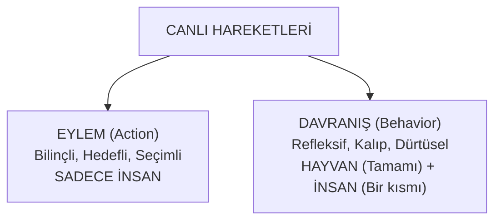
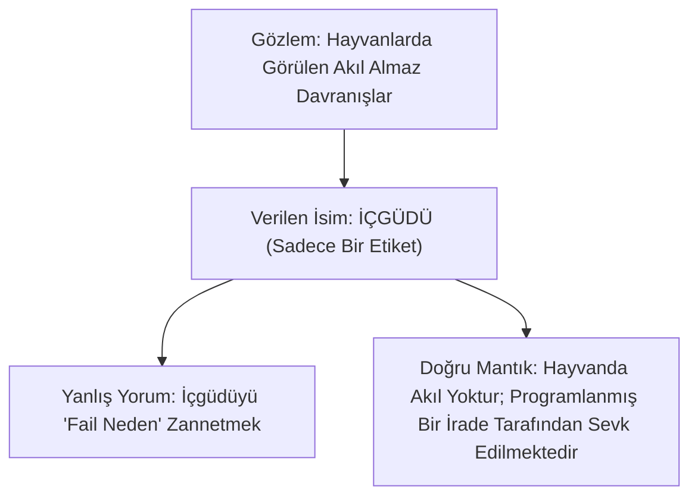
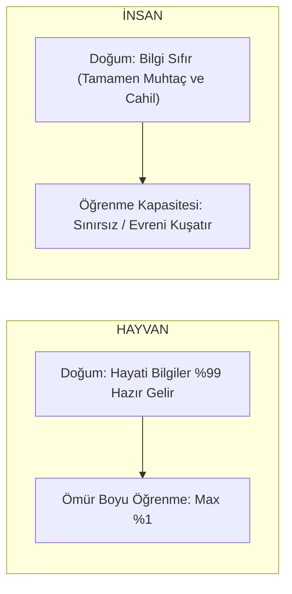

# Bölüm 4: Ontoloji ve İnsan Felsefesi

> *"Bina yapmak için işçi, demir, su, çimento, tuğla, sıva ve kalıp lazımdır; biri eksik olsa bina kurulamaz. Ama binayı yıkmak istiyorsanız tek bir direğin olmaması yeterlidir."*

---

## 1. Eylem (Action) ile Davranış (Behavior) Ayrımı

Felsefi antropolojide ve ahlak felsefesinde insanı diğer canlılardan ayıran en temel ontolojik çizgi, hareketlerinin mahiyetidir:

```
┌─────────────────────────────────────────────────────────────┐
│ EYLEM (Action)      : Bilinçli, gayeli, iradi hareket.      │
│                       (Sadece İnsana Özgüdür)               │
├─────────────────────────────────────────────────────────────┤
│ DAVRANIŞ (Behavior) : Refleksif, kalıplaşmış, güdüsel hareket│
│                       (Hayvanların Tümü + İnsanın Bir Kısmı)│
└─────────────────────────────────────────────────────────────┘
```



- **Hayvanlarda Asla Eylem Yoktur:** Hayvanların ortaya koyduğu hareketlerin tamamı biyolojik programlanmış birer **davranıştır**. Hayvan geçmişi muhakeme edip *"Bugün şöyle bir hata yaptım, yarın bunu düzelteyim"* diyerek iradi bir hedef belirleyemez.
- **İnsanda İse Hem Davranış Hem Eylem Vardır:** İnsan biyolojik yapısıyla refleksler (davranış) gösterirken, aklı ve iradesiyle davranışlarını **eyleme** dönüştürme kudretine sahiptir.

### Karşılaştırmalı Örnekler Tablosu:

| Günlük Durum | Davranış Boyutu (Biyolojik/Kalıp) | Eylem Boyutu (Bilinçli/İradi) |
| :--- | :--- | :--- |
| **Beslenme** | Açlık hissiyle alelacele yemek yemek. | Yemeğe *"Bismillah"* diyerek, helal-haram gözeterek ve şükür niyetiyle başlamak. |
| **Uyku** | Yorgunluktan sızıp uyuyakalmak. | *"Sünnet üzere abdestli ve sağ tarafıma dönerek yatacağım"* bilinciyle uyumak. |
| **Yürüme** | Dalgın ve hedefsizce sokakta yürümek. | Belirlenmiş ilmi veya ahlaki bir gayeye doğru adımlarını bilerek atmak. |
| **Evlat Sevgisi** | **Annenin Sevgisi:** Fıtridir, doğuştandır; kendi iradesi karışmaz, doğrudan verilir (Davranış). | **Babanın Sevgisi:** Sonradan bilinçle inşa edilir, sorumluluk ve ahlaki seçim barındırır (Eylem). |

---

## 2. Doğru Düşünmenin Zorluğu: "Bina Yapmak vs. Yıkmak"

Doğru düşünmek insanlık tarihindeki en zahmetli iştir; çünkü doğruluk sistemik bir mükemmellik şart koşar:

> **"Bir binanın ayakta kalması için binlerce tuğla, tonlarca demir, çimento, su ve usta işçilik eksiksiz bir arada olmalıdır. Doğru olmak böyledir; tek bir kavramın eksikliği bütün sistemi çökertir. Yanlış olmak ise çok kolaydır; kolonlardan birini kesmek binayı yıkmaya kâfidir."**

İnsanlar genelde neyi bilmediklerini bilmezler. Kavram haznesi eksik olan bir kimse, eksik düşündüğünün dahi farkına varamaz; çünkü zihninin ufku kendi kelimeleri kadardır.

### Sokrates'in İlmi Devrimi
Antik Yunan felsefesinde Sokrates'in meşhur sözü:
> *"Bildiğim tek şey, hiçbir şey bilmediğimdir."*

Bu söz bir acziyet veya sofistçe bir inkâr değildir. İnsanın zihinsel sınırlarını, ön kabullerinin yanıltıcılığını ve hakiki bilgiye ulaşmak için zihni temelsiz şablonlardan arındırmak gerektiğini ilan eden muazzam bir **epistemolojik uyanıştır**.

---

## 3. "İçgüdü" Kavramının Mantıksal ve Felsefi Analizi

Modern biyolojide hayvanların akıl almaz işleri nasıl yaptığı sorulduğunda hemen tek bir kelime yapıştırılır: **"İçgüdü."**

Peki, içgüdü nedir? Varlığına dair bilimsel ve somut delil nedir?

> ### **İçgüdünün Hakiki Tanımı:**
> **İçgüdü; hayvanlarda müşahede edilen akıl almaz ve olağanüstü hareketlere bizim verdiğimiz bir İSİMDİR, ETİKETTİR; o davranışın NEDENİ DEĞİLDİR!**

İnsanlar tıpkı "kanun" kavramında olduğu gibi, bir etiket uydurup o etiketi olayın gerçek nedeni zannetme yanılgısına düşerler:
- *"Arı bu peteği nasıl yaptı?"* $\rightarrow$ *"İçgüdüyle yaptı."*
- *"İçgüdü nedir?"* $\rightarrow$ *"Arının o peteği yapmasını sağlayan güçtür!"*  
*(Kendi kendini doğrulayan totoloji / kısır döngü).*



### Çelişkiyi Ortaya Koyan Vaka Örnekleri:

1. **Arının Geometrisi vs. Açık Cam Çıkmazı:**
   - Arı kovandan 2 kilometre uzağa uçar, çiçek tarlasını bulur, kovana döner ve zikzak dansıyla güneşe göre açıyı arkadaşlarına tarif eder (*"Saat 2 yönünde 120 derece açıyla uçun"*).
   - Fakat aynı arı, derslikte pencere 5 santimetre açıkken kafasını kapalı cama vurur durur; 5 santim yana kayıp açık pencereden çıkmayı akıl edemez!
   - Eğer arının içinde her şeyi bilen bağımsız bir zekâ veya içgüdü gücü olsaydı, camın açık kısmını da akıl ederdi. Hayvanda akıl yoktur; o fiil ona ilahi bir sevk ile yaptırılmaktadır.

2. **Somon / Alabalık Paradoksu:**
   - Nehirde yumurtadan çıkar, binlerce kilometre okyanusa gider; sonra çağlayanları, akıntıları tersine yüzerek aşar, tam doğduğu nehir yatağına gelir, yumurtlar ve kendini karaya vurup intihar eder.

3. **Ahtapotun Fedakarlığı:**
   - Anne ahtapot yavrularını bir kaya oyuğuna kilitler, başında haftalarca yemeden içmeden nöbet tutar ve açlıktan can verir. Yumurtadan çıkan yavrular annelerinin cesedini yiyerek ilk gıdalarını alırlar.

4. **Deniz Fıskiyesi (Tunicate):**
   - Denizde yüzen bir omurgalıyken gelir, uygun bir kayanın üstüne oturur; kendi beynini ve sinir sistemini sindirerek tüketir ve ömrünün kalanını bir bitki gibi taşa yapışık tamamlar.

Bütün bu olaylar gösterir ki; hayvanda bir "içgüdü tanrısı" yoktur. Hayvan sadece fıtratına yüklenen yazılımı icra eden şuursuz bir memurdur.

---

## 4. İnsan ile Hayvanın Yaratılış / Donanım Karşılaştırması

İnsan ile hayvanın ontolojik yaratılışı arasındaki tezat şu formülle özetlenir:

```
┌─────────────────────────────────────────────────────────────┐
│ HAYVAN : Bilgisi tam/hazır gelir, kapasitesi sabittir (%1)   │
│ İNSAN  : Bilgisi sıfır gelir, öğrenme kapasitesi sonsuzdur  │
└─────────────────────────────────────────────────────────────┘
```



- **Ördek Yavrusu:** Yumurtadan çıkar çıkmaz suya atlar ve mükemmel yüzer; kimse ona hidrodinamik öğretmemiştir. Bilgisi hazır verilmiştir ama ömrü boyunca bu bilginin üzerine bir satır bile ekleyemez.
- **İnsan Yavrusu:** Dünyaya geldiğinde yürümeyi, yemeyi, konuşmayı dahi bilmez; mutlak bir cehalet ve acziyet içindedir. Lâkin insanın içine konulan akıl, ruh ve öğrenme istidadı öyle bir donanımdır ki; sıfırdan başlayıp kâinatın sırlarını çözen, atomu parçalayan ve uzaya araç gönderen bir dehaya dönüşebilir.
