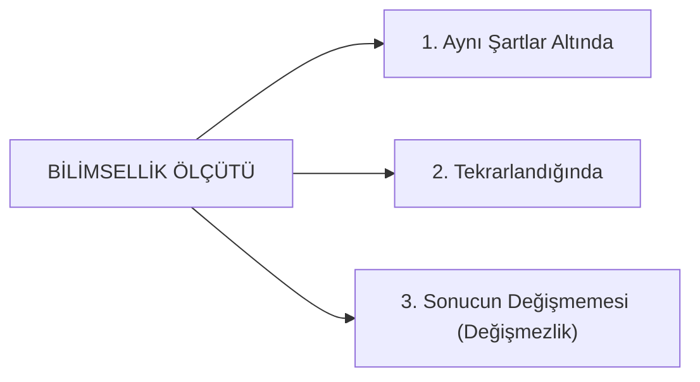
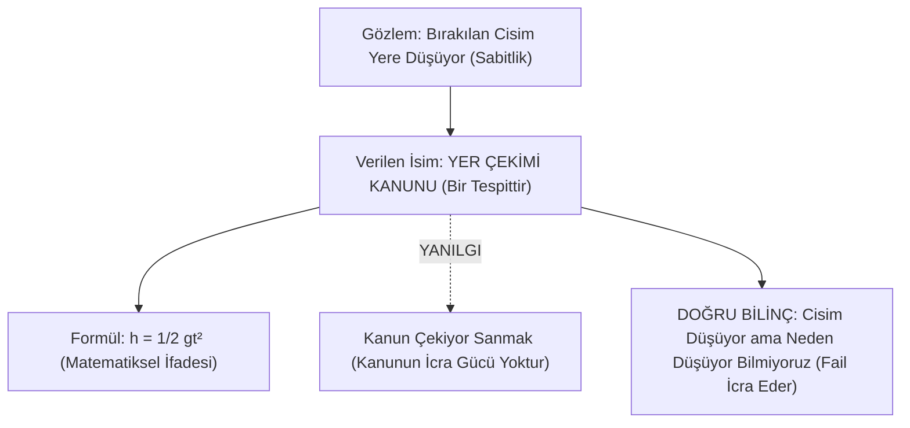

# Bölüm 5: Bilim, Kanun ve Mühendislik Felsefesi

> *"Kanun; evrendeki değişmezliklere verdiğimiz addır, isimdir. Kanun o değişmezliğin nedeni zannedilemez!"*

---

## 1. Bilimselliğin Üç Temel Şartı

Bir iddianın veya önermenin "bilimsel" kabul edilebilmesi için üç temel koşulu eksiksiz sağlaması gerekir:



1. **Aynı Şartlar Altında**
2. **Tekrarlandığında**
3. **Sonucun Değişmemesi (Değişmezlik)**

### Şartlandırılmış Önerme Zorunluluğu:
Hocanın sınıfa sorduğu klasik soru:
- *"Su 100 derecede kaynar önermesi bilimsel midir?"*
- Sınıf: *"Evet."*
- Hoca: **"Bilimsel DEĞİLDİR!"**

Ağrı Dağı'nın zirvesine veya Everest'e çıktığınızda açık hava basıncı düştüğü için su $70^\circ\text{C} - 80^\circ\text{C}$ civarında kaynar. Öyleyse şartı belirtilmemiş bir iddia bilimsel değil, eksik bir genellemedir.

> ### **Bilimsel Önerme:**
> *"Su, deniz seviyesinde (1 atmosfer basınç altında) 100 santigrat derecede kaynar."*  
> Şartı net olarak zikredilmeyen önerme bilim değil, inançtır.

---

## 2. Mühendislik, Hendese ve Matematik Nedir?

Mühendislik eğitimi alan bir öğrencinin ilk bilmesi gereken şey, unvanının etimolojisi ve epistemolojisidir:

- **Mühendis:** Arapça *hendese* kelimesinden türemiş ismi faildir; **"Hendeseci"** demektir.
- **Hendese:** Arapçada **Geometri** demektir. Klasik ilimlerde geometri matematik anlamında da kullanıldığı için mühendis kelimesinin tam karşılığı **"Matematikçi"**dir.

### Matematik Nedir ve Ne İş Yapar?

> ### **Matematik:**
> **Rakamlarla yapılan sembolik mantıktır; DEĞİŞMEZLİK İLMİDİR.**

Gerçek geometride ve matematikte zorunlu olmadıkça rakam kullanılmaz; çünkü rakamlar sadece pratik inşaat/köprü hesapları için üretilmiş sembollerdir. Hakiki matematik kavramsal bağıntılarla düşünür.

```
┌─────────────────────────────────────────────────────────────┐
│ Üçgenin İç Açıları = Doğru Açı = Yarım Daire = 2 Dik Açı   │
│                      = Dörtgenin Açıları Toplamının Yarısı  │
├─────────────────────────────────────────────────────────────┤
│ Dairenin Açısı     = Kesişen İki Doğrunun Toplam Açısı     │
│                      = 4 Dik Açı = Dörtgenin Toplam Açısı   │
└─────────────────────────────────────────────────────────────┘
```

- **Pi Sayısı Nedir?** Çemberin çevresinin çapına oranıdır ($\frac{22}{7}$'dir; yaklaşık 3.14 değildir, değişmez bir bağıntıdır).

### Düzlem Geometrisi vs. Eğri/Küresel Geometri
- *"Bir üçgenin iç açıları toplamı her zaman 180 dereceye eşit midir?"* $\rightarrow$ **HAYIR!**
- 180 derece sadece iki boyutlu düzlem yüzeyde (**Öklid Geometrisi**) geçerlidir.
  - **Kürenin Dış Yüzeyinde (Eliptik Geometri):** Üçgenin iç açıları toplamı $180^\circ$'den **büyüktür** ($270^\circ$ olabilir).
  - **İçbükey Yüzeyde (Hiperbolik Geometri):** Üçgenin iç açıları toplamı $180^\circ$'den **küçüktür**.
- İslam medeniyeti bu küresel geometriyi yüzyıllar önce çözmüş ve Dünya'ya bin yıldır **Küre-i Arz** (Yerküre) demiştir.

---

## 3. Değişmezlik İlmi Olarak Mühendislik Dalları

Mühendis; evrendeki değişmezlik kanunlarını öğrenip bunları teknolojiye tatbik eden kimsedir:

- **Fizik Mühendisi:** Maddenin fizik dünyasındaki değişmezliklerini bilen kişidir.
- **Kimya Mühendisi:** Maddenin moleküler ve atomik bileşimindeki değişmezlikleri bilen kişidir.
- **Makine Mühendisi:** Maddenin mekanik ve kinetik hareketindeki değişmezlikleri bilen kişidir.
- **Elektrik Mühendisi:** Elektronun **iletken kablo üzerindeki** hareketinin değişmezliklerini yöneten kişidir.
- **Elektronik Mühendisi:** Elektronun **yarı iletkenler (silikon) veya vakum/boşluk içindeki** hareketinin değişmezliklerini yöneten kişidir.

### Elektrik ile Elektronik Arasındaki Keskin Fark:

| Kriter | Elektrik Mühendisliği | Elektronik Mühendisliği |
| :--- | :--- | :--- |
| **Elektronun Ortamı** | İletken tel/kablo üzerinden akar. | Yarı iletken (diyot, transistör) veya boşluk/gaz. |
| **Gerilim & Güç** | Yüksek gerilim, enerji üretimi, nakli, motor gücü. | Küçük gerilimler ($5\text{V}, 3.3\text{V}$), sinyal ve veri işleme. |
| **Örnek Cihazlar** | Elektrikli süpürge, trafo, asenkron motor, floresan. | Akıllı telefon, bilgisayar çipi, LED (driver devreli), telsiz. |
| **Arıza Karakteri** | Arızayı bulmak çok kolaydır (trafo yanmıştır); tamir etmek çok zahmetlidir. | Arızayı bulmak çok zordur (mikroskobik transistör); bulduktan sonra değiştirmek 10 saniyedir. |

---

## 4. Kanun ve Formül Kavramı (Hocanın 99 Punto ile Çizdiği Bölüm)

> [!CAUTION]
> ### **EN KRİTİK SINAV KONUSU: KANUN NEDİR?**
> **"Kanun; evrendeki değişmezliklere bizim verdiğimiz ADDIR, İSİMDİR, TESPİTTİR."**  
> **Kanun, o değişmezliğin NEDENİ DEĞİLDİR!**

- **Formül Nedir?** Evrendeki değişmezliklerin matematiksel sembollerle ifade edilmesidir ($V = I \times R$, $h = \frac{1}{2}gt^2$).



### Yer Çekimi Bir Neden midir?
- Bir cismi bıraktığınızda düşer. Cisim niye düşüyor? *"Yer çekiminden dolayı."*
- Peki, yer çekimi nedir? *"Bir kanundur."*
- Yani o kanun mu çekiyor cismi? Hayır! Cisim düşüyor, biz bu değişmez olguya **"yer çekimi"** adını veriyoruz.
- Cisim aşağıdan mı çekiliyor, yoksa yukarıdaki kozmik bir basınçla (Descartes'ın ether/esîr girdabı gibi) aşağı mı bastırılıyor?
- **El-cevap: BİLMİYORUZ!**
- Çayı karıştırdığınızda bütün çay taneleri bardağın merkezinde toplanır. Merkezde çayı çeken bir mıknatıs mı vardır? Hayır; girdap (vortex) dinamiği nedeniyle merkeze toplanır. Bilim cismin düştüğünü tespit eder; ama değişmezliğin asıl fail nedenini açıklayamaz.

### Mahkeme ve Anayasa Kanunları Benzetmesi:
- Anayasa kitapçığında *"Hırsızlık yapan cezalandırılır"* yazar.
- Bugüne kadar hırsızın peşinden koşup onu yakalayan bir anayasa maddesi gördünüz mü?
- Kanunun eli, ayağı, iradesi, icra gücü yoktur! Kanun sadece bir hükümdür.
- Hırsızı yakalayan **faildir (polistir, hâkimdir)**. Kâinattaki doğa kanunları da kendi kendine bir şey yapamaz; kanun sadece irade sahibi bir Failin (Yaratıcının) evrende uyguladığı nizamın adıdır.

---

## 5. Bilim, Hipotez ve Teori Ayrımı

İnsanların en büyük epistemolojik yanılgılarından biri hipotezleri kesin bilim zannetmektir:

1. **Bilim:** Kesinleşmiş, şartları net, tekrarlanabilir değişmezliklerdir.
2. **Hipotez:** Bilim insanının elindeki verileri açıklamak için öne sürdüğü geçici varsayımdır; halk diliyle *"İdare et abi"* modelidir. Bilim insanına bir çalışma güzergâhı çizer ama henüz bilim değildir.
3. **Örnek:** Evrim teorisi bir doğa kanunu değil; eldeki eksik fosil verilerini materyalist ön kabullerle birbirine bağlamaya çalışan kurgusal bir hipotezdir. Solungaçlı bir canlının karaya çıkıp akciğere dönüşmesini tetikleyecek yeter sebep gösterilemediği için bir inanç olarak kalmaktadır.
