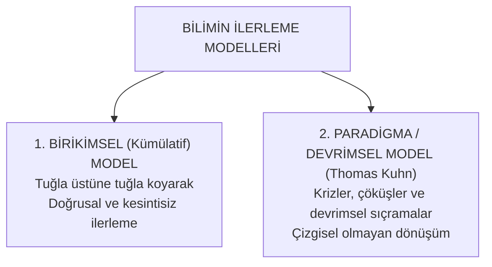
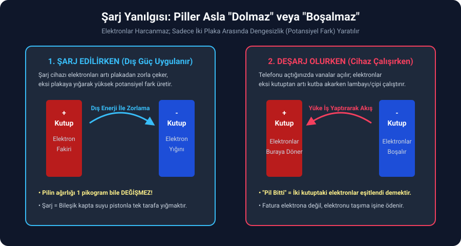
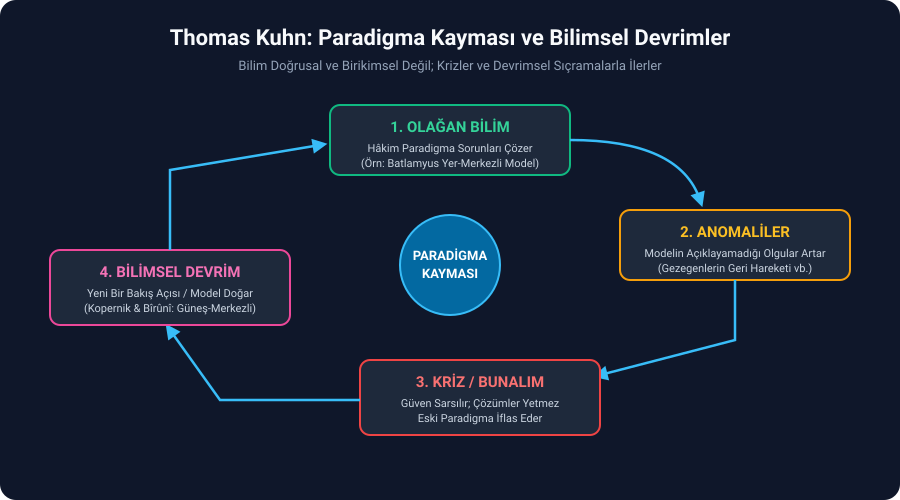
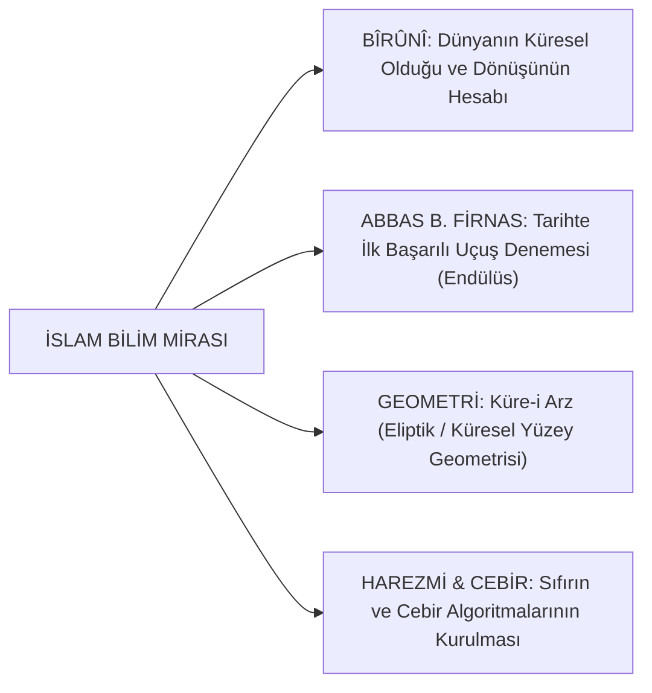

# Bölüm 6: Bilim Tarihi ve Bilimin İlerleme Modelleri

> *"Tarihi var kılan, insanın HÜR İRADESİDİR. Aynılık varsa, tarih yoktur."*

---

## 1. Tarih Kavramının Özü ve İnsanın Hür İradesi

Bilim tarihine giriş yaparken sorulması gereken ilk ontolojik soru şudur:  
**Neden bir "karınca tarihi", "arı tarihi" veya "aslan tarihi" yoktur da yalnızca "insan tarihi" vardır?**

- Bir karıncanın veya sırtlanın 10.000 yıl önceki beslenmesi, yuva yapması, avlanması ile bugünkü arasında en küçük bir fark yoktur.
- Canlıların hareketlerinde değişmeyen bir aynılık hüküm sürüyorsa, orada tarihten söz edilemez.

> [!CAUTION]
> ### **KESİN SINAV SORUSU:**
> **"Tarihi var kılan temel unsur insanın HÜR İRADESİDİR."**  
> **Temel İlke: "Aynılık varsa, tarih yoktur."**

İnsan hür iradeye sahip olduğu için tercihler yapar; iki günü birbirine eşit olmaz. İnsanın tercihi 1000 yıl öncesiyle bugünü, dün ile bugünü, hatta bir saat öncesiyle sonrasını bambaşka kılar. Bilim tarihi de insanın hür iradesiyle yaptığı keşifler ve tercihler zinciridir.

---

## 2. Bilimin İlerlemesine İlişkin İki Temel Görüş

Bilim felsefesinde bilimin zaman içinde nasıl geliştiğine ve sıçramalar yaptığına dair iki zıt model vardır:



---

### A. Birikimsel (Kümülatif) İlerleme Anlayışı

Bu klasik anlayışa göre bilim; basamak basamak, her neslin bir öncekinin buluşunu muhafaza edip üzerine yeni bir tuğla koymasıyla doğrusal ilerler. Tekerlek bulunmasaydı bugünkü otomotiv olamazdı; yazı bulunmasaydı bilgi aktarılamazdı.

#### Vaka İncelemesi: Elektrik ve Manyetizma Tarihinin Birikimli Gelişimi

```
[Kehribar (ēlektron)] ──> [Manisa Taşı (Magnetit)] ──> [Bağdat Pili (MÖ)] ──> [Volta Pili (1800)] ──> [Faraday (Dinamo/Motor)]
```

1. **Kehribar (*ēlektron*):**
   - Kehribar, çam ağacı reçinesinin milyonlarca yılda taşlaşmış kristal halidir.
   - Antik Yunanca karşılığı **"ēlektron"**dur. Kehribarın yüne veya saça sürtüldüğünde kuru samanları ve tozları çektiği antik çağda fark edilmiş ve "elektrik" kavramı buradan doğmuştur.
2. **Doğal Mıknatıs (Manyezya / Manisa):**
   - Mıknatıs kelimesi kökenini **Manisa’dan (Magnesia)** alır. Bu bölgede demiri çeken doğal mıknatıs taşları (**magnetit** / $\text{Fe}_3\text{O}_4$) bulunduğu için manyetizma ismi buradan dünyaya yayılmıştır.
3. **Bağdat Pili (Yaklaşık 2000 Yıl Önce):**
   - Mezopotamya'da kilden kaplar içine bakır silindir ve ortasına demir çubuk konularak asidik sıvı (sirke/şarap) ile ilk galvanik elektrik akımı elde edilmiştir.
4. **Alessandro Volta ve İlk Kimyasal Pil (1800):**
   - İtalyan fizikçi Volta; bakır disk, tuzlu suya batırılmış bez/keçe ve çinko diski üst üste dizerek kimyasal reaksiyondan sürekli doğru akım ($DC$) elde etmiştir.
   - İki metal arasındaki potansiyel fark yaklaşık **$1.5\text{ Volt}$** tur. Volta bu diskleri kule gibi üst üste dizerek gerilimi $80-100\text{ Volt}$ seviyelerine çıkarmıştır.

---

### Büyük Bilimsel Yanılgı: Piller Asla "Dolmaz" veya "Boşalmaz"!

Toplumdaki ve mühendislik öğrencilerindeki en büyük kavram yanılgılarından biri bataryaların *"dolup boşaldığını"* zannetmektir:



> [!IMPORTANT]
> **Pili şarja taktığınızda içine elektrik mi doluyor? Pilin ağırlığı 1 pikogram bile artar mı?**  
> **HAYIR! Kesinlikle artmaz.**

- **Şarj Nedir?** Bileşik kaplar örneğindeki gibi, bir taraftaki suyu pistonla zorla basıp diğer kaba aktarmaktır. Dışarıdan verilen elektrik enerjisi, elektronları bir plakadan (artı kutuptan) zorla koparıp diğer plakaya (eksi kutba) yığar. Arada yapay bir **potansiyel fark (dengesizlik)** oluşturulur.
- **Deşarj (Kullanım) Nedir?** Cihazı açtığınızda aradaki vana açılır; eksi kutupta sıkışan elektronlar devre üzerinden lambayı, işlemciyi yakarak eski yuvasına (artı kutba) geri akar.
- **"Pil Bitti" Ne Demektir?** İki kutup arasındaki elektron miktarının eşitlenip dengelenmesi demektir; içerideki tek bir elektron bile kaybolmaz!
- **Kirchhoff Kanunu:** Devreye giren akım ile devreden çıkan akım birbirine eşittir. Siz faturayı elektronun kendisine değil, **elektronları taşıma ve hareket ettirme işine** ödersiniz.

#### Michael Faraday: Jeneratör ve Motor Simetrisi
- Bir tel bobini mıknatıslar arasında **mekanik olarak çevirirseniz:** Uçlarından elektrik üretirsiniz $\rightarrow$ **Jeneratör (Dinamo).**
- Aynı düzeneğin uçlarına **dışarıdan elektrik akımı verirseniz:** Bobin hızla dönmeye başlar $\rightarrow$ **Elektrik Motoru.**  
Bu mekanizma sanayi devrimini ve elektrik santrallerini doğurmuştur.

---

### B. Thomas Kuhn ve Paradigma Devrimleri

1962 yılında **Thomas Kuhn**, bilim felsefesinde çığır açan *Bilimsel Devrimlerin Yapısı* (*The Structure of Scientific Revolutions*) kitabıyla bilimin birikimsel ilerlediği tezine karşı çıkmıştır.

> ### **Paradigma Nedir?**
> **Belirli bir tarihsel dönemde bilim topluluğuna ve topluma hâkim olan ortak inançlar, değerler, model ve dünyaya bakış açısıdır.**

Kuhn'a göre bilim tuğla üstüne tuğla koyarak dümdüz ilerlemez; krizler, kırılmalar ve devrimsel sıçramalarla yürür:



```
1. OLAĞAN BİLİM ──> 2. ANOMALİLER ──> 3. BUNALIM (KRİZ) ──> 4. BİLİMSEL DEVRİM ──> YENİ PARADİGMA
```

1. **Olağan Bilim:** Hâkim paradigma herkes tarafından tartışmasız kabul edilir; bilim insanları paradigmanın sınırları içinde bulmaca çözer.
2. **Anomaliler:** Mevcut teorinin açıklayamadığı olgular ve çelişkiler birikmeye başlar.
3. **Bunalım (Kriz):** Anomaliler o kadar çoğalır ki eski paradigma artık yamalarla dahi ayakta tutulamaz.
4. **Bilimsel Devrim:** Genç ve cesur bilim insanları radikal yeni bir model önerir. Eski paradigmanın temsilcileri direnir; zamanla yeni paradigma hâkim olur ve eski paradigma tamamen çöpe atılır.

#### Astronomi Tarihinden Paradigma Devrimi Örneği:

| Dönem / Âlim | Savunulan Model | Paradigma Karakteri |
| :--- | :--- | :--- |
| **Sisamlı Aristarkus** *(MÖ 3. yy)* | **Güneş Merkezli Model:** Dünya ve gezegenler Güneş'in etrafında döner. | Devrimsel Sezgi |
| **Batlamyus (Ptolemy)** *(MS 2. yy)* | **Yer Merkezli Model:** Dünya evrenin merkezinde sabittir; Güneş gökte dönmektedir. Duyusal gerçekliğe dayanır. | **1500 Yıllık Dogmatik Kilitlenme** |
| **Bîrûnî & Kopernik** *(11. - 16. yy)* | **Güneş Merkezli Model:** Batlamyus paradigması yıkılmış; Aristarkus'un 1500 yıl önce terk edilmiş modeli diriltilmiştir. | **Bilimsel Devrim** |

Aristarkus MÖ 300'lerde hakikati söylemişken, Batlamyus duyusal gerçekliğe dayanarak *"Gözünle görüyorsun işte, Güneş doğup batıyor"* demiş ve bu yanlış paradigma insanlığı 1500 yıl boyunca kilitlemiştir. Bilim düz bir çizgide gitmemiş; asırlar sonra eski bir fikir yeniden keşfedilerek devrim yapılmıştır.

#### Unutulan Medeniyetler: Abydos Tapınağı Kabartmaları
Mısır'daki I. Seti (Abydos) Tapınağı'nda helikopter, denizaltı ve tek kanatlı uçak silüetlerine benzeyen hiyeroglif kabartmaları arkeologlarca üst üste binmiş yazılar (*palimpsest*) olarak açıklansa da; insanlık tarihinde bilginin zaman zaman kaybolduğunu, medeniyetlerin çöktüğünü ve paradigmaların sıfırlanabildiğini gösteren çarpıcı bir tartışma konusudur.

---

## 3. İslam Bilim Tarihinin Temel Taşları

Batı merkezli tarih anlayışı antik Yunan'dan doğrudan Rönesans'a atlayarak 1000 yıllık İslam medeniyeti havzasını karanlık bir ara dönem gibi göstermeye çalışır. Oysa modern bilimin temellerinin %90'ı İslam âlimleri tarafından inşa edilmiştir:



- **Ebû Reyhan el-Bîrûnî (973 – 1048):**
  - Dünyanın çapını ve çevresini bugünkü modern GPS ölçümlerine milimetrik yaklaşan trigonometrik bir yöntemle (bir dağın tepesinden ufuk alçalma açısını ölçerek) hesaplamıştır.
  - Dünyanın kendi ekseni etrafında döndüğünü Kopernik'ten 500 yıl önce matematiksel olarak savunmuştur.
- **Abbas b. Firnas (810 – 887):**
  - Endülüs'te kuş tüyleri ve ipekten kanatlarla ilk uçuş makinesini yapmış, Cordoba vadisinde havalanıp havada uzun süre süzülmüştür (ancak kuşların inişte kuyruk kullandığını hesaba katmadığı için inişte yaralanmıştır).
- **Felsefe ile Din Arasındaki Keskin Çizgi:**
  - **Felsefe:** İnsan ve kâinat hakkında **insan aklı kaynaklı** düşüncedir.
  - **Din:** Varlığın mahiyeti hakkında **vahiy kaynaklı** ilahi bilgidir.
  İslam düşüncesi bu iki kaynağı birbirine düşman kılmamış; aklı vahyi anlamanın ve tasdik etmenin zaruri şartı kılmıştır.
