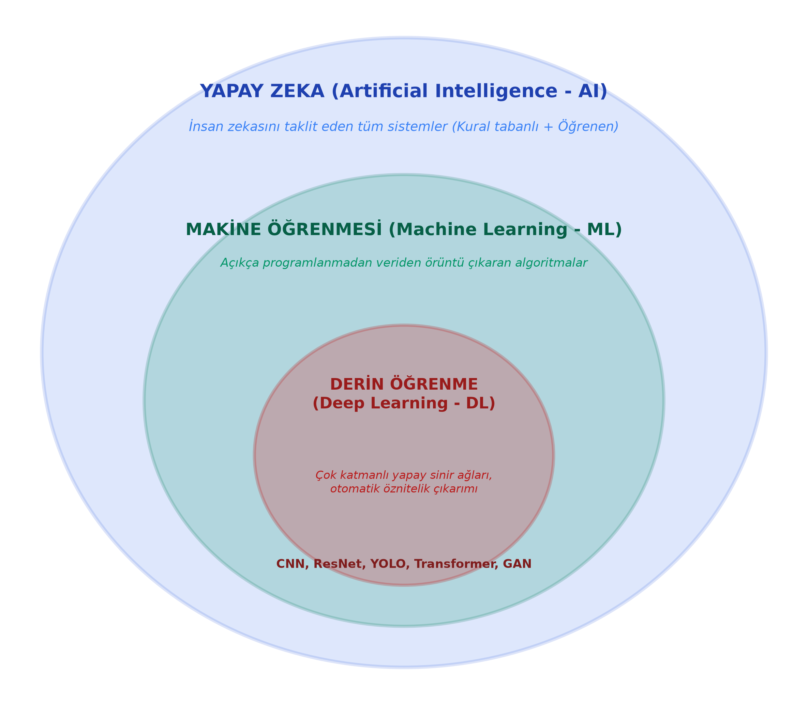
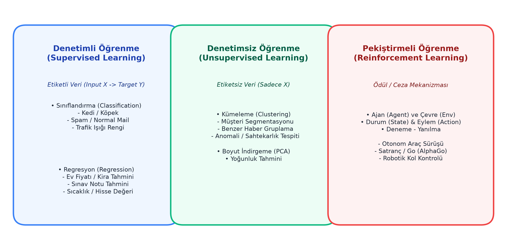
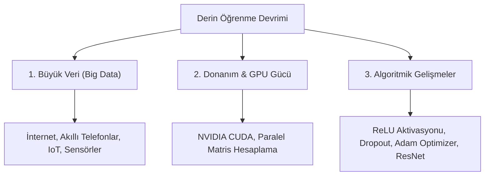

# Bölüm 1: Giriş ve Temel Kavramlar

---

## 1.1. Mühendislik Yaklaşımı ve Terminolojinin Önemi

Derin öğrenme ve yapay zeka alanında başarılı bir mühendis olmanın ilk şartı, kavramların **kitabi ezberinden ziyade arkasındaki mantığı ve mühendislik sezgisini** kavramaktır. Bu ders yalnızca sınavı geçip not almak için değil; sektöre çıktığınızda gerçek dünya problemlerini çözen, ticarileşebilir sistemler geliştirebilmeniz için tasarlanmıştır.

Günümüz mühendislik dünyasında literatür, kütüphaneler (PyTorch, TensorFlow, OpenCV) ve global topluluklar tamamen İngilizce terminoloji üzerinden haberleşmektedir. Sınavlarda ve meslek hayatınızda şu temel İngilizce terimleri doğrudan bilmeniz beklenir:
- **Artificial Intelligence (AI):** Yapay Zeka
- **Machine Learning (ML):** Makine Öğrenmesi
- **Deep Learning (DL):** Derin Öğrenme
- **Pattern Recognition:** Örüntü Tanıma
- **Feature Extraction:** Öznitelik Çıkarımı
- **Supervised / Unsupervised Learning:** Denetimli / Denetimsiz Öğrenme
- **Classification / Regression:** Sınıflandırma / Regresyon
- **Dataset (Train, Validation, Test):** Veri Seti (Eğitim, Doğrulama, Test)

---

## 1.2. Yapay Zeka, Makine Öğrenmesi ve Derin Öğrenme Hiyerarşisi

Yapay zeka sistemleri birbiri içerisine geçmiş kapsayıcı halkalardan oluşur. En geniş küme Yapay Zeka, onun bir alt kümesi Makine Öğrenmesi, makine öğrenmesinin de özelleşmiş en derin alt kümesi Derin Öğrenmedir.



### 1. Yapay Zeka (Artificial Intelligence - AI)
* **Tanım:** Bilgisayarların insan zekası gerektiren karmaşık görevleri (görsel algılama, konuşma anlama, akıl yürütme, problem çözme ve karar verme) yerine getirebilmesini amaçlayan en geniş şemsiye bilim alanıdır.
* **Kapsamı:** Yalnızca veriyle öğrenen modelleri değil; 1950'lerden bu yana geliştirilen kural tabanlı uzman sistemleri (Rule-based expert systems), arama algoritmalarını (A* algoritması vb.) ve mantıksal karar ağaçlarını da kapsar.

### 2. Makine Öğrenmesi (Machine Learning - ML)
* **Geleneksel Programlama vs. Makine Öğrenmesi:**
  * **Geleneksel Yazılım:** Mühendis oturur; tüm kuralları ve mantığı kodlar ($Kurallar + Veri \rightarrow Çıktı$).
  * **Makine Öğrenmesi:** Her kuralı tek tek elle yazmak imkansızdır. Sisteme bol miktarda veri ve hedef çıktılar verilir; sistem verinin içerisindeki örüntüleri (patterns) matematiksel olarak kendisi öğrenir ($Veri + Çıktılar \rightarrow Model/Kurallar$).
* **Tanım:** Bilgisayarların, her adımı açık şekilde programlanmadan, verilerden örüntüler öğrenerek tecrübe kazanmasını sağlayan yapay zeka alt dalıdır.

### 3. Derin Öğrenme (Deep Learning - DL)
* **Tanım:** İnsan beynindeki biyolojik sinir ağlarının çalışma prensibinden esinlenen, çok sayıda ardışık katmandan (derinlikten) oluşan yapay sinir ağlarını (Artificial Neural Networks - ANN) kullanan makine öğrenmesi alt alanıdır.
* **Klasik Makine Öğrenmesinden Temel Farkı:**
  * **Klasik ML'de:** Öznitelikleri (features) bir insan uzman elle çıkarmak zorundadır (Örn: Bir fotoğrafta kedinin kulak açısı, bıyık uzunluğu vb.). Ardından bu öznitelikler bir sınıflandırıcıya (SVM, Random Forest) verilir.
  * **Derin Öğrenmede:** Ham veri (piksel matrisi, ses dalgası, metin) doğrudan ağa verilir. Model ilk katmanlardan son katmanlara doğru **kendi özniteliğini kendisi hiyerarşik olarak otomatik çıkarır** (Feature Learning).

---

## 1.3. Gerçek Hayat Örneği: İstenmeyen E-posta (Spam) ve Oltalama (Phishing) Tespiti

Gelen kutunuza her gün yüzlerce e-posta düşer. Sistem bunların hangisinin normal, hangisinin spam veya dolandırıcılık olduğunu nasıl anlar?

* **Kural Tabanlı Yaklaşım Neden Başarısız Oldu?**
  * Eski sistemlerde mühendisler filtre yazardı: *"Eğer metinde 'ikramiye', 'hediye', 'tıkla' geçiyorsa spam yap."*
  * Dolandırıcılar hemen kuralı atlattı: Harflerin arasına nokta koydular (`i.k.r.a.m.i.y.e`), benzer karakterler kullandılar veya kelimeleri değiştirdiler. Elle kural yazarak trilyonlarca varyasyonu engellemek imkansızdır.
* **Makine Öğrenmesi / Derin Öğrenme Yaklaşımı:**
  * Sisteme geçmişte işaretlenmiş milyonlarca spam ve normal e-posta verilir.
  * Model gönderen e-posta adresinin yapısını, metindeki kelime dağılımlarını, kullanılan şüpheli bağlantıları (URL) ve IP itibarını birlikte değerlendirerek öğrenir.
* **Hocanın PTT Oltalama (Phishing) Vaka Analizi:**
  * Gerçek hayatta dolandırıcılar resmi kurumların (PTT Kargo, bankalar vb.) arayüzlerini birebir kopyalar.
  * Kullanıcıya *"Kargonuz teslim edilemedi, adresinizi güncellemek için linke tıklayın"* SMS veya e-postası atılır.
  * Tıklanan web sitesinin arayüzü PTT ile tıpatıp aynıdır ve kredi kartı bilgisi ister. Ancak URL dikkatle incelendiğinde harfler arasında fazladan bir karakter olduğu görülür (Örn: `ptt-kargo-guncelle.com`).
  * Modern yapay zeka modelleri sadece arayüze aldanmaz; alan adı yapısını, SSL sertifikasını, metin dilini ve ağ trafiği özelliklerini tarayarak kullanıcıyı tuzağa düşmeden uyarır.

---

## 1.4. Makine Öğrenmesi Türleri ve Problem Tipleri

Makine öğrenmesi problemleri, verinin tipine ve öğrenme metodolojisine göre üç temel gruba ayrılır:



### 1. Denetimli Öğrenme (Supervised Learning)
Veri setinde her bir girdiye ($X$) karşılık gelen doğru bir hedef etiket ($Y$) bulunur. Model bir "öğretmen" eşliğinde öğrenir: Tahminde bulunur, doğru cevapla karşılaştırılır ve aradaki hatayı düzelterek ağırlıklarını günceller.
Denetimli öğrenme iki temel problem tipine ayrılır:

> [!IMPORTANT]
> **Sınav Uyarısı (Hocanın Soru Mantığı):** Hoca bir senaryo verip *"Bu problem sınıflandırma mıdır yoksa regresyon mudur?"* diye sorar!

* **A. Sınıflandırma (Classification):**
  * **Çıktı:** Kesikli (ayrık / kategorik) etiketlerdir ($0$ veya $1$, "Kedi" veya "Köpek", "Kırmızı" / "Sarı" / "Yeşil").
  * **Örnekler:**
    * Bir otonom aracın ön kamerasının trafik ışığının kırmızı mı yeşil mi olduğunu belirlemesi.
    * Gelen mailin Spam ($1$) veya Normal ($0$) olarak etiketlenmesi.
    * Röntgen görüntüsünden kanserli dokunun tespiti (Pozitif / Negatif).
* **B. Regresyon (Regression):**
  * **Çıktı:** Sürekli (sayısal / reel) değerlerdir.
  * **Örnekler:**
    * Bir evin metrekaresi, oda sayısı, konumu verilerek fiyatının veya kirasının tahmin edilmesi.
    * Bir öğrencinin ders çalışma saati ve geçmiş ödev notlarına bakarak sınavdan alacağı notun tahmin edilmesi.
    * Yarınki hava sıcaklığının ($24.6^\circ\text{C}$) tahmin edilmesi.

### 2. Denetimsiz Öğrenme (Unsupervised Learning)
Veri setinde hedef etiket ($Y$) **yoktur**; yalnızca ham girdiler ($X$) bulunur. Model verinin kendi içerisindeki matematiksel benzerlikleri, uzaklıkları ve dağılımları bularak veriyi gruplandırır.
* **Kümeleme (Clustering):** Benzer müşterilerin alışveriş alışkanlıklarına göre segmentlere ayrılması (E-ticaret tavsiye sistemleri).
* **Anomali Tespiti (Anomaly Detection):** Banka kartı harcamalarında olağan dışı şüpheli işlemlerin yakalanması.
* **Boyut İndirgeme (Dimensionality Reduction / PCA):** Yüksek boyutlu verinin temel bileşenlerine ayrıştırılması.

### 3. Pekiştirmeli Öğrenme (Reinforcement Learning)
Model (ajan / agent) bir çevre (environment) içerisindedir. Önceden belirlenmiş bir veri seti yerine deneme-yanılma yoluyla hareket eder. Yaptığı doğru hareketlerde **ödül (reward)**, hatalı hareketlerde **ceza (penalty)** alır. Amacı kümülatif ödülü maksimize etmektir (Örn: AlphaGo, Boston Dynamics robotları, otonom yarış araçları).

---

## 1.5. Derin Öğrenmenin Tarihsel Gelişimi ve Yükseliş Nedenleri

Yapay sinir ağları kavramı yeni değildir; temelleri 1940'lar ve 1950'lere (McCulloch-Pitts nöron modeli ve Rosenblatt Perceptron'u) dayanır. 1970 ve 1980'lerde yaşanan "Yapay Zeka Kışları"nda (AI Winters) sinir ağları terk edilmiş ve fonlar kesilmiştir.

**Peki ne oldu da 2010'lu yıllardan sonra derin öğrenme bir anda patlama yaşadı?**

Hocanın derste vurguladığı üzere bu sıçramayı sağlayan **üç sacayağı** vardır:



1. **Büyük Veri (Big Data):** 
   Derin sinir ağları milyonlarca parametreye sahiptir. Az veriyle beslenirlerse ezberlerler (overfit olurlar). Akıllı telefonlar, sosyal medya, kameralar ve internet sayesinde trilyonlarca etiketli veri (örneğin ImageNet projesi) toplanabilir hale geldi.
2. **Donanım ve Paralel Hesaplama (GPU / TPU):**
   Bir sinir ağının eğitimi trilyonlarca matris çarpımından ibarettir. Standart işlemciler (CPU) birkaç çekirdekle işlemleri sırayla yaparken; Grafik İşlem Birimleri (GPU) binlerce küçük çekirdeğiyle matris işlemlerini paralel olarak saniyeler içerisinde tamamlar.
3. **Algoritmik Yenilikler:**
   Eski modellerde derin ağlar eğitilemiyordu çünkü gradyanlar yok oluyordu (vanishing gradient). ReLU aktivasyon fonksiyonunun bulunması, Dropout yöntemi ve Adam optimizer gibi optimizasyon teknikleri derin katmanların stabil eğitilmesini mümkün kıldı.

---

## 1.6. Vaka Analizi: İHA ve Derin Öğrenme ile Yasadışı Kenevir / Haşhaş Tespiti

Hocanın derste anlattığı önemli bir mühendislik ve savunma sanayii vaka çalışmasıdır:

* **Problem:** Kırsal ve dağlık arazilerde mısır tarlalarının veya ormanların arasına gizlenmiş yasadışı ekimlerin (kenevir, haşhaş vb.) güvenlik güçleri tarafından karadan tespit edilmesi hem çok zaman alır hem de personeli tehlikeye atar.
* **Geleneksel Çözüm:** Helikopterle uçup jandarma/polisin çıplak gözle veya dürbünle araziyi taraması. (Maliyetli, yorucu ve insan hatasına son derece açık).
* **Derin Öğrenme & İHA Çözümü:**
  1. İnsansız Hava Aracı (İHA), otonom rota üzerinde uçar ve yüksek çözünürlüklü multispektral kameralarla yüz binlerce kare fotoğraf çeker.
  2. Kenevir bitkisinin yaprak yapısı, yeşil tonunun yansıma katsayısı ve dokusu eğitilmiş bir CNN / Nesne Tespiti (YOLO) modeline verilir.
  3. Model mısır yaprağı ile kenevir yaprağının morfolojik farkını saniyenin yüzde birinde ayırt eder ve koordinatlarıyla birlikte ekrana yansıtır.
* **Mühendislik Dersi:** Mühendislik, kağıt üzerindeki teoriyi alıp toplumun güvenliğine veya üretimine katkı sağlayan çalışan bir prototipe dönüştürme sanatıdır.

---

## 1.7. Veri Seti Bölümleme (Data Splitting) Kuralları

Bir makine öğrenmesi veya derin öğrenme projesinde eldeki ham veri doğrudan eğitime sokulmaz. Veri seti titizlikle üç parçaya bölünür:

```
Tüm Veri Seti (%100)
┌───────────────────────────────────────┬───────────────────┬───────────────────┐
│          Eğitim (Train) Seti          │ Doğrulama (Val)   │     Test Seti     │
│                %70 - %80              │    %10 - %15      │     %10 - %15     │
└───────────────────────────────────────┴───────────────────┴───────────────────┘
```

1. **Eğitim Seti (Training Set - %70-80):** Modelin ağırlıklarını ($W$) ve sapmalarını ($b$) güncellemek için doğrudan gördüğü ve üzerinden öğrendiği veri kümesidir.
2. **Doğrulama Seti (Validation Set - %10-15):** Eğitim devam ederken her epoch sonunda modelin genel durumunu kontrol ettiğimiz, hiperparametreleri (öğrenme oranı, katman sayısı vb.) ayarladığımız kümedir. Ağırlıklar bu kümeye göre doğrudan güncellenmez.
3. **Test Seti (Test Set - %10-15):** Modelin eğitim sürecinde **kesinlikle hiç görmediği**, nihai başarısını ölçtüğümüz tarafsız hakem kümedir.

> [!WARNING]
> **Hayati İlke (Veri Sızıntısı / Data Leakage):** Test seti gerçek dünyayı temsil eder. Veri artırma (Data Augmentation), gürültü ekleme veya normalizasyon parametreleri hesabı sadece ve sadece **Train kümesine** uygulanır! Test verisine veri artırma yapılmaz ve test verisi eğitime sızdırılmaz.
