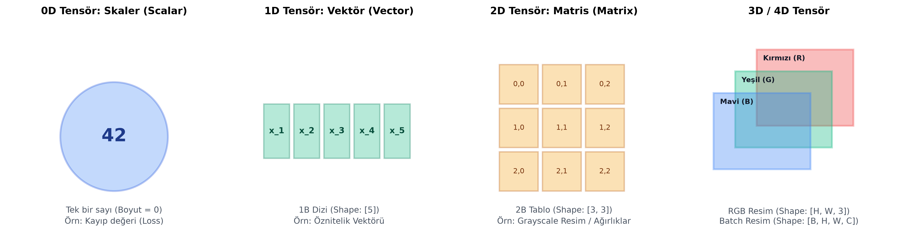
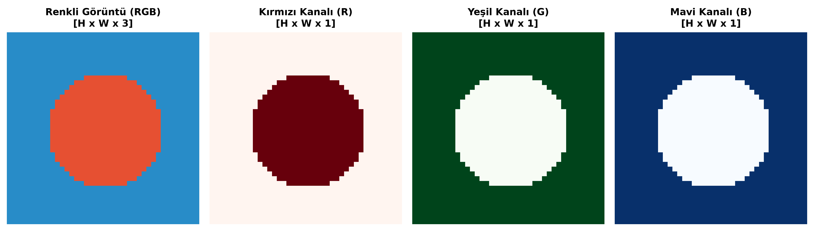

# Bölüm 2: Matematiksel Altyapı ve Veri Temsili

---

## 2.1. Bilgisayarlar Dünyayı Nasıl Algılar?

İnsan beyni bir resmi gördüğünde anlamı (bir kedi, ağaç veya araba) doğrudan algılar; bir sesi duyduğunda tınıyı ve sözcükleri tanır. Ancak dijital bilgisayarlar fiziksel dünyadaki hiçbir nesneyi, rengi veya sesi doğrudan tanıyamaz. Bilgisayarlar için evrendeki her şey yalnızca **sayılardan (matrisler ve tensörler)** ibarettir:

* **Görüntü:** Işık şiddetini temsil eden $0$ ile $255$ arasındaki sayıların oluşturduğu $2$ veya $3$ boyutlu ızgaralardır (grid).
* **Ses:** Hava basıncındaki dalgalanmaların zamana bağlı genlik değerleridir (1 boyutlu sinyal) veya frekans-zaman görüntüleridir (Spektrogram).
* **Metin:** Sözcüklerin veya karakterlerin yüksek boyutlu vektör uzayındaki sayısal izdüşümleridir (Embeddings).

---

## 2.2. Veri Boyutları ve Tensör Hiyerarşisi

Derin öğrenme kütüphanelerinde (PyTorch, TensorFlow) tüm veri akışı **tensör** adı verilen çok boyutlu sayı dizileri üzerinden yürütülür.

### 1. Skaler (Scalar - 0D Tensör)
* **Tanım:** Sadece tek bir büyüklüğü ifade eden yönsüz, tek bir sayıdır. Eksen (rank / rank-0) sayısı sıfırdır.
* **Derin Öğrenmedeki Yeri:** Modelin o andaki **kayıp değeri (Loss)**, başarı oranı (**Accuracy**), anlık öğrenme oranı ($\alpha$).
* *Örnek:* $x = 42$, $\mathcal{L} = 0.354$

### 2. Vektör (Vector - 1D Tensör)
* **Tanım:** Sayıların tek bir eksen (satır veya sütun) boyunca yan yana dizildiği 1 boyutlu dizidir.
* **Öznitelik Vektörü (Feature Vector):** Bir nesnenin ölçülebilir özelliklerinin listesidir.
* *Örnek (Ev Tahmin Modeli):* Bir evin özelliklerini temsil eden vektör:
  $$x = \begin{bmatrix} 120 \\ 3 \\ 2 \\ 5 \end{bmatrix} \begin{matrix} \text{(Metrekare: } 120\text{)} \\ \text{(Oda Sayısı: } 3\text{)} \\ \text{(Banyo Sayısı: } 2\text{)} \\ \text{(Bina Yaşı: } 5\text{)} \end{matrix}$$

### 3. Matris (Matrix - 2D Tensör)
* **Tanım:** Sayıların satırlar ve sütunlar halinde iki eksende düzenlendiği tablolardır (Boyut: $Satır \times Sütun$ veya $H \times W$).
* **Derin Öğrenmedeki Yeri:** 
  * Tek kanallı siyah-beyaz (Grayscale) fotoğraflar.
  * Sinir ağlarındaki ağırlık matrisleri ($W$).
  * Tablolu veri setleri (Her satır bir örnek, her sütun bir öznitelik).

### 4. Çok Boyutlu Tensörler (3D, 4D, 5D Tensörler)
Tensör, skalerlerin, vektörlerin ve matrislerin herhangi bir boyuta genelleştirilmiş üst kavramıdır:
* **3D Tensör ($H \times W \times C$):** Renkli tek bir fotoğraf (Yükseklik, Genişlik, 3 Renk Kanalı).
* **4D Tensör ($B \times H \times W \times C$ veya $B \times C \times H \times W$):** Modele aynı anda verilen bir paket (Batch) renkli görüntü.
  * $B$: Batch Size (Örn: 32 adet resim)
  * $C$: Kanal Sayısı (RGB için 3)
  * $H$: Yükseklik (Height, örn: 224)
  * $W$: Genişlik (Width, örn: 224)
* **5D Tensör ($B \times T \times H \times W \times C$):** Video verileri ($T$: Zaman / Kare sayısı).

---

## 2.3. Bilgisayarlı Görüde Görüntü Temsili ve Renk Kanalları

Dijital bir ekranda gördüğünüz her bir piksel (pixel = picture element), bilgisayar belleğinde bir tamsayı ile saklanır.

### 1. Piksel Değerleri ve Derinlik ($uint8$)
* Standart görüntülerde her bir renk kanalı $8\text{ bit}$ ($2^8 = 256$ farklı değer) ile kodlanır.
* Değerler $[0, 255]$ aralığındadır:
  * $0$: Tamamen karanlık (Siyah / Işık yok)
  * $255$: Tamamen aydınlık (Maksimum ışık şiddeti)

### 2. Grayscale (Gri Tonlamalı) Görüntüler
* Tek bir kanaldan ($H \times W \times 1$) oluşur. Her piksel sadece o noktanın parlaklık (luminance) değerini tutar.
* MNIST el yazısı rakam veri seti gri tonlamalıdır ($28 \times 28 \times 1$).

### 3. RGB (Kırmızı, Yeşil, Mavi) ve Biyolojik Altyapısı
* Renkli görüntüler üst üste bindirilmiş 3 ayrı 2B matristen oluşur: Kırmızı (Red), Yeşil (Green) ve Mavi (Blue).
* **Biyolojik Neden:** İnsan retinasında renkleri algılayan üç tip koni hücresi (S-cone, M-cone, L-cone) bulunur ve bunlar sırasıyla mavi, yeşil ve kırmızı dalga boylarına duyarlıdır. Bilgisayarlar da bu biyolojik evrimi taklit ederek tüm renkleri bu üç ana ışığın karışımıyla sentezler.

---

## 2.4. Temel Lineer Cebir İşlemleri

Sinir ağlarının çalışması doğrudan matris ve vektör cebirine dayanır.

### 1. Vektör İç Çarpımı (Dot Product)
Boyutları aynı iki vektörün ($u, v \in \mathbb{R}^n$) karşılıklı elemanlarının çarpımlarının toplamıdır:
$$u \cdot v = \sum_{i=1}^n u_i v_i = u_1 v_1 + u_2 v_2 + \dots + u_n v_n$$
* İki vektör arasındaki yön benzerliğini ve izdüşümü ölçer. Tek bir yapay nöronun girdilerle ağırlıkları çarpması tam olarak bu işlemdir.

### 2. Matris Çarpımı (Matrix Multiplication)
İki matrisin ($A$ ve $B$) çarpılabilmesi için temel kural: **Birinci matrisin sütun sayısı, ikinci matrisin satır sayısına eşit olmalıdır.**

$$(M \times K) \cdot (K \times N) = (M \times N)$$

* **Örnek Hesaplama:**
  $$A = \begin{bmatrix} 1 & 2 \\ 3 & 4 \end{bmatrix}_{2 \times 2}, \quad B = \begin{bmatrix} 5 & 6 \\ 7 & 8 \end{bmatrix}_{2 \times 2}$$
  $$C = A \cdot B = \begin{bmatrix} (1 \cdot 5 + 2 \cdot 7) & (1 \cdot 6 + 2 \cdot 8) \\ (3 \cdot 5 + 4 \cdot 7) & (3 \cdot 6 + 4 \cdot 8) \end{bmatrix} = \begin{bmatrix} 19 & 22 \\ 43 & 50 \end{bmatrix}_{2 \times 2}$$

> [!CAUTION]
> **Eleman Düzeyinde Çarpım (Hadamard Product) ile Karıştırmayın:**
> * $A \cdot B$: Standart matris çarpımıdır (iç çarpım mantığı).
> * $A \odot B$: Aynı boyuttaki iki matrisin karşılıklı elemanlarının çarpımıdır.

---

## 2.5. Temel İstatistiksel Ölçütler ve Normalizasyon

Veriyi sinir ağına vermeden önce istatistiksel dağılımını anlamak ve dönüştürmek hayati öneme sahiptir.

### 1. Aritmetik Ortalama ($\mu$)
Veri kümesinin merkez noktasını gösterir:
$$\mu = \frac{1}{N} \sum_{i=1}^N x_i$$

### 2. Varyans ($\sigma^2$) ve Standart Sapma ($\sigma$)
Verilerin ortalamanın etrafında ne kadar yayıldığını, saçıldığını gösterir:
$$\sigma^2 = \frac{1}{N} \sum_{i=1}^N (x_i - \mu)^2$$
$$\sigma = \sqrt{\sigma^2}$$

### 3. Normalizasyon ve Standardizasyon (Z-Score)
Piksel değerleri $[0, 255]$ arasındadır. Ancak ev tahmininde evin metrekaresi $150$, oda sayısı $3$ olabilir. Eğer veriyi olduğu gibi ağa verirseniz, sayısal değeri büyük olan metrekare parametresi ağırlıkları domine eder, ağ küçük ölçekli özellikleri öğrenemez ve gradyanlar kararsızlaşır.

* **Min-Max Ölçekleme:** Değerleri $[0, 1]$ aralığına sıkıştırır:
  $$X_{norm} = \frac{X - X_{min}}{X_{max} - X_{min}} \quad \xrightarrow{\text{Pikseller için}} \quad X_{norm} = \frac{X}{255.0}$$
* **Standardizasyon (Z-Score Normalization):** Verinin ortalamasını $0$, varyansını $1$ yapar:
  $$Z = \frac{X - \mu}{\sigma}$$
* **Derin Öğrenmeye Katkısı:** Ağırlıkların hızlı ve kararlı yakınsamasını (convergence) sağlar; aşırı büyük değerlerin aktivasyon fonksiyonlarını doygunluğa (saturation) sokmasını engeller.
