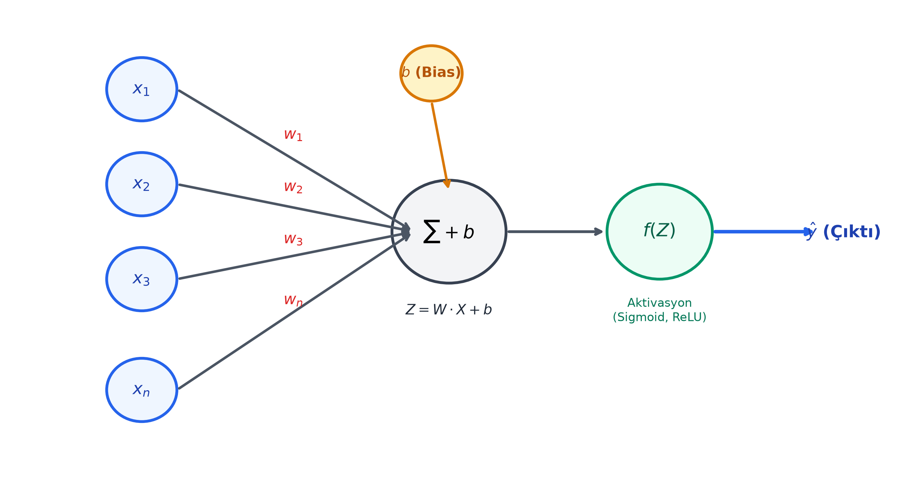
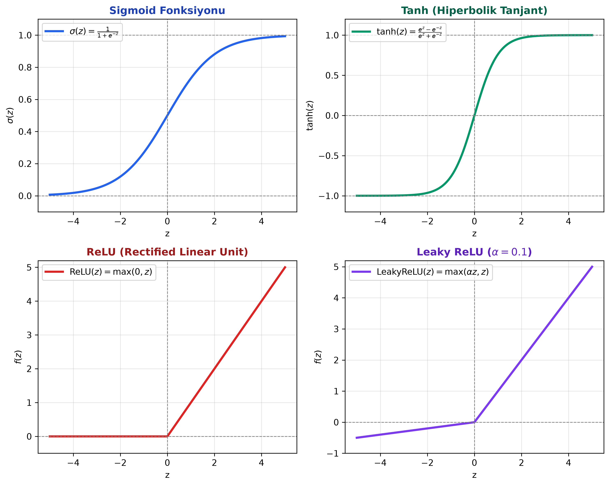

# Bölüm 3: Yapay Sinir Ağları ve Nöron Mimarisi

---

## 3.1. Biyolojik Nörondan Yapay Nörona (Perceptron)

Yapay sinir ağları, insan beynindeki milyarlarca nöronun elektrokimyasal sinyal iletim mekanizmasını matematiksel olarak modelleme fikrinden doğmuştur.

| Biyolojik Nöron Bileşeni | Görevi | Yapay Nöron Karşılığı | Matematiksel Sembol |
| :--- | :--- | :--- | :--- |
| **Dendrit (Dendrite)** | Diğer nöronlardan gelen elektrokimyasal sinyalleri toplar. | Girdi Kanalları | $x_1, x_2, \dots, x_n$ |
| **Sinaps (Synapse)** | Gelen sinyalin iletim gücünü / önemini ayarlar (kuvvetlendirir/zayıflatır). | Ağırlıklar (Weights) | $w_1, w_2, \dots, w_n$ |
| **Hücre Gövdesi (Soma)** | Gelen tüm ağırlıklı sinyalleri toplar ve eşik değerini belirler. | Toplam Fonksiyonu & Bias | $Z = \sum w_i x_i + b$ |
| **Akson (Axon)** | Eşik aşıldığında üretilen aksiyon potansiyelini (çıktıyı) diğer nörona iletir. | Aktivasyon Fonksiyonu & Çıktı | $\hat{y} = f(Z)$ |

---

## 3.2. Tek Bir Nöronun Matematiksel Modeli

Yapay bir nöron iki aşamalı bir hesaplama gerçekleştirir:
1. **Lineer Kombinasyon (Ağırlıklı Toplam):** Girdiler ile ağırlıkların iç çarpımı ve bias eklenmesi.
2. **Doğrusal Olmayan Dönüşüm (Aktivasyon):** Elde edilen skaler değerin bir aktivasyon fonksiyonundan geçirilmesi.

Matematiksel formülasyon:

$$Z = w_1 x_1 + w_2 x_2 + \dots + w_n x_n + b = \sum_{i=1}^n w_i x_i + b = W^T X + b$$

$$\hat{y} = f(Z)$$

Burada:
- $X = [x_1, x_2, \dots, x_n]^T \in \mathbb{R}^n$: Girdi öznitelik vektörü
- $W = [w_1, w_2, \dots, w_n]^T \in \mathbb{R}^n$: Öğrenilebilir ağırlık vektörü
- $b \in \mathbb{R}$: Öğrenilebilir sapma (bias) skaleri
- $f(\cdot)$: Doğrusal olmayan aktivasyon fonksiyonu
- $\hat{y}$: Modelin ürettiği nihai tahmin değeri

### Ağırlıkların (Weights) Anlamı: Ev Fiyatı / Kira Tahmin Vakası
Hocanın derste verdiği analoji: Bir evin kira bedelini tahmin etmek istiyorsunuz.
* Girdiler: $x_1$ = Merkeze/Kampüse yakınlık, $x_2$ = Metrekare, $x_3$ = Binanın yaşı, $x_4$ = Otopark/Güvenlik.
* **Kullanıcı Tercihleri = Ağırlıklar ($W$):**
  * Üniversite öğrencisi için en önemli şey okula yakınlıktır; dolayısıyla öğrenci zihninde $w_1$ çok büyük bir katsayıdır, otopark ($w_4$) ise sıfıra yakındır.
  * Zengin bir aile için evin metrekaresi ve güvenliği çok önemlidir; bu nedenle onların modelinde $w_2$ ve $w_4$ çok büyüktür.
* **Özet:** Ağırlıklar, bir özniteliğin hedefe ulaşmada ne kadar kritik bir öneme sahip olduğunu belirleyen parametrelerdir. Model eğitilirken amaç tam olarak bu doğru ağırlıkları bulmaktır.

### Bias (Sapma / Öteleme) Parametresi ve Bisiklet Analojisi
Neden formülde sadece $W \cdot X$ yetmez de bir de $+ b$ ekleriz?
1. **Matematiksel Gerekçe:** Eğer $b = 0$ olursa, tüm girdiler $X = 0$ olduğunda $Z = 0$ olur. Çizilecek karar doğrusu/düzlemi daima orijinden $(0, 0)$ geçmek zorunda kalır. Bias, karar doğrusunu koordinat ekseninde yukarı-aşağı, sağa-sola serbestçe ötelememizi sağlar.
2. **Hocanın Bisiklet Analojisi:**
   * Düz bir yolda bisiklet sürerken pedal çevirmezseniz (Girdi $X = 0$), durursunuz.
   * Eğer yokuş aşağı bir yoldaysanız, **hiç pedal çevirmeseniz bile** bisiklet kendiliğinden hızlanır ve ilerler. İşte bu pozitif biastır ($+b$).
   * Eğer dik bir yokuşu tırmanıyorsanız, bisikletin durmaması ve hareket edebilmesi için belirli bir eşik kuvvetinin üzerinde pedal basmanız gerekir. Bu da negatif biastır ($-b$).
   * Bias, nöronun uyarılma eşiğini (threshold) belirler; girdiler sıfır veya zayıf olsa dahi nöronun aktifleşip aktifleşmeyeceğini kontrol eder.

---

## 3.3. Aktivasyon Fonksiyonları ve Doğrusallık Dışılık (Non-Linearity)

> [!IMPORTANT]
> **Sınav Sorusu Mantığı:** *"Neden sinir ağlarında aktivasyon fonksiyonu kullanmak zorundayız? Aktivasyon fonksiyonu koymazsak ne olur?"*

Eğer katmanlar arasına aktivasyon fonksiyonu koymazsanız, ardı ardına 1000 tane gizli katman dizseniz bile sistem matematiksel olarak **tek bir lineer katmana çöker**:
$$Z_1 = W_1 X + b_1$$
$$Z_2 = W_2 Z_1 + b_2 = W_2 (W_1 X + b_1) + b_2 = (W_2 W_1) X + (W_2 b_1 + b_2) = W' X + b'$$
Lineer fonksiyonların bileşkesi yine lineerdir. Gerçek dünyadaki problemler (kedi resmi ayırma, kanser hücresi tespiti, otonom sürüş) ise son derece karmaşık, eğrisel ve doğrusal olmayan (non-linear) karar sınırları gerektirir. Aktivasyon fonksiyonları ağa bu bükülme, kıvrılma ve karmaşık örüntüleri temsil etme yeteneğini (Universal Approximation) kazandırır.

### 1. Sigmoid Fonksiyonu
* **Matematiksel Formül:**
  $$\sigma(z) = \frac{1}{1 + e^{-z}}$$
* **Çıkış Aralığı:** $(0, 1)$
* **Kullanım Yeri:** İkili sınıflandırma (Binary Classification) problemlerinin **en son çıktı katmanında** olasılık değeri üretmek için kullanılır.
* **Türevi:** $\sigma'(z) = \sigma(z) \cdot (1 - \sigma(z))$
* **Dezavantajları (Neden Ara Katmanlarda Terk Edildi?):**
  1. **Yok Olan Gradyan (Vanishing Gradient):** $z$ değeri çok büyük ($+5$) veya çok küçük ($-5$) olduğunda eğri düzleşir. Türev neredeyse $0$ olur. Geri yayılımda bu sıfıra yakın türevler birbiriyle çarpılınca ilk katmanlara hata sinyali ulaşamaz ve eğitim durur.
  2. **Sıfır Merkezli Değildir (Not Zero-Centered):** Çıktılar daima pozitiftir ($0$ ile $1$ arası). Bu durum gradyanların zig-zag çizerek yavaş öğrenmesine sebep olur.

### 2. Tanh (Hiperbolik Tanjant)
* **Matematiksel Formül:**
  $$\tanh(z) = \frac{e^z - e^{-z}}{e^z + e^{-z}} = 2\sigma(2z) - 1$$
* **Çıkış Aralığı:** $(-1, 1)$
* **Avantajı:** **Sıfır merkezlidir (Zero-centered).** Ortalama çıktısı 0'a yakın olduğu için Sigmoid'e göre optimizasyonu daha kolaydır.
* **Dezavantajı:** Uç noktalarda ($z > 3$ veya $z < -3$) yine doygunluğa (saturation) ulaşır ve **Vanishing Gradient** problemi devam eder.

### 3. ReLU (Rectified Linear Unit)
Derin öğrenme devrimini başlatan en kritik fonksiyondur (AlexNet ile standart hale gelmiştir).
* **Matematiksel Formül:**
  $$f(z) = \max(0, z) = \begin{cases} z, & z \ge 0 \\ 0, & z < 0 \end{cases}$$
* **Çıkış Aralığı:** $[0, \infty)$
* **Türevi:**
  $$f'(z) = \begin{cases} 1, & z > 0 \\ 0, & z < 0 \end{cases}$$
* **Avantajları:**
  1. **Hesaplama Hızı:** Üstel ($e^z$) işlem içermez, sadece bir if-else karşılaştırmasıdır. GPU'larda ışık hızında hesaplanır.
  2. **Gradyan Yok Olmaz:** Pozitif bölgede türevi sabit $1$'dir. Ağ ne kadar derin olursa olsun hata geriye kayıpsız akar.
  3. **Seyreklik (Sparsity):** Negatif girdiler için nöronları sıfırlar. Biyolojik beyinde olduğu gibi aynı anda nöronların sadece küçük bir kısmı aktifleşir.
* **Dezavantajı (Dying ReLU - Ölü Nöron Sorunu):**
  * Eğer bir nörona gelen ağırlıklı toplam sürekli negatif kalırsa ($z < 0$), türevi daima $0$ olur. Bu nöron artık hiçbir güncellemeyi alamaz ve kalıcı olarak "ölür".

### 4. Leaky ReLU
Dying ReLU problemini çözmek için geliştirilmiştir.
* **Matematiksel Formül:**
  $$f(z) = \max(\alpha z, z) = \begin{cases} z, & z \ge 0 \\ \alpha z, & z < 0 \end{cases}$$
* Genellikle $\alpha = 0.01$ veya $\alpha = 0.1$ seçilir.
* **Avantajı:** Negatif bölgede nöronun tamamen ölmesini engelleyen küçük bir sızıntı (leak) eğimi bırakır; böylece gradyan sıfırlanmaz.

### 5. Softmax Fonksiyonu (Çok Sınıflı Çıkış Katmanı)
* **Matematiksel Formül:**
  $$\text{Softmax}(z_i) = \frac{e^{z_i}}{\sum_{j=1}^C e^{z_j}} \quad \text{için } i = 1, 2, \dots, C$$
* $C$: Toplam sınıf sayısıdır.
* **Özellikleri:**
  1. Tüm çıktı değerlerini $[0, 1]$ aralığına normalize eder.
  2. Tüm sınıfların çıktılarının toplamı **tam olarak 1'e ($%100$) eşittir**: $\sum_{i=1}^C \text{Softmax}(z_i) = 1$.
* **Hocanın Zürafa / Hayvan Sınıflandırma Örneği:**
  * Modelin son katmanından çıkan ham skorlar (Logits): $z = [\text{Zürafa: } 4.2, \text{ At: } 1.8, \text{ Köpek: } 0.3]$ olsun.
  * Bu ham skorlar anlamsızdır ve doğrudan olasılık olarak okunamaz.
  * Softmax bu değerlerin üstelini ($e^{4.2}, e^{1.8}, e^{0.3}$) alıp toplama böler.
  * Sonuç: $[\text{Zürafa: } 0.89, \text{ At: } 0.08, \text{ Köpek: } 0.03]$ $\rightarrow$ Model $\%89$ güvenle görüntünün zürafa olduğunu söyler.
