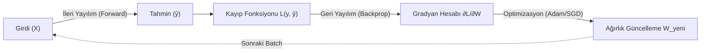
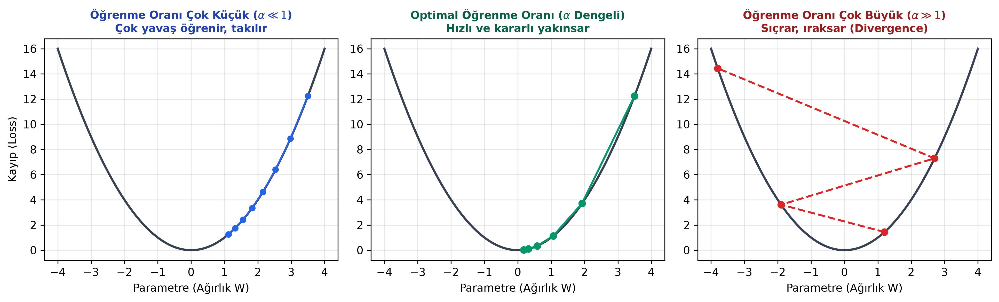

# Bölüm 4: Model Eğitimi, Kayıp Fonksiyonları ve Optimizasyon

---

## 4.1. Eğitimin Kalbi: İleri ve Geri Yayılım Döngüsü

Bir derin öğrenme modelinin "öğrenmesi", aslında çok boyutlu bir hata uzayında en düşük kayıp (loss) değerine sahip ağırlık kombinasyonunu arama sürecidir. Eğitim döngüsü sürekli tekrarlanan iki ana fazdan oluşur:

1. **İleri Yayılım (Forward Propagation):** Girdi verisi ($X$) ilk katmandan başlayarak ağırlıklarla çarpılır, bias eklenir, aktivasyonlardan geçer ve en son katmanda bir tahmin ($\hat{y}$) üretilir.
2. **Kayıp Hesabı (Loss Calculation):** Üretilen tahmin ($\hat{y}$) ile gerçek etiket ($y$) arasındaki fark bir kayıp fonksiyonu ile hesaplanır.
3. **Geri Yayılım (Backpropagation):** Hata değeri en son katmandan geriye doğru zincir kuralı (Chain Rule) işletilerek her bir ağırlığın bu hataya ne kadar katkı sağladığı (kısmi türevler / gradyanlar) bulunur.
4. **Parametre Güncelleme (Optimization):** Gradyan inişi algoritması ağırlıkları hatayı azaltacak ters yönde günceller.

---

## 4.2. Kayıp Fonksiyonları (Loss Functions)

Kayıp fonksiyonu ($\mathcal{L}$), modelin ne kadar "yanıldığını" tek bir skaler sayıya döken metriktir. Problem tipine göre uygun kayıp fonksiyonu seçilmelidir.

### 1. Ortalama Kare Hata (Mean Squared Error - MSE)
* **Kullanım Alanı:** Regresyon problemleri (Ev fiyatı tahmini, borsa değeri, sıcaklık vb.).
* **Formül:**
  $$\text{MSE} = \frac{1}{N} \sum_{i=1}^N (y_i - \hat{y}_i)^2$$
* **Özelliği:** Hatanın karesi alındığı için büyük hataları aşırı derecede cezalandırır (Outlier / aykırı değerlere karşı hassastır).

### 2. İkili Çapraz Entropi (Binary Cross-Entropy - BCE)
* **Kullanım Alanı:** İkili sınıflandırma (Spam / Normal, Kedi / Köpek, Hasta / Sağlıklı - $y \in \{0, 1\}$). Çıktı katmanında **Sigmoid** aktivasyonu kullanılır.
* **Formül:**
  $$\mathcal{L}_{\text{BCE}} = - \frac{1}{N} \sum_{i=1}^N \Big[ y_i \log(\hat{y}_i) + (1 - y_i) \log(1 - \hat{y}_i) \Big]$$
* **Mantığı:**
  * Eğer gerçek etiket $y = 1$ ise formülün ikinci kısmı sıfırlanır, geriye $-\log(\hat{y})$ kalır. Model $\hat{y} \to 1$ tahmin ederse kayıp $0$ olur; $\hat{y} \to 0$ tahmin ederse kayıp sonsuza ($\infty$) fırlar.
  * Eğer gerçek etiket $y = 0$ ise ilk kısım sıfırlanır, $-\log(1 - \hat{y})$ çalışır.

### 3. Kategorik Çapraz Entropi (Categorical Cross-Entropy - CCE)
* **Kullanım Alanı:** Çok sınıflı sınıflandırma (MNIST 10 rakam, ImageNet 1000 nesne). Çıktı katmanında **Softmax** aktivasyonu kullanılır.
* **Formül:**
  $$\mathcal{L}_{\text{CCE}} = - \sum_{c=1}^C y_c \log(\hat{y}_c)$$
* Burada $y$, One-Hot kodlanmış vektördür (örn: Zürafa için $[0, 1, 0]$). Modelin doğru sınıfa verdiği olasılık ne kadar $1$'e yakınsa kayıp o kadar $0$'a yaklaşır.

---

## 4.3. Gradyan İnişi (Gradient Descent) ve Geri Yayılım

Optimizasyonun temel mantığı dağlık ve sisli bir vadide en derin çukuru (minimum kayıp noktasını) bulmaya benzer. Eğim yönünün tam tersine adım atılır.

### Ağırlık Güncelleme Kuralı:
$$W_{\text{yeni}} = W_{\text{eski}} - \alpha \frac{\partial \mathcal{L}}{\partial W}$$
$$b_{\text{yeni}} = b_{\text{eski}} - \alpha \frac{\partial \mathcal{L}}{\partial b}$$

Burada:
- $\frac{\partial \mathcal{L}}{\partial W}$: Kaybın ağırlığa göre kısmi türevidir (Gradyan). Eğrinin eğimini ve artış yönünü belirtir. Eksi işareti eğimin tersine (azalış yönüne) gitmemizi sağlar.
- $\alpha$: Öğrenme oranıdır (Learning Rate). Atılacak adımın büyüklüğünü belirler.

### Zincir Kuralı (Chain Rule) ile Türev Akışı:
Bir nöron için $X \to Z \to \hat{y} \to \mathcal{L}$ zincirinde:
$$\frac{\partial \mathcal{L}}{\partial W} = \frac{\partial \mathcal{L}}{\partial \hat{y}} \cdot \frac{\partial \hat{y}}{\partial Z} \cdot \frac{\partial Z}{\partial W}$$
Geri yayılım, bu zincirleme türevleri en son çıktı katmanından ilk girdi katmanına doğru ara belleklerde saklayarak dinamik programlama mantığıyla hesaplar.

---

## 4.4. Öğrenme Oranı (Learning Rate - $\alpha$) ve Etkileri

Öğrenme oranı derin öğrenmedeki en kritik hiperparametredir.

1. **Öğrenme Oranı Çok Küçük İse ($\alpha = 10^{-6}$):**
   * Adımlar mikroskobiktir. Modelin minimum noktaya ulaşması haftalar/aylar sürebilir.
   * Model yerel minimumlara (Local Minima) veya eğimin sıfır olduğu eyer noktalarına (Saddle Points) takılıp kalır.
2. **Öğrenme Oranı Çok Büyük İse ($\alpha = 1.0$ veya $10$):**
   * Adımlar çukurun genişliğini aşar. Minimum noktanın üzerinden atlar, bir o duvara bir bu duvara çarpar.
   * Kayıp değeri azalmak yerine patlar ($Loss \to \infty$ veya `NaN` hatası). Model tamamen ıraksar (Divergence).
3. **Optimal Öğrenme Oranı (Genellikle $10^{-3}$ veya $3 \times 10^{-4}$):**
   * Kararlı, dengeli ve hızlı bir şekilde vadinin tabanına yakınsar (Convergence).

---

## 4.5. Temel Eğitim Hiperparametreleri: Epoch, Batch Size ve İterasyon

> [!IMPORTANT]
> **Sınav Sorusu Mantığı:** Hoca veri sayısı ve batch size verip *"Kaç iterasyon gerçekleşir?"* veya *"Epoch nedir?"* diye sorar!

* **Epoch (Çağ / Devir):** Eğitim veri setinde bulunan **bütün örneklerin** ağdan ileri ve geri yönde tam bir kez geçmesi sürecidir. 
  * Örneğin 50 Epoch = Model tüm veri setini baştan sona 50 kez görmüş ve çalışmıştır.
* **Batch Size (Yığın / Paket Boyutu):** Ağın ağırlıklarını güncellemeden önce aynı anda belleğe (GPU'ya) yüklenip tek bir adımda işlenen veri/resim sayısıdır.
  * Genellikle $2$'nin kuvvetleri seçilir: $16, 32, 64, 128$.
  * **Neden tüm veriyi tek seferde vermiyoruz?** 
    1. GPU VRAM belleği 100.000 fotoğrafı aynı anda tutamaz (Out of Memory hatası).
    2. Küçük paketlerle çalışmak gradyana faydalı bir stokastik gürültü ekler; bu da modelin yerel çukurlardan kurtulup genelleme yapmasını sağlar.
* **İterasyon (Iteration / Adım Sayısı):** Tek bir epoch içerisinde ağırlıkların kaç kez güncellendiğini gösterir.

### Matematiksel Bağıntı:
$$\text{İterasyon Sayısı (1 Epoch İçin)} = \frac{\text{Toplam Eğitim Veri Sayısı}}{\text{Batch Size}}$$

* **Sayısal Örnek:**
  * Toplam Veri: $60.000$ görüntü
  * Batch Size: $64$
  * İterasyon $= \frac{60.000}{64} = 937.5 \approx 938 \text{ adım / güncelleme}$
  * Eğer model $10$ Epoch eğitilirse toplamda $10 \times 938 = 9.380$ kez ağırlık güncellemesi yapılır.

---

## 4.6. Modern Optimizasyon Algoritmaları

1. **Stokastik Gradyan İnişi (SGD - Stochastic Gradient Descent):**
   * Klasik gradyan inişinin her adımda küçük bir veri paketiyle (Mini-batch) çalıştırılan halidir.
   * Basittir ancak eyer noktalarında ve gürültülü loss yüzeylerinde yavaş ilerler.
2. **Momentum:**
   * Fizikteki eylemsizlik prensibini gradyana ekler: Eğer adımlar sürekli aynı yöne gidiyorsa hızlanır, yön değiştiriyorsa yavaşlar. Vadilerden çok daha hızlı çıkar.
3. **Adam (Adaptive Moment Estimation):**
   * Günümüz derin öğrenme çalışmalarında açık ara en popüler ve varsayılan optimizer'dır.
   * **Çalışma Mantığı:** Her bir parametre/ağırlık için öğrenme oranını ayrı ayrı ve adaptif olarak ayarlar. Çok sık güncellenen ağırlıkların adımını küçültür, nadir güncellenen ağırlıkların adımını büyütür. Momentum ile RMSProp algoritmalarının mükemmel bir sentezidir.
