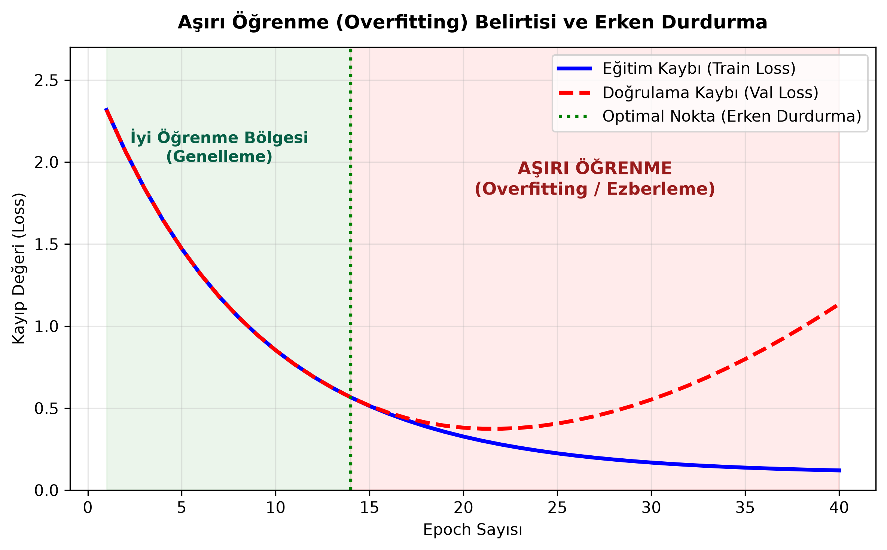
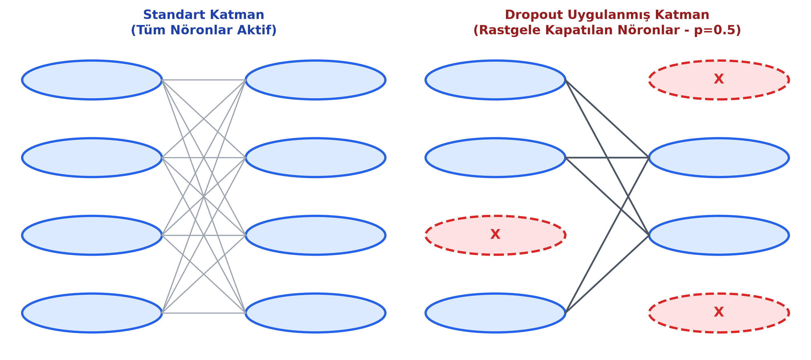

# Bölüm 5: Model Başarımı, Genelleme ve Aşırı Öğrenme ile Mücadele

---

## 5.1. Model Başarımı ve Doğruluk (Accuracy) Sınırı

Bir sınıflandırma modelinin başarısını ölçerken en sık başvurulan metrik **Doğruluk (Accuracy)** değeridir:

$$\text{Accuracy} = \frac{\text{Doğru Tahmin Edilen Örnek Sayısı}}{\text{Toplam Örnek Sayısı}}$$

### Doğruluk Metriğinin Tehlikesi: Dengesiz Veri Kümeleri (Imbalanced Datasets)
Hocanın derste özellikle uyardığı durum: Modelin $\%99$ doğruluk alması, her zaman harika çalıştığı anlamına gelmez.
* **Tıbbi Teşhis Örneği:** 10.000 kişilik bir tarama veri setinde yalnızca 10 kişi kanser ($y=1$), 9.990 kişi ise sağlıklıdır ($y=0$).
* Eğer model hiçbir şey öğrenmeyip önüne gelen herkese *"Sağlıklısın"* derse:
  $$\text{Accuracy} = \frac{9.990}{10.000} = \%99.9$$
* Kağıt üzerinde model $\%99.9$ başarılı görünür; ancak pratikte hayati tehlikesi olan 10 kanserli hastanın tamamını kaçırmış ve amacına tamamen ters düşmüştür.
* **Mühendislik Sonucu:** Dengesiz veri setlerinde sadece Accuracy'ye bakılmaz; Precision, Recall, F1-Score ve Karmaşıklık Matrisi (Confusion Matrix) incelenir.

---

## 5.2. Genelleme Yeteneği (Generalization)

Derin öğrenmenin nihai hedefi, eğitim verisinde rekor kırmak değildir. Asıl hedef **Genelleme Yeteneği (Generalization)** kazanmaktır.
* **Tanım:** Bir yapay zeka modelinin, eğitim sırasında daha önce hiç karşılaşmadığı, gerçek hayattan gelen yeni ve gürültülü veriler üzerinde doğru tahmin üretebilme kabiliyetidir.
* Sınavlarda ve literatürde bu kavram doğrudan İngilizce ismiyle (**Generalization**) sorulur.

---

## 5.3. Aşırı Öğrenme (Overfitting) ve Eksik Öğrenme (Underfitting)

Model eğitimi sırasında karşılaşılan iki temel patoloji vardır:

### 1. Eksik Öğrenme (Underfitting)
* **Durum:** Model verideki temel örüntüleri dahi öğrenememiştir.
* **Belirtisi:** Hem Eğitim Kaybı ($Loss_{train}$) hem de Doğrulama Kaybı ($Loss_{val}$) yüksektir.
* **Nedenleri:** Model mimarisi probleme göre çok basittir (Örn: Karmaşık bir resim için tek katmanlı lineer model kullanmak), eğitim çok erken kesilmiştir veya özellikler yetersizdir.
* **Çözümü:** Katman sayısını/nöron sayısını artırmak, modeli daha uzun süre (epoch) eğitmek, daha güçlü bir mimariye geçmek.

### 2. Aşırı Öğrenme (Overfitting / Ezberleme)
* **Durum:** Model genelleme yapmayı bırakmış; eğitim verisindeki örneklerin kendine has piksellerini, arka plan gürültülerini ve rastgele detaylarını kelimesi kelimesine ezberlemiştir.
* **Hocanın Öğrenci Analojisi:** Bir öğrenci düşünün; geçmiş yılların çıkmış vize sorularını çözerken mantığı anlamak yerine sorunun soru numarasını, şıkların sırasını ve noktalamasını ezberliyor. Eski testten 100 alıyor ama sınavda hocanın rakamları veya kelimeleri azıcık değiştirdiği yeni bir soru geldiğinde çakılıyor ve 0 alıyor!
* **Grafiksel Teşhisi:**
  * Eğitim Kaybı düşmeye devam eder ($Loss_{train} \to 0, Acc_{train} \to \%100$).
  * Doğrulama Kaybı ise belirli bir noktadan sonra düşmeyi bırakır ve yukarı doğru fırlamaya başlar ($Loss_{val} \uparrow, Acc_{val} \downarrow$).

---

## 5.4. Aşırı Öğrenme ile Mücadele (Regularization / Düzenlileştirme)

Derin öğrenmede ezberlemeyi kırmak ve genellemeyi artırmak için kullanılan 5 temel mühendislik tekniği vardır:

### 1. Dropout Katmanı (Nöron Devre Dışı Bırakma)
Srivastava ve ark. (2014) tarafından önerilen, aşırı öğrenmeyi engelleyen en güçlü katmanlardan biridir.

* **Çalışma Prensibi:** Eğitim sırasında (Training phase), her ileri yayılım adımında o katmandaki nöronların belirlenen bir olasılıkla (genellikle $p = 0.5$ veya $p = 0.2$) rastgele bağlantıları koparılır ve çıktıları $0$'a eşitlenir.
* **Neden Ezberlemeyi Önler?**
  1. **Birlikte Uyumlanmayı (Co-Adaptation) Engeller:** Nöronlar birbirine güvenemez. *"Yanındaki nöron bir sonraki adımda kapalı olabilir, bu yüzden sen tek başına bağımsız ve güçlü bir öznitelik öğrenmek zorundasın"* baskısı oluşur.
  2. **Topluluk (Ensemble) Etkisi:** Her adımda ağın farklı bir alt kümesi eğitildiği için tek bir ağ içerisinde üstel sayıda farklı mimari eğitilmiş gibi olur.
* **Hocanın İnsan Beyni ve Unutma Mekanizması Analojisi:** İnsan beyni gün boyunca binlerce araba plakası, tabela ve ayrıntı görür. Gece uykuda beyin önemsiz bağlantıları siler (unutur). Eğer her şeyi ezberleseydik delirme noktasına gelirdik ve yeni bilgileri öğrenemezdik. Nöronların unutması ve kapatılması zekanın temel parçasıdır.
* **Test / Çıkarım (Inference) Zamanı:** Model eğitildikten sonra test edilirken **Dropout tamamen kapatılır**. Bütün nöronlar devrededir; ancak eğitimdeki ölçeği korumak için ağırlıklar $(1 - p)$ faktörü ile çarpılır.

### 2. Veri Artırma (Data Augmentation)
Modelin veri ezberlemesini engellemenin en doğal yolu ona sürekli farklı varyasyonlar sunmaktır.
* **Uygulanan Yöntemler:** Rastgele yatay/dikey çevirme (Horizontal/Vertical Flip), hafif döndürme (Rotation $\pm 15^\circ$), kırpma (Random Crop), parlaklık ve kontrast değiştirme (Color Jitter), hafif yakınlaştırma (Zoom).
* Kedinin fotoğrafını ters çevirdiğinizde veya biraz parlaklığını kıstığınızda o hala bir kedidir. Böylece model arka planı değil kedinin formunu öğrenir.

> [!CAUTION]
> **Hayati Kural:** Veri Artırma **YALNIZCA VE YALNIZCA EĞİTİM (TRAIN) KÜMESİNE** uygulanır! Doğrulama (Validation) ve Test kümelerine asla veri artırma yapılmaz. Test verisinin orijinalliği bozulamaz; aksi halde modelin gerçek dünya başarısını tarafsız ölçemezsiniz.

### 3. Ağırlık Cezalandırma (L1 ve L2 Regularization / Weight Decay)
Ağdaki ağırlıkların aşırı büyümesini engellemek için kayıp fonksiyonuna ağırlıkların büyüklüğünü temsil eden bir ceza terimi eklenir:
$$\mathcal{L}_{\text{toplam}} = \mathcal{L}_{\text{orijinal}} + \lambda \sum w_i^2 \quad (\text{L2 / Ridge})$$
Bu sayede model sadece hatayı düşürmeye çalışmaz; aynı zamanda ağırlıkları küçük ve dağıtık tutmaya zorlanır. Tek bir nöronun aşırı baskın hale gelmesi engellenir.

### 4. Erken Durdurma (Early Stopping)
Doğrulama kaybı ($Loss_{val}$) takip edilir. Doğrulama kaybının düşmeyi bırakıp üst üste birkaç epoch (Patience) boyunca artmaya başladığı an eğitim otomatik olarak kesilir ve en iyi ağırlıklar belleğe geri yüklenir.

### 5. Ablasyon Çalışması (Ablation Study)
* **Tanım:** Geliştirilen bir derin öğrenme modelindeki bileşenlerin (Dropout katmanı, Veri artırma, belirli bir konvolüsyon bloku vb.) tek tek sistemden çıkarılarak model başarısına olan gerçek katkısının test edilmesidir.
* **Önemi:** Bir bilimsel makalede veya mühendislik projesinde *"Modelim %95 doğruluk verdi"* demek yetmez. *"Ben bu modele Dropout eklediğim için doğruluk %91'den %95'e çıktı"* diyebilmek için aradaki farkı ablasyon deneyiyle ispatlamanız gerekir.
