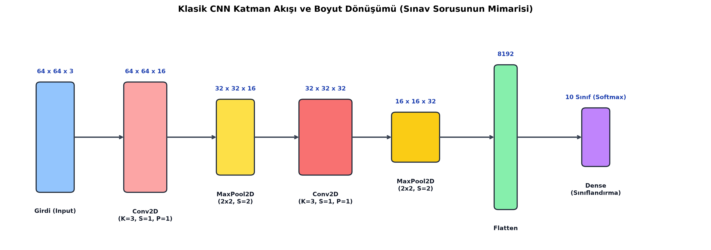
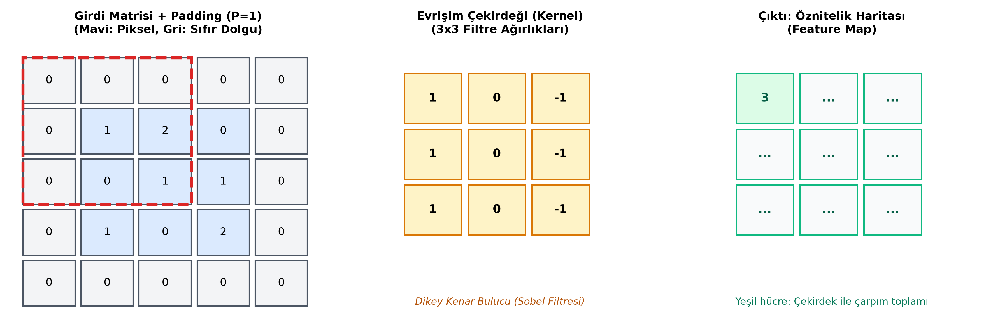

# Bölüm 6: Evrişimsel Sinir Ağları (CNN) Mimarisi ve Matematiksel Hesaplamalar

---

> [!IMPORTANT]
> **VİZE SINAVININ EN KRİTİK BÖLÜMÜ:**
> Hoca 2 Kasım ve 4 Kasım derslerinde bu konunun sınavın ana omurgasını oluşturacağını, tahtada çözülen boyut ve parametre hesaplama sorusunun klasik vize sınavında **kesinlikle sorulacağını** vurgulamıştır. Bu bölümü adım adım ve formülleriyle çok iyi öğreniniz!

---

## 6.1. Görüntülerde Neden Klasik Tam Bağlantılı (Dense) Ağlar Kullanılmaz?

Klasik Yapay Sinir Ağlarında (ANN / MLP), girdi katmanındaki tüm pikseller tek bir uzun vektöre dönüştürülür (Düzleştirilir). Bu yaklaşım görüntülerde iki büyük felakete yol açar:

1. **Parametre Patlaması (Dimensionality Explosion):**
   * Orta çözünürlüklü renkli bir fotoğraf düşünün: $1000 \times 1000 \times 3 = 3.000.000$ piksel.
   * Bu girdiyi sadece 1.000 nöronlu tek bir gizli katmana bağlarsanız:
     $$\text{Ağırlık Sayısı} = 3.000.000 \times 1.000 = 3.000.000.000 \text{ (3 Milyar Parametre!)}$$
   * Tek bir katmanda 3 milyar parametre, GPU belleğini anında çökertir ve modelin aşırı ezberlemesine (Overfitting) yol açar.
2. **Uzamsal (Spatial) Bilginin Kaybı:**
   * Bir fotoğrafta piksellerin birbirine olan mesafesi anlam taşır (Göz pikselleri yan yanadır, burun altındadır).
   * Resmi tek bir vektöre açtığınızda $(x, y)$ koordinatlarındaki komşuluk ilişkisi tamamen yok olur.

**CNN Çözümü:** Evrişimsel Sinir Ağları, tüm resmi tek seferde görmek yerine küçük pencerelerle (filtrelerle) resmin üzerinde gezinir (**Yerel Bağlantı / Local Receptive Field**) ve aynı filtre ağırlıklarını tüm resim boyunca paylaşır (**Ağırlık Paylaşımı / Parameter Sharing**).

---

## 6.2. Temel CNN Katmanları ve Görevleri

Tam bir CNN mimarisi şu katmanların sırayla dizilmesiyle oluşur:

### 1. Evrişim Katmanı (Convolutional Layer - Conv2D)
Ağın öznitelik çıkarımı (Feature Extraction) yapan ana motorudur.
* **Filtre / Çekirdek (Kernel):** Görüntü üzerinde kaydırılan küçük bir ağırlık matrisidir (Genellikle $3 \times 3$ veya $5 \times 5$).
* **Adım (Stride - $S$):** Filtrenin her adımda kaç piksel sağa ve aşağı kayacağını belirler. $S=1$ ise birer piksel kayar; $S=2$ ise ikişer piksel atlar.
* **Dolgu (Padding - $P$):** Filtre köşelerden geçerken pikseller merkezdeki piksellere göre daha az işlenir ve resim her evrişimde küçülür. Resmin dış çerçevesine $P$ piksel kalınlığında sıfırlar eklenerek (Zero-Padding) boyut korunur.
  * **Valid Padding ($P=0$):** Dolgu yapılmaz, resim küçülür.
  * **Same Padding ($P \ge 1$):** Çıktı boyutu girdi boyutuyla aynı kalacak şekilde kenarlara sıfır eklenir.

### 2. Havuzlama Katmanı (Pooling Layer - MaxPool2D / AvgPool2D)
Ağın öznitelik haritasını özetleme ve boyutunu küçültme katmanıdır.
* **Max Pooling ($2 \times 2, \text{Stride}=2$):** Belirlenen $2 \times 2$'lik pencere içindeki en büyük (en baskın) sayıyı alır, diğerlerini atar.
  * **Boyut:** Resmin enini ve boyunu tam olarak **yarıya (%50)** indirir.
  * **Kanal Sayısı ($C$):** Asla değişmez, aynı kalır!
  * **Öğrenilebilir Parametresi:** **SIFIRDIR!** Havuzlama katmanında hiçbir ağırlık veya bias yoktur; sadece matematiksel bir maksimum seçme kuralıdır.
* **Hocanın Hayat Analojisi (24 Saat / 24 Yaş):**
  * Bir insan 24 saatlik bir gününü hatırlarken saniye saniye her anı aklında tutmaz; o günün en çarpıcı, en zirve 1-2 anını (Max) hatırlar.
  * 24 yaşına gelmiş bir insan hayatındaki her günü tek tek saymaz, dönüm noktası olan anları hatırlar.
  * Max Pooling de resimdeki gereksiz detayları eler, kenar veya doku gibi en yüksek sinyalleri koruyarak belleği rahatlatır.

### 3. Düzleştirme Katmanı (Flatten Layer)
* 3 boyutlu tensör formundaki öznitelik haritalarını ($H \times W \times C$) tek boyutlu bir vektöre ($1 \text{D}$) dönüştürür.
* **Öğrenilebilir Parametresi:** **SIFIRDIR!** Sadece tensörün şeklini (reshape) değiştirir.

### 4. Tam Bağlantılı Katman (Fully Connected / Dense Layer)
* Flatten katmanından gelen tüm öznitelikleri birbirine bağlar.
* Çıkarılan bu özelliklerin kombinasyonuna göre nihai sınıflandırma mantığını kurar.

### 5. Softmax Çıkış Katmanı
* Sınıf sayısı kadar nöron içerir. Çıkan değerleri toplamı $\%100$ olan sınıf olasılıklarına dönüştürür.

### 6. Modern Alternatif: Global Average Pooling (GAP)
* Klasik CNN'lerde Flatten katmanı milyonlarca parametre üretir.
* Modern ağlarda (ResNet, EfficientNet) Flatten yerine **Global Average Pooling** kullanılır: Her bir öznitelik haritasının ($H \times W$) doğrudan ortalaması alınarak tek bir sayıya indirgenir ($1 \times 1 \times C$). Parametre sayısını dramatik olarak düşürür.

---

## 6.3. Sınav İçin Matematiksel Boyut Hesaplama Formülleri

> [!CAUTION]
> Aşağıdaki iki formülü ve kısayol kuralını sınavdan önce adınız gibi bilmeniz şarttır!

### Formül 1: Evrişim Katmanı (Conv2D) Çıkış Boyutu
Girdi boyutu $W_{in}$, filtre boyutu $K$, dolgu $P$, adım $S$ ise çıkış genişliği ($W_{out}$):

$$W_{out} = \left\lfloor \frac{W_{in} - K + 2P}{S} \right\rfloor + 1$$

$$H_{out} = \left\lfloor \frac{H_{in} - K + 2P}{S} \right\rfloor + 1$$

Çıkış kanal sayısı ($C_{out}$), o katmanda kullanılan **filtre (çekirdek) sayısına** eşittir.

### Altın Kısayol Kuralı (Sınavda Zaman Kazandıran Püf Noktası):
Eğer filtre boyutu $K = 3$, adım $S = 1$ ve dolgu $P = 1$ ise:
$$W_{out} = \frac{W_{in} - 3 + 2(1)}{1} + 1 = W_{in} - 3 + 2 + 1 = W_{in}$$
> **KURAL:** $3 \times 3$ filtrede `Stride = 1` ve `Padding = 1` verildiğinde **BOYUT ASLA DEĞİŞMEZ, AYNEN KORUNUR!**

---

### Formül 2: Havuzlama Katmanı (MaxPool2D) Çıkış Boyutu
Genellikle $K = 2$ ve $S = 2$ kullanılır:

$$W_{out} = \frac{W_{in}}{2}, \quad H_{out} = \frac{H_{in}}{2}$$

Kanal sayısı ($C$) değişmez: $C_{out} = C_{in}$.

---

### Formül 3: Flatten Katmanı Çıkış Eleman Sayısı
Flatten katmanına giren tensörün boyutları $H_{out} \times W_{out} \times C_{out}$ ise:

$$\text{Toplam Özellik (Feature) Sayısı} = H_{out} \times W_{out} \times C_{out}$$

---

### Formül 4: Katmanlardaki Eğitilebilir Parametre (Ağırlık + Bias) Sayısı

* **Conv2D Katmanı Parametre Sayısı:**
  Her bir filtre $K_h \times K_w \times C_{in}$ boyutundadır ve her filtrenin $1$ adet bias'ı vardır:
  $$\text{Parametre Sayısı} = \Big( (K_h \times K_w \times C_{in}) + 1 \Big) \times C_{out}$$
* **Fully Connected (Dense) Katmanı Parametre Sayısı:**
  $$\text{Parametre Sayısı} = (N_{in} + 1) \times N_{out}$$

---

## 6.4. Hocanın Derste Sorduğu Quiz Sorusunun Adım Adım Çözümü

**Soru Metni:**
> Bir derin öğrenme modeline **$64 \times 64$ boyutunda 3 kanallı (RGB)** bir görüntü verilmektedir ($64 \times 64 \times 3$).
> Model aşağıdaki katmanlardan oluşmaktadır:
> 1. Katman: `Conv2D(in_channels=3, out_channels=16, kernel_size=3, stride=1, padding=1)`
> 2. Katman: `MaxPool2D(kernel_size=2, stride=2)`
> 3. Katman: `Conv2D(in_channels=16, out_channels=32, kernel_size=3, stride=1, padding=1)`
> 4. Katman: `MaxPool2D(kernel_size=2, stride=2)`
> 5. Katman: `Flatten`
> 
> **Soru:** *Flatten katmanından sonra elde edilen toplam özellik (feature) sayısı kaçtır?*

### Adım Adım Çözüm:

* **Başlangıç Girdisi:** $64 \times 64 \times 3$
* **1. Katman (Conv2D):**
  * $K = 3, S = 1, P = 1$. Altın kısayolumuz gereği uzamsal boyut değişmez: $64 \times 64$.
  * Çıkış kanalı $16$ olarak tanımlanmıştır.
  * **1. Katman Çıktısı:** **$64 \times 64 \times 16$**
* **2. Katman (MaxPool2D):**
  * $K = 2, S = 2$. Uzamsal boyut tam yarıya iner: $\frac{64}{2} = 32$.
  * Kanal sayısı değişmez ($16$).
  * **2. Katman Çıktısı:** **$32 \times 32 \times 16$**
* **3. Katman (Conv2D):**
  * $K = 3, S = 1, P = 1$. Boyut yine korunur: $32 \times 32$.
  * Çıkış kanalı $32$ olarak tanımlanmıştır.
  * **3. Katman Çıktısı:** **$32 \times 32 \times 32$**
* **4. Katman (MaxPool2D):**
  * $K = 2, S = 2$. Uzamsal boyut tekrar yarıya iner: $\frac{32}{2} = 16$.
  * Kanal sayısı değişmez ($32$).
  * **4. Katman Çıktısı:** **$16 \times 16 \times 32$**
* **5. Katman (Flatten):**
  * Bu tensör tek boyutlu bir vektör olarak açılır:
    $$\text{Toplam Eleman Sayısı} = 16 \times 16 \times 32$$
    $$16 \times 16 = 256$$
    $$256 \times 32 = \mathbf{8192}$$

**NİHAİ CEVAP:** **8192**
