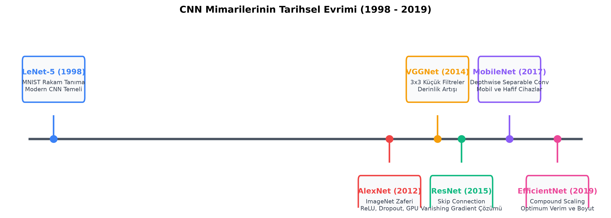
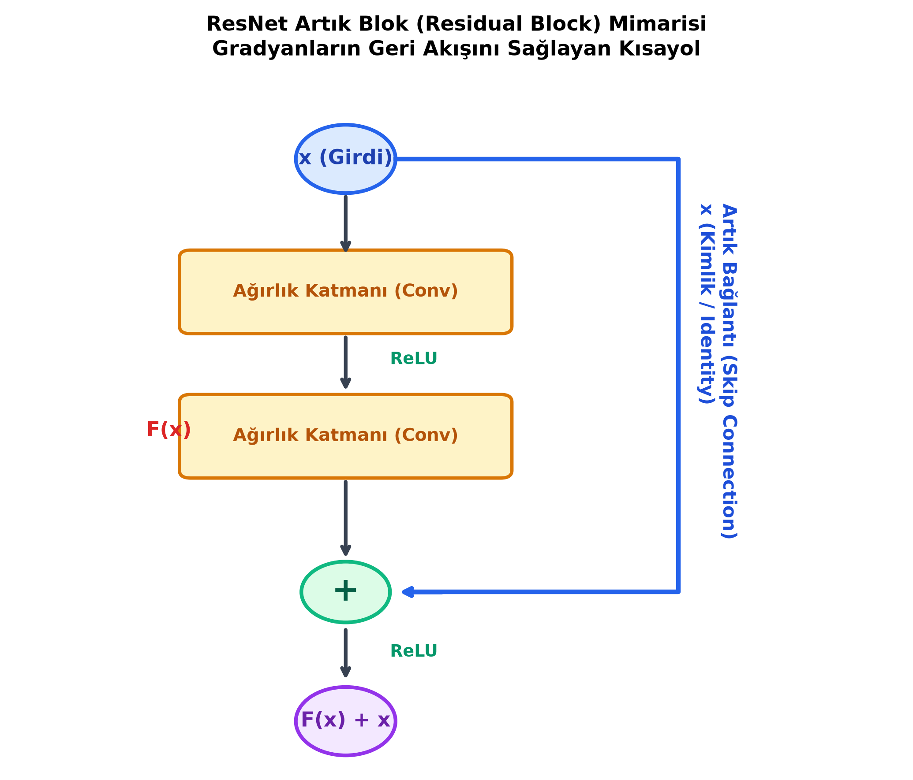

# Bölüm 7: Klasik ve Modern CNN Mimarileri (Karşılaştırmalı Analiz)

---

## 7.1. CNN Mimarilerinin Tarihsel Gelişim Çizgisi

Bilgisayarlı görü alanında derin öğrenmenin gelişimi, mimarilerin giderek daha derinleştiği, hesaplama açısından daha verimli hale geldiği ve gradyan akışını koruyan yeni blok tasarımlarının keşfedildiği bir evrim sürecidir.

---

## 7.2. Detaylı Mimari İncelemeleri

### 1. LeNet-5 (1998 – Yann LeCun)
* **Tarihsel Önemi:** Günümüz modern evrişimsel sinir ağlarının atası kabul edilir.
* **Kullanım Amacı:** Banka çeklerindeki ve posta zarflarındaki el yazısı rakamların (MNIST Veri Seti – $28 \times 28$ tek kanallı gri görüntüler) otomatik tanınması.
* **Mimari Yapısı:** 
  $$\text{Girdi } (28 \times 28 \times 1) \to \text{Conv2D} \to \text{AvgPool} \to \text{Conv2D} \to \text{AvgPool} \to \text{Dense} \to \text{Dense} \to \text{Çıktı (10 Sınıf)}$$
* **Dönemin Kısıtları:** O yıllarda ReLU ve Dropout henüz bilinmediği için aktivasyon olarak **Sigmoid ve Tanh** kullanılmış; havuzlama olarak **Average Pooling** tercih edilmiştir.

---

### 2. AlexNet (2012 – Alex Krizhevsky, Ilya Sutskever, Geoffrey Hinton)
* **Tarihsel Önemi:** 2012 ImageNet (ILSVRC) yarışmasında geleneksel yöntemleri ezici bir farkla (hata oranını $\%26$'dan $\%15$'e düşürerek) mağlup etmiş ve **modern Derin Öğrenme devrimini resmen başlatmıştır.**
* **Devrim Yaratan 4 Temel Yenilik:**
  1. **ReLU Aktivasyonunun İlk Kez Büyük Ölçekte Kullanımı:** Sigmoid yerine ReLU kullanılarak ağın 6 kat daha hızlı eğitilmesi sağlanmış ve vanishing gradient engellenmiştir.
  2. **Dropout ($p=0.5$):** 60 milyon parametreli bu devasa modelin ezberlemesini (Overfitting) engellemek için tam bağlantılı katmanlarda ilk kez Dropout kullanılmıştır.
  3. **Çift GPU Mimarisi:** Dönemin bellek yetersizliği nedeniyle ağ ikiye bölünmüş ve iki adet NVIDIA GeForce GTX 580 (3GB) üzerinde paralel eğitilmiştir.
  4. **Yoğun Veri Artırma (Data Augmentation):** Görüntüler rastgele kırpılmış, aynalanmış ve renk değişimlerine uğratılmıştır.

---

### 3. VGGNet (VGG16 / VGG19 – 2014 – Simonyan & Zisserman, Oxford)
* **Tarihsel Önemi:** Mimaride karmaşık ve büyük filtreler ($11 \times 11, 7 \times 7$) yerine **yalnızca çok küçük $3 \times 3$ filtrelerin ardışık kullanımıyla derinliğin artırılması** felsefesini literatüre kazandırmıştır.

> [!IMPORTANT]
> **Sınav Sorusu Mantığı:** *"Neden bir adet $5 \times 5$ filtre yerine iki adet ardışık $3 \times 3$ filtre tercih edilir?"*
> 1. **Aynı Alıcı Alan (Effective Receptive Field):** İki adet ardışık $3 \times 3$ evrişim katmanı, girdi üzerinde tam olarak $5 \times 5$'lik bir alana bakar. Bilgi kaybı olmaz.
> 2. **Daha Fazla Doğrusallık Dışılık (Non-Linearity):** Tek bir $5 \times 5$ katmanda 1 adet ReLU varken; iki adet $3 \times 3$ katmanda 2 adet ReLU çalışır. Ağ daha karmaşık desenleri öğrenebilir.
> 3. **Çok Daha Az Parametre (%28 Tasarruf):**
>    * Bir adet $5 \times 5$ filtre: $5 \times 5 = 25$ parametre.
>    * İki adet $3 \times 3$ filtre: $2 \times (3 \times 3) = 18$ parametre.
>    * $18 < 25$ olduğundan $\%28$ daha az ağırlık hesaplanır!
* **VGG'nin Zayıflığı:** Toplam 138 milyon parametreye sahiptir. Özellikle sonundaki devasa Fully Connected (Dense) katmanları bellek ve hesaplama açısından modeli hantal kılar.

---

### 4. ResNet (Residual Networks – 2015 – Kaiming He ve ark.)
* **Tarihsel Önemi:** Derin öğrenmede o güne kadar aşılamayan **"Derinleşme Çöküşü" (Degradation Problem)** ve **Yok Olan Gradyan (Vanishing Gradient)** krizini çözmüştür. Ağları 152 katmana kadar derinleştirerek ILSVRC 2015'te insan gözünün hata sınırını ($\%5.1$) geride bırakmış ve $\%3.57$ hata almıştır.

* **Artık Blok (Residual Block) ve Kısayol Bağlantısı (Skip / Identity Connection):**
  * Klasik ağlarda katman doğrudan hedef fonksiyonu ($H(x)$) öğrenmeye zorlanır. Ağ derinleştikçe türevler sıfıra yaklaşır ve ilk katmanlar öğrenemez.
  * ResNet'te katman $H(x)$ yerine aradaki farkı (Artık / Residual) öğrenir:
    $$F(x) = H(x) - x$$
  * Katmanın çıktısına girdinin kendisi ($x$) doğrudan eklenir:
    $$H(x) = F(x) + x$$
  * **Gradyan Otobanı (Superhighway):** Geri yayılım yapılırken türev alındığında:
    $$\frac{\partial H}{\partial x} = \frac{\partial F}{\partial x} + 1$$
    Buradaki $+1$ terimi, hata sinyalinin ağ 1000 katman bile olsa ilk katmanlara kadar hiçbir zayıflamaya uğramadan kayıpsız akmasını garanti eder.
* **Hocanın Basamak / Asansör Analojisi:** 100 katlı bir gökdelene merdivenleri tek tek çıkarak çıkarsanız (klasik ağ), yolda yorulur ve tükenirsiniz. ResNet her kat arasına doğrudan bir ekspres asansör veya atlama basamağı koyarak gücünüzü korumanızı sağlar.

---

### 5. MobileNet (2017 – Google)
* **Tarihsel Önemi:** Bilgisayarlı görü modellerini sunucu GPU'larından çıkarıp akıllı telefonlarda, gömülü sistemlerde ve İHA otopilotlarında gerçek zamanlı çalışabilir hale getirmiştir.
* **Çekirdek Yenilik: Derinlik Ayrıştırılabilir Evrişim (Depthwise Separable Convolution):**
  * Standart evrişim işlemi hem uzamsal pikselleri hem de kanalları aynı anda çarpar (Çok maliyetlidir).
  * MobileNet bu işlemi iki bağımsız adıma böler:
    1. **Depthwise Convolution:** Her bir kanal için sadece uzamsal $3 \times 3$ filtreleme yapılır (Kanallar arası geçiş yok).
    2. **Pointwise Convolution ($1 \times 1$ Conv):** Kanalları birbiriyle birleştirmek ve özetlemek için $1 \times 1$ boyutlu evrişim uygulanır.
  * **Hesaplama Kazancı:**
    $$\text{Maliyet Oranı} \approx \frac{1}{N} + \frac{1}{D_k^2} \approx \frac{1}{3^2} = \frac{1}{9}$$
    Standart evrişime kıyasla **yaklaşık 8 ila 9 kat daha az hesaplama ve bellek** gerektirir; buna rağmen doğruluktan sadece $\%1-2$ ödün verir.

> [!TIP]
> **Hocanın 26 Ekim Quiz Sorusu:** *"Bir öğrenci cep telefonunda hafif ve çok hızlı çalışan bir görüntü sınıflandırma modeli geliştirmek istiyor. Hangi modeli seçmelidir?"*
> $\rightarrow$ **Cevap:** **MobileNet**

---

### 6. EfficientNet (2019 – Mingxing Tan & Quoc V. Le)
* **Tarihsel Önemi:** Mimarilerin rastgele ölçeklenmesi dönemini kapatıp **Bileşik Ölçekleme (Compound Scaling)** ilkesini getirmiştir.
* **Bileşik Ölçekleme Mantığı:**
  * Eski araştırmacılar modeli büyütmek için sadece derinliği artırıyordu (Daha çok katman), ya da sadece genişliği (Daha çok kanal) veya çözünürlüğü (Daha büyük resim) artırıyordu. Tek bir ekseni aşırı büyütmek hızla doygunluğa yol açar.
  * EfficientNet bu üç ekseni sabit bir bileşik katsayı ($\phi$) ile matematiksel bir dengede birlikte büyütür:
    $$\text{Derinlik: } d = \alpha^\phi, \quad \text{Genişlik: } w = \beta^\phi, \quad \text{Çözünürlük: } r = \gamma^\phi$$
    $$\text{Kısıt: } \alpha \cdot \beta^2 \cdot \gamma^2 \approx 2$$
* **Sonuç:** EfficientNet-B7, önceki devasa modellerden 8.4 kat daha küçük ve 6.1 kat daha hızlı olmasına rağmen ImageNet rekorunu kırmıştır.

---

## 7.3. Mimarilerin Karşılaştırma Tablosu ve Seçim Kriterleri

| Model | Yıl | Ana Yenilik / Felsefe | Parametre Sayısı (M) | Tipik Doğruluk (Top-1) | İdeal Kullanım Senaryosu |
| :--- | :---: | :--- | :---: | :---: | :--- |
| **LeNet-5** | 1998 | İlk modern CNN yapısı | ~0.06 M | MNIST: %99 | Eğitim amaçlı, basit rakam tanıma |
| **AlexNet** | 2012 | ReLU + Dropout + GPU | ~60 M | %63.3 | Tarihsel referans |
| **VGG-16** | 2014 | $3 \times 3$ filtre blokları, sadelik | ~138 M | %71.3 | Transfer learning öznitelik çıkarımı |
| **ResNet-50** | 2015 | Residual Skip Connection | ~25.6 M | %76.1 | Genel endüstriyel projeler, sağlam omurga |
| **MobileNetV2** | 2018 | Inverted Residuals & Linear Bottlenecks | ~3.4 M | %72.0 | **Mobil uygulamalar, gömülü sistemler, İHA** |
| **EfficientNet-B0** | 2019 | Compound Scaling (Bileşik Ölçekleme) | ~5.3 M | %77.1 | **Yüksek doğruluk ve sınırlı kaynak dengesi** |
