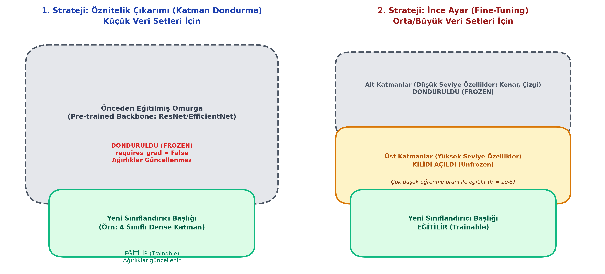

# Bölüm 8: Transfer Öğrenme (Transfer Learning) ve İnce Ayar (Fine-Tuning)

---

## 8.1. Transfer Öğrenmenin Temel Mantığı

Sıfırdan (From Scratch) bir derin öğrenme modeli eğitmek, milyonlarca etiketli görsel ve haftalarca sürecek devasa GPU hesaplama kaynakları gerektirir. Eğer elinizde sadece 500 veya 1.000 fotoğraftan oluşan özel bir veri seti varsa (örneğin: Fabrika parça hata tespiti veya tarımsal bitki hastalıkları), modeli sıfırdan eğitmeye kalktığınızda kaçınılmaz olarak **aşırı öğrenme (Overfitting)** felaketiyle karşılaşırsınız.

* **Transfer Öğrenme:** Daha önce devasa bir veri kümesi (örneğin 1.4 milyon görselden ve 1000 sınıftan oluşan ImageNet) üzerinde eğitilmiş ve görsel dünyanın temel özelliklerini (kenarlar, dokular, şekiller, perspektif) öğrenmiş güçlü bir modelin (ResNet, EfficientNet, MobileNet) ağırlıklarını alıp, kendi özel problemimize uyarlamaktır.

### Hocanın İnsan Analojisi: "Sizler de Birer Pre-Trained Modelsiniz!"
> *"Siz bu üniversiteye ve mühendislik bölümüne geldiğinizde zihniniz bomboş bir sayfa mıydı? Hayır! Siz 12 yıl boyunca ilkokul, ortaokul ve lisede Türkçe konuşmayı, okuma-yazmayı, temel matematiği, fizik kurallarını ve mantıksal düşünmeyi öğrendiniz (Bu sizin **Pre-training** aşamanızdı).*
> *Şimdi bu sınıfta sadece 2-3 ayda Derin Öğrenme öğreniyorsunuz. Derin öğrenmeyi öğrenmek için anaokuluna geri dönüp harfleri baştan öğrenmiyorsunuz; var olan güçlü zihinsel altyapınızın üzerine yeni uzmanlık katmanını ekliyorsunuz (**Fine-Tuning**)."*

---

## 8.2. Transfer Öğrenme Stratejileri

Probleminizin veri büyüklüğüne göre iki temel yöntem uygulanır:



### 1. Strateji: Öznitelik Çıkarımı (Feature Extraction / Katman Dondurma)
* **Ne Zaman Kullanılır?** Kendi elinizdeki veri seti çok küçükse (Örn: Sınıf başına 50-200 resim).
* **Nasıl Uygulanır?**
  1. Önceden eğitilmiş modelin (örneğin ResNet-50) omurgası (Backbone - tüm evrişim katmanları) alınır.
  2. Bu katmanların tüm ağırlıkları **DONDURULUR (Freeze)**:
     ```python
     for param in model.parameters():
         param.requires_grad = False
     ```
  3. Modelin sonundaki 1000 sınıflı orijinal Fully Connected katmanı kesilip atılır.
  4. Yerine kendi problemimizin sınıf sayısına uygun (Örn: 4 sınıflı bitki hastalığı için 4 nöronlu) yeni bir Dense katman eklenir.
  5. Eğitim başlatıldığında **sadece ve sadece bu yeni eklenen son katman eğitilir**. Dondurulan katmanların ağırlıkları kesinlikle değişmez.
* **Avantajı:** Çok hızlı eğitilir (birkaç dakika), aşırı öğrenme riski minimumdur.

---

### 2. Strateji: İnce Ayar (Fine-Tuning)
* **Ne Zaman Kullanılır?** Elinizde orta veya büyük ölçekli bir veri seti varsa ve modelin kendi verinizin özel detaylarına daha iyi uyum sağlamasını istiyorsanız.
* **Nasıl Uygulanır?**
  1. Önce sınıflandırıcı başlığı birkaç epoch eğitilerek dengelenir.
  2. Ardından omurganın üst katmanlarının (yüksek seviyeli öznitelikleri çıkaran son konvolüsyon bloklarının) **KİLİDİ AÇILIR (Unfreeze)**.
  3. Model hem yeni başlığıyla hem de üst konvolüsyon katmanlarıyla birlikte tekrar eğitime sokulur.

> [!CAUTION]
> **Hayati İlke: Neden Çok Düşük Öğrenme Oranı ($\alpha \approx 10^{-5}$) Kullanılır?**
> İnce ayar yaparken standart öğrenme oranı ($\alpha = 10^{-3}$) kullanılırsa, yeni veriden gelen büyük gradyanlar önceden öğrenilmiş mükemmel ağırlıkları ezer ve yok eder (**Felaket Unutması / Catastrophic Forgetting**). Önceden eğitilmiş ağırlıkların incelikle korunabilmesi için öğrenme oranı en az 10 ila 100 kat küçültülür ($\alpha = 10^{-4}$ veya $10^{-5}$).

---

## 8.3. Veri Etiketleme (Data Annotation) ve Model Kıyaslama Esasları

Kendi derin öğrenme projenizi geliştirirken ham resimleri topladıktan sonra modelin eğitime girebilmesi için etiketleme yapılması gerekir:
* **Popüler Araçlar:** **Roboflow**, **LabelImg**, **CVAT**.
* **Bilimsel Kıyaslama Kuralı (Hocanın Laboratuvar Kuralı):**
  * Eğer 5 farklı modeli (MobileNet, EfficientNet, ResNet, VGG, LeNet) kıyaslayacaksanız; **hepsini birebir aynı veri seti üzerinde, aynı Train/Val ayrımıyla ve aynı epoch sayısıyla** eğitmek zorundasınız.
  * Böylece hangi modelin kaç parametreye sahip olduğunu, eğitim süresini, GPU bellek tüketimini ve gerçek doğruluğunu tarafsız bir tabloda raporlayabilirsiniz.
