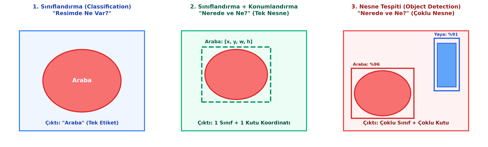
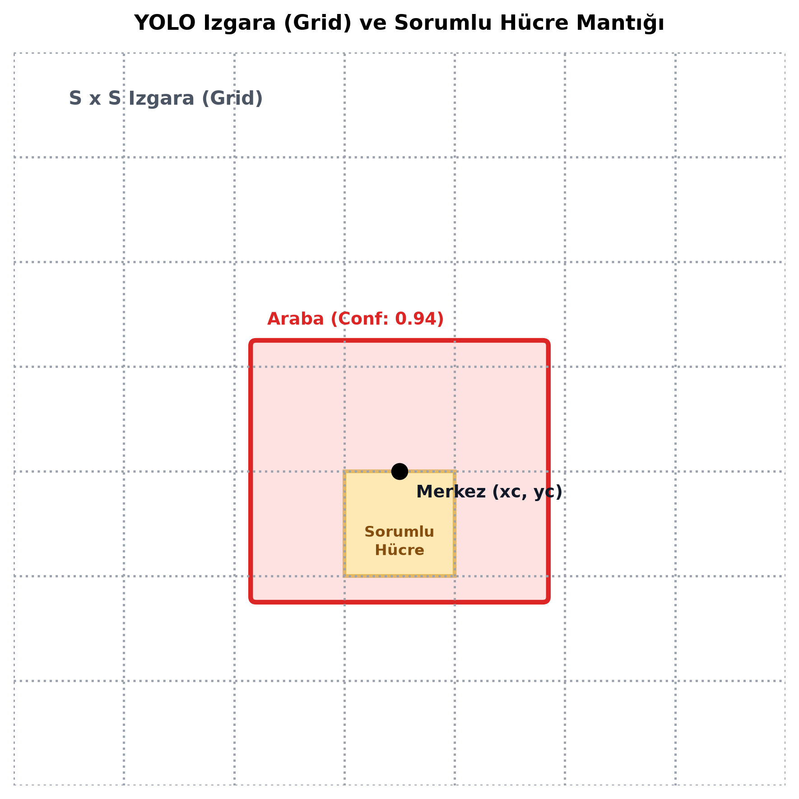

# Bölüm 9: Nesne Tespiti (Object Detection) ve YOLO Mimarisi

---

## 9.1. Bilgisayarlı Görü Görevlerinin Hiyerarşisi

Bilgisayarlı görüde çözülmek istenen problem, karmaşıklığına ve çıktının detayına göre dört ana seviyeye ayrılır:



1. **Görüntü Sınıflandırma (Image Classification):**
   * **Soru:** *"Bu görüntüde ne var?"*
   * Görüntüde tek bir baskın nesne olduğu varsayılır ve tüm resme tek bir etiket atanır (Örn: "Kedi", "Araba").
2. **Sınıflandırma ve Konumlandırma (Classification with Localization):**
   * **Soru:** *"Görüntüdeki nesne ne ve tam olarak nerede?"*
   * Resimdeki tek bir ana nesne sınıflandırılır ve etrafına bir sınırlayıcı kutu (Bounding Box) çizilir.
3. **Nesne Tespiti (Object Detection):**
   * **Soru:** *"Bu görüntüde hangi nesneler var, kaç taneler ve her biri nerede?"*
   * Görüntüde farklı sınıflara ait birden fazla nesne aynı anda bulunur; her bir nesne ayrı ayrı sınıflandırılır ve koordinat kutuları belirlenir (Örn: 2 araba, 3 yaya, 1 trafik ışığı).
4. **Örnek / Semantik Segmentasyon (Instance / Semantic Segmentation):**
   * **Soru:** *"Hangi piksel hangi nesneye ait?"*
   * Kutu yerine nesnenin piksel düzeyinde sınırları boyanır.

---

## 9.2. Sınırlayıcı Kutu (Bounding Box) ve Koordinat Mantığı

Nesne tespitinde her bir nesnenin konumu bir **Sınırlayıcı Kutu (Bounding Box)** ile tanımlanır.

### Koordinat Temsili ve Normalizasyon
YOLO formatında kutular piksel cinsinden değil; resmin boyutundan bağımsız çalışabilmesi için **$[0.0, 1.0]$ aralığında normalize edilmiş** 4 parametre ile ifade edilir:

$$x_c = \frac{X_{\text{merkez}}}{W_{\text{resim}}}, \quad y_c = \frac{Y_{\text{merkez}}}{H_{\text{resim}}}$$

$$w = \frac{W_{\text{kutu}}}{W_{\text{resim}}}, \quad h = \frac{H_{\text{kutu}}}{H_{\text{resim}}}$$

* $x_c, y_c$: Sınırlayıcı kutunun tam **merkez noktasının** normalize koordinatları.
* $w, h$: Kutunun normalize **genişliği** ve **yüksekliği**.

### YOLO Metin Dosyası Formatı (`.txt`):
Her bir resim için aynı isimde bir `.txt` etiket dosyası oluşturulur. Her satır resimdeki bir nesneyi temsil eder:
```text
<class_id> <x_center> <y_center> <width> <height>
```
* **Örnek:**
  ```text
  0 0.450000 0.520000 0.280000 0.410000
  1 0.780000 0.350000 0.120000 0.250000
  ```
  *(0 sınıfından nesne resmin merkezinde %45 genişlik ve %52 yükseklikte; 1 sınıfından nesne sağ tarafta).*

---

## 9.3. Nesne Tespit Modelleri: İki Aşamalı vs. Tek Aşamalı

Tarihsel olarak nesne tespiti iki farklı yaklaşımla gelişmiştir:

| Özellik | İki Aşamalı (Two-Stage) Dedektörler | Tek Aşamalı (Single-Stage) Dedektörler |
| :--- | :--- | :--- |
| **Örnek Modeller** | R-CNN, Fast R-CNN, **Faster R-CNN** | **YOLO (You Only Look Once)**, SSD, RetinaNet |
| **Çalışma Prensibi** | 1. Adım: Aday bölge önerileri üretilir (RPN).<br>2. Adım: Her bölge ayrı ayrı sınıflandırılır. | Tek bir ileri yayılımda (Forward pass) tüm resim taranır; kutular ve sınıflar aynı anda tahmin edilir. |
| **Hız (FPS)** | Yavaş (5 – 15 FPS). Gerçek zamanlı çalışamaz. | **Çok Hızlı (45 – 150+ FPS). Gerçek zamanlı (Real-Time).** |
| **Doğruluk** | Çok küçük nesnelerde hafifçe daha yüksek doğruluk. | Modern versiyonlarla (YOLOv8, YOLOv11) iki aşamalıları yakalamış ve geçmiştir. |
| **Kullanım Yeri** | Tıbbi mikroskop görüntüleri, uydu analizi | **Otonom araçlar (Tesla, TOGG), İHA'lar, güvenlik kameraları** |

---

## 9.4. YOLO (You Only Look Once) Mimarisi ve Çalışma Prensibi

YOLO, Joseph Redmon ve ark. (2016) tarafından önerilmiş; bilgisayarlı görüde devrim yaratan tek aşamalı nesne tespit algoritmasıdır.



### 1. Izgara (Grid) Bölümleme
* Girdi görüntüsü $S \times S$ boyutunda eşit ızgara hücrelerine bölünür (Örneğin $7 \times 7, 13 \times 13$ veya $19 \times 19$).
* **Altın Kural:** Bir nesnenin merkez noktası ($x_c, y_c$) hangi ızgara hücresinin sınırları içerisine düşüyorsa, **o nesneyi tespit etmekten ve kutusunu çizmekten yalnızca o hücre sorumludur!**

### 2. Çıkış Vektörü ve Tahminler
Her bir ızgara hücresi $B$ adet sınırlayıcı kutu ve her kutu için bir **Güven Skoru (Confidence Score)** tahmin eder:

$$\text{Güven Skoru} = P(\text{Object}) \times \text{IoU}_{\text{pred}}^{\text{truth}}$$

* Eğer hücrede nesne yoksa $P(\text{Object}) = 0$ olur ve güven skoru sıfırlanır.
* Eğer nesne varsa güven skoru, tahmin edilen kutunun gerçek kutuyla ne kadar örtüştüğünü (**IoU**) yansıtır.
* Aynı zamanda hücre, nesnenin hangi sınıfa ait olduğunu gösteren koşullu sınıf olasılıklarını ($P(\text{Class}_i \mid \text{Object})$) tahmin eder.

### 3. Gerçek Zamanlı Güç ve Otonom Araç Projeleri
Hocanın derste vurguladığı otonom sürüş senaryosu:
* $120\text{ km/s}$ hızla otobanda giden bir aracın önündeki engeli fark edip fren yapabilmesi için modelin gecikme süresinin (latency) milisaniyeler seviyesinde olması gerekir.
* İki aşamalı bir model saniyede 5 kare (FPS) işlerken araç 200 milisaniye boyunca "kör" ilerler.
* YOLO tek aşamalı mimarisi sayesinde görüntüyü saniyede 60-100 kare işleyerek anlık reaksiyon verir.
