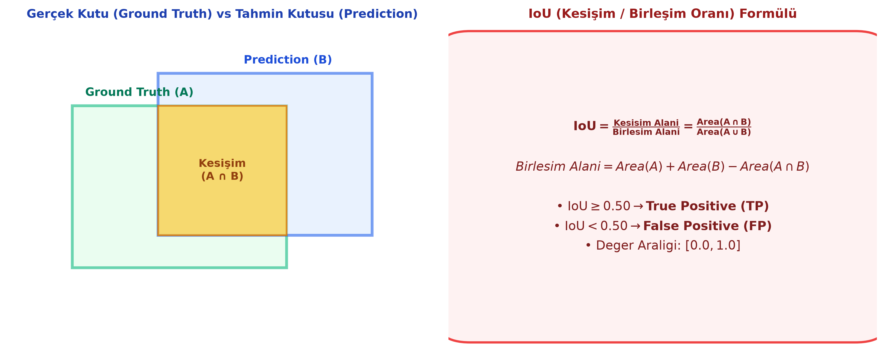
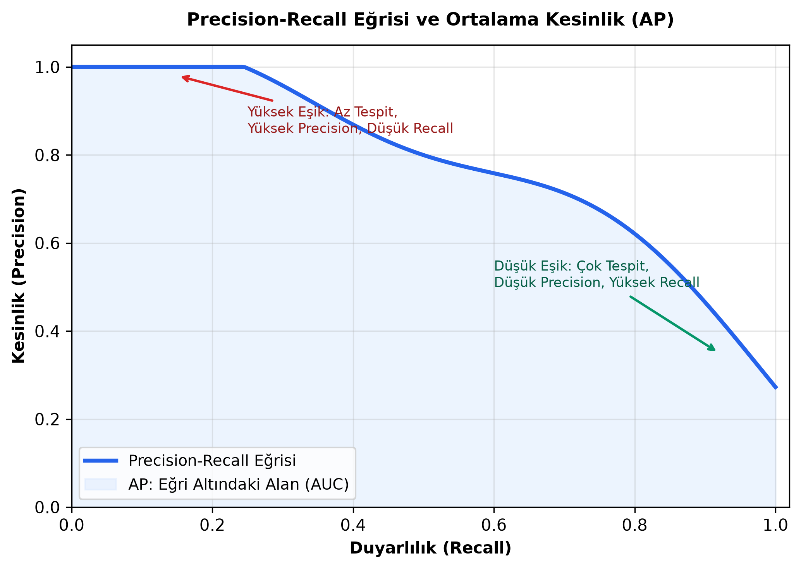

# Bölüm 10: Nesne Tespiti Değerlendirme Metrikleri ve Matematiksel Analizi

---

> [!IMPORTANT]
> **VİZE SINAVI UYARISI:**
> Hoca 4 Kasım dersinde IoU, Precision, Recall ve mAP hesaplamalarının vizede klasik yazılı soru olarak doğrudan sorulacağını açıkça ifade etmiştir. Formülleri ve arkasındaki mantığı çok iyi öğreniniz!

---

## 10.1. Kesişim / Birleşim Oranı (IoU – Intersection over Union)

Nesne tespitinde modelin çizdiği tahmin kutusu (Prediction) ile insanın etiketlediği gerçek kutunun (Ground Truth) uzamsal olarak ne kadar iyi örtüştüğünü ölçen temel geometrik metriktir.



### Matematiksel Formül:
$$\text{IoU} = \frac{\text{Kesişim Alanı}}{\text{Birleşim Alanı}} = \frac{\text{Area}(A \cap B)}{\text{Area}(A \cup B)}$$

Kümeler teorisinden bilindiği üzere birleşim alanı:
$$\text{Area}(A \cup B) = \text{Area}(A) + \text{Area}(B) - \text{Area}(A \cap B)$$

* **Değer Aralığı:** $[0.0, 1.0]$ arasındadır.
  * $\text{IoU} = 1.0$: Tahmin kutusu gerçek kutunun üzerine milimetrik oturmuştur (Mükemmel örtüşme).
  * $\text{IoU} = 0.0$: İki kutu birbirine hiç değmemektedir.
* **Karar Eşiği (Threshold):** Literatürde (PASCAL VOC standardı) genellikle eşik $\mathbf{\tau = 0.50}$ kabul edilir:
  * $\text{IoU} \ge 0.50 \implies$ **Başarılı Tespit (True Positive - TP)**
  * $\text{IoU} < 0.50 \implies$ **Hatalı / Yetersiz Tespit (False Positive - FP)**

---

## 10.2. Nesne Tespitinde Hata Matrisi (Confusion Matrix)

Klasik sınıflandırmadan farklı olarak, nesne tespitinde TP, FP ve FN kavramları **hem sınıf doğruluğuna hem de IoU değerine** bağlıdır:

```
┌────────────────────────────────────────────────────────────────────────┐
│ 1. True Positive (TP):                                                 │
│    • Model bir kutu çizdi.                                             │
│    • Sınıf tahmini DOĞRU.                                              │
│    • IoU ≥ 0.50.                                                       │
├────────────────────────────────────────────────────────────────────────┤
│ 2. False Positive (FP - Yanlış Alarm / Hayalet Tespit):                │
│    • Durum A: Model kutu çizdi ama IoU < 0.50 (Konum kötü).            │
│    • Durum B: Model kutu çizdi ama sınıfı YANLIŞ bildi.                │
│    • Durum C: Ortada hiç nesne yokken arka plana kutu çizdi.           │
├────────────────────────────────────────────────────────────────────────┤
│ 3. False Negative (FN - Kaçırılan Nesne):                              │
│    • Gerçekte bir nesne vardı ama model onu HİÇ GÖREMEDİ / kutu çizmedi│
├────────────────────────────────────────────────────────────────────────┤
│ 4. True Negative (TN):                                                 │
│    • Nesne olmayan boş arka plan alanlarına kutu çizilmemesidir.       │
│    • Bir resimde sonsuz sayıda boş arka plan kutusu seçilebileceğinden │
│      nesne tespitinde TN sayısal olarak hesaplanmaz ve kullanılmaz.    │
└────────────────────────────────────────────────────────────────────────┘
```

---

## 10.3. Kesinlik (Precision) ve Duyarlılık (Recall)



### 1. Kesinlik (Precision)
* **Soru:** *"Modelin 'Nesne buldum' dediği tahminlerin yüzde kaçı gerçekten doğru?"*
* **Formül:**
  $$\text{Precision} = \frac{TP}{TP + FP}$$
* **Ne Zaman Önemlidir?** Yanlış alarm vermenin (False Positive) çok maliyetli olduğu durumlarda (Örn: Spam filtresinde önemli bir iş mailini yanlışlıkla spam yapmak istemezsiniz).

### 2. Duyarlılık / Anma (Recall)
* **Soru:** *"Gerçek dünyada var olan nesnelerin yüzde kaçını model yakalayabildi?"*
* **Formül:**
  $$\text{Recall} = \frac{TP}{TP + FN}$$
* **Ne Zaman Önemlidir?** Hiçbir hedefi kaçırmamanın (False Negative'i sıfırlamanın) hayati olduğu durumlarda (Örn: Otonom aracın önündeki yayayı kaçırmaması, tıbbi kanser hücresi tespiti).

### 3. Precision - Recall Dengesi (Trade-off) ve Güven Eşiği (Threshold)
Modelin kutuları kabul etmesi için bir Güven Skoru Eşiği (Confidence Threshold, örn: $0.25$ veya $0.70$) seçilir:
* **Eşiği Yüksek Tutarsanız (Örn: Conf > 0.85):**
  * Model sadece çok emin olduğu bariz nesneleri çizer.
  * Yanlış alarm (FP) azalır $\implies$ **Precision tavan yapar.**
  * Ancak uzaktaki, gölgedeki gerçek nesneleri kaçırır (FN artar) $\implies$ **Recall düşer.**
* **Eşiği Düşük Tutarsanız (Örn: Conf > 0.15):**
  * Model gördüğü her şüpheli karaltıya kutu çizer.
  * Gerçek nesnelerin neredeyse hepsini yakalar $\implies$ **Recall tavan yapar.**
  * Ancak bir sürü çöp kutusuna, gölgeye kutu atar (FP patlar) $\implies$ **Precision çöker.**

### 4. F1-Score (Harmonik Ortalama)
Precision ve Recall arasındaki dengeyi tek bir sayıda özetlemek için kullanılır:
$$\text{F1} = 2 \cdot \frac{\text{Precision} \cdot \text{Recall}}{\text{Precision} + \text{Recall}}$$

---

## 10.4. Ortalama Kesinlik (AP) ve mAP (mean Average Precision)

Nesne tespitinde modelleri tek bir güven eşiğinde değerlendirmek adil değildir. Modelin her türlü eşik değerindeki genel performansını ölçmek için **mAP** metriği kullanılır.

1. **Precision-Recall Eğrisi:** Modelin güven eşiği $1.0$'dan $0.0$'a doğru yavaş yavaş düşürülerek her adımdaki Precision ve Recall değerleri grafiğe dökülür.
2. **Ortalama Kesinlik (AP - Average Precision):** Tek bir nesne sınıfı (örneğin sadece "Araba") için Precision-Recall eğrisinin altında kalan alandır (AUC - Area Under Curve). Değer $[0.0, 1.0]$ arasındadır.
3. **mAP (mean Average Precision):** Veri setindeki **tüm sınıfların AP değerlerinin aritmetik ortalamasıdır**:
   $$\text{mAP} = \frac{1}{C} \sum_{c=1}^C \text{AP}_c$$
   Burada $C$ toplam sınıf sayısıdır.

### Sınavda Çıkabilecek mAP Türleri:
* **$\text{mAP@0.5}$ (PASCAL VOC Formatı):** IoU eşiği sabit $\tau = 0.50$ iken hesaplanan mAP değeridir.
* **$\text{mAP@0.5:0.95}$ (COCO Yarışma Standardı):** IoU eşiğinin $0.50, 0.55, 0.60, \dots, 0.95$ şeklinde 10 farklı değer için ayrı ayrı hesaplanıp bu 10 sonucun ortalamasının alınmasıdır. Modelin nesneleri sadece kabaca değil, sınırları ne kadar hassas çizdiğini de ölçer.

---

## 10.5. Sayısal Örnek Vaka Analizi (Sınav Formatı)

**Soru:**
Bir otonom araç kamerası veri setinde test edilen YOLO modeli için şu sonuçlar kaydedilmiştir:
* Gerçek dünyadaki toplam yaya sayısı: $50$
* Modelin tespit ettiği toplam kutu sayısı: $40$
* Bu 40 kutudan $32$ tanesi doğru sınıf ve $\text{IoU} \ge 0.5$ şartını sağlamıştır.
* Kalan $8$ kutu arka plandaki ağaç gövdelerine çizilmiştir.

**Hesaplayınız:**
1. $\text{TP} = 32$
2. $\text{FP} = 8$
3. $\text{FN} = \text{Toplam Gerçek Nesne} - \text{TP} = 50 - 32 = 18$
4. **Precision:**
   $$\text{Precision} = \frac{TP}{TP + FP} = \frac{32}{32 + 8} = \frac{32}{40} = 0.80 \quad (\%80)$$
5. **Recall:**
   $$\text{Recall} = \frac{TP}{TP + FN} = \frac{32}{32 + 18} = \frac{32}{50} = 0.64 \quad (\%64)$$
