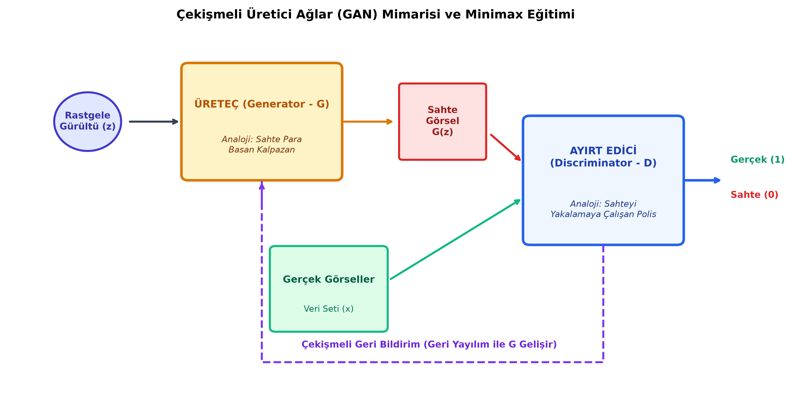

# Bölüm 11: Üretken Modeller: Çekişmeli Üretici Ağlar (GAN) ve Halüsinasyon

---

## 11.1. Ayırt Edici (Discriminative) vs. Üretici (Generative) Modeller

Derin öğrenme modelleri problem çözme yaklaşımlarına göre iki ana kategoriye ayrılır:

1. **Ayırt Edici Modeller (Discriminative Models):**
   * **Koşullu Olasılık:** $P(Y \mid X)$
   * Kendisine verilen bir girdinin ($X$) hangi sınıfa ($Y$) ait olduğunu belirlemeye odaklanır (Karar sınırını öğrenir).
   * *Örnek:* Bir fotoğrafın kedi mi köpek mi olduğunu söyleyen CNN modelleri, YOLO nesne tespiti.
2. **Üretici Modeller (Generative Models):**
   * **Birleşik Olasılık:** $P(X)$ veya $P(X \mid Y)$
   * Verinin doğrudan dağılımını öğrenir ve bu dağılımdan örnekleme yaparak **dünyada daha önce hiç var olmamış yepyeni, sentetik ama son derece gerçekçi veriler** üretir.
   * *Örnek:* GAN (Generative Adversarial Networks), Difüzyon Modelleri (Stable Diffusion, Midjourney).

---

## 11.2. Çekişmeli Üretici Ağlar (GAN) ve Minimax Oyunu

2014 yılında Ian Goodfellow tarafından önerilen GAN, oyun teorisindeki sıfır toplamlı iki oyunculu **Minimax** mantığına dayanır.

Ağ iki rakip alt modelden oluşur:

### 1. Üreteç (Generator - $G$)
* **Girdisi:** Rastgele bir gürültü vektörü ($z \sim \mathcal{N}(0, I)$).
* **Görevi:** Bu rastgele sayılardan gerçek veri setindeki görüntülere tıpatıp benzeyen sentetik görseller ($G(z)$) üretmektir.
* **Hocanın Analojisi: Sahte Para Basan Kalpazan**
  * Kalpazanın amacı öyle kusursuz sahte paralar basmaktır ki polisi kandırabilsin.

### 2. Ayırt Edici (Discriminator - $D$)
* **Girdisi:** Gerçek veri setinden gelen orijinal fotoğraflar ($x$) veya Üreteç'in ürettiği sahte fotoğraflar ($G(z)$).
* **Görevi:** Önüne gelen fotoğrafın gerçek ($1$) mi yoksa sahte ($0$) mi olduğunu doğru tespit etmektir.
* **Hocanın Analojisi: Sahte Parayı Yakalayan Polis**
  * Polisin amacı önüne gelen paranın sahte olup olmadığını en ince detayına kadar inceleyip yakalamaktır.

### Çekişmeli Eğitim Süreci ve Nash Dengesi:
1. Başlangıçta kalpazan (Üreteç) çok acemidir, sadece anlamsız renkli pikseller üretir. Polis (Ayırt Edici) bunları kolayca yakalar.
2. Ayırt edici polisin geri bildirimleri gradyan olarak Üreteç'e akar. Kalpazan polisin neye dikkat ettiğini öğrenir ve kendini geliştirir.
3. Kalpazan geliştikçe polis de yakalamak için daha ince detaylara bakar.
4. **Nash Dengesi (Nash Equilibrium):** Eğitim sonunda Üreteç o kadar kusursuz görüntüler üretmeye başlar ki; Ayırt Edici artık gerçeği sahteden ayırt edemez hale gelir ve yazı-tura atar ($D(G(z)) \approx 0.5$).

### Matematiksel Minimax Fonksiyonu:
$$\min_G \max_D V(D, G) = \mathbb{E}_{x \sim p_{\text{data}}} [\log D(x)] + \mathbb{E}_{z \sim p_z} [\log (1 - D(G(z)))]$$

* **$D$, bu fonksiyonu MAKSİMİZE etmeye çalışır:** Gerçek resimlere $1$ ($D(x) \to 1$), sahtelere $0$ ($D(G(z)) \to 0$) vermek ister.
* **$G$, bu fonksiyonu MİNİMİZE etmeye çalışır:** Sahte resimleri polise $1$ olarak yedirmek ($D(G(z)) \to 1$) ister.

---

## 11.3. Popüler GAN Türleri ve Kullanım Alanları

1. **DCGAN (Deep Convolutional GAN):** Evrişim ve ters-evrişim (Transposed Convolution) katmanlarını GAN yapısına başarıyla entegre eden ilk kararlı mimaridir.
2. **CycleGAN:** Eşleşmemiş (Unpaired) veri kümeleri arasında stil transferi yapar:
   * Örneğin: At fotoğraflarını Zebraya çevirme, Yaz manzarasını Kış manzarasına dönüştürme (Fotoğrafların birebir aynı açıdan çekilmiş çiftlerine ihtiyaç duymaz).
3. **StyleGAN (NVIDIA):** 1024x1024 çözünürlükte, insan gözünün ayırt edemeyeceği ultra gerçekçi insan portreleri üreten gelişmiş mimaridir (`thispersondoesnotexist.com`).

---

## 11.4. Derin Öğrenmede Halüsinasyon (Hallucination)

Üretici yapay zeka ve derin öğrenme modellerinin en büyük risklerinden biridir.

* **Tanım:** Bir derin öğrenme modelinin, yüzeyde son derece ikna edici, gerçekçi ve kusursuz görünen; ancak nesnel gerçeklikte **tamamen uydurma, hatalı veya var olmayan** veriler/çıktılar üretmesi durumudur.
* **Neden Ortaya Çıkar?**
  * Derin sinir ağları dünyayı "anlamaz" veya doğruları "bilmez". Yalnızca eğitim verisindeki piksellerin ve sözcüklerin istatistiksel olasılık dağılımını taklit eder.
  * Model için önemli olan çıktının matematiksel olarak o bağlama "yakışıp yakışmadığıdır"; fiziksel olarak doğru olup olmadığı değildir.

### Mühendislik ve Tıptaki Hayati Riskleri:
* **Tıbbi Görüntülemede (MR / BT Süper-Çözünürlük):**
  * Düşük kaliteli bir MR görüntüsünü netleştirmek için GAN kullandığınızda, model eksik pikselleri tamamlamak için hastanın beyninde gerçekte olmayan bir tümör dokusu (Halüsinasyon) uydurabilir veya var olan gerçek bir mikro kanamayı "arka plan gürültüsü" sanıp silebilir!
* **Otonom Araçlarda:**
  * Görsel tamamlama yapan bir model, sisten dolayı görünmeyen yolda varmış gibi sanal bir şerit çizgisi veya engel halüsinasyonu görebilir.
* **Mühendislik İlkesi:** Güvenlik ve sağlık kritik sistemlerde üretken modellerin çıktıları daima doğrulanabilir sensörlerle ve deterministik algoritmalarla denetlenmelidir.
