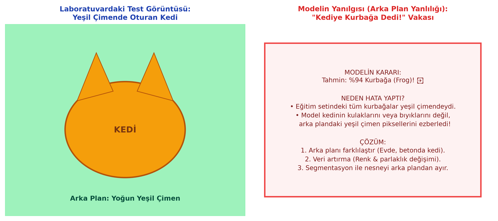
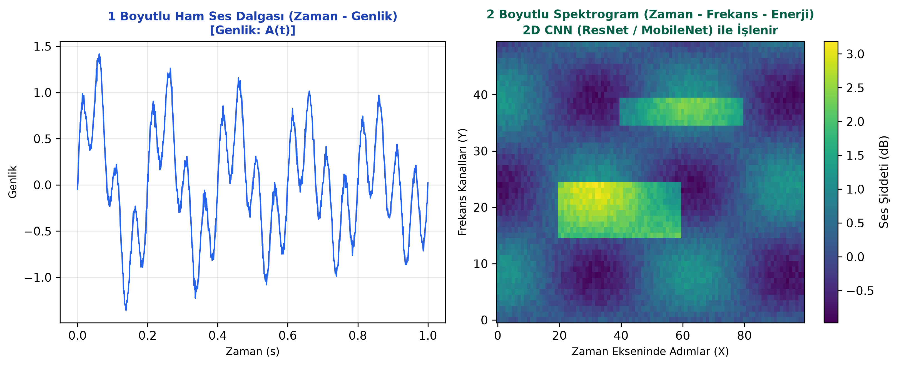

# Bölüm 12: Pratik Mühendislik Uygulamaları, Hata Analizi ve Donanım

---

## 12.1. Model Hata Analizi ve Arka Plan Yanlılığı (Background Bias)

Bir derin öğrenme modelinin eğitim setinde $\%98$ doğruluk alması, gerçek hayatta güvenle çalışabileceği anlamına gelmez. Modeller her zaman en az efor sarf ederek kaybı düşürecek en kolay istatistiksel kestirme yolu (Shortcut Learning) bulur.

### Hocanın Laboratuvardaki Vaka İncelemesi: "Kediye Kurbağa Dedi!" Vakası
Hocanın 26 Ekim laboratuvarında bizzat yaşadığı ve öğrencileri uyardığı gerçek bir olay:
* **Senaryo:** Bir öğrenci internetten kedi ve kurbağa fotoğrafları indirerek ikili bir sınıflandırma modeli eğittiğini ve eğitimde $\%95$ başarıya ulaştığını belirtir.
* **Canlı Test:** Hoca, öğrencinin modeline yeşil çimenlerin üzerinde oturan sarman bir kedi fotoğrafı verir.
* **Sonuç:** Model $\%94$ güvenle kediyi **"Kurbağa (Frog)"** olarak sınıflandırır!

### Kök Neden Analizi (Root Cause Analysis):
1. İnternetten rastgele toplanan veri kümesinde, neredeyse tüm kurbağa fotoğrafları yeşil sazlıklarda, yaprakların üzerinde veya çimendedir.
2. Kediler ise çoğunlukla ev içinde, parke veya koltuk üzerinde çekilmiştir.
3. Model kedinin kulaklarını, bıyıklarını veya göz yapısını öğrenmek yerine; **"Yeşil renk yoğunsa $\implies$ Kurbağa"** kestirmesini ezberlemiştir!
4. Yeşil çimende oturan bir kedi verildiğinde model nesneye değil arka plana bakarak felaket bir hata üretmiştir.

### Mühendislik Çözümleri:
1. **Veri Dağılımını Çeşitlendirmek:** Kedileri çimende, karda, asfaltta; kurbağaları taş üzerinde, beyaz arka planda içeren dengeli veri toplamak.
2. **Arka Planı Rastgele Değiştirmek / Veri Artırma:** Segmentasyon maskeleriyle nesneyi kesip farklı arka planlara yapıştırmak.
3. **Açıklanabilir Yapay Zeka (XAI / Grad-CAM):** Modelin karar verirken görüntünün hangi piksellerine odaklandığını gösteren ısı haritalarını (Heatmap) incelemek.

---

## 12.2. Farklı Veri Modaliteleri: Ses Verisini 2D CNN ile Sınıflandırma

Derin öğrenmede en sık düşülen yanılgılardan biri, CNN'lerin yalnızca kamera görüntülerinde çalıştığını sanmaktır.

### 1B Ses Dalgasını 2B Görüntüye Dönüştürme:
* **Problem:** Ham ses, zamana bağlı hava basıncı genliğidir ($1\text{D}$ sinyal: $A(t)$). $1\text{D}$ sinyalleri doğrudan işlemek frekans harmoniklerini yakalamada yetersiz kalabilir.
* **Çözüm (Spektrogram / Mel-Spectrogram):**
  1. Ses sinyaline **Kısa Zamanlı Fourier Dönüşümü (STFT - Short-Time Fourier Transform)** uygulanır.
  2. Sinyal küçük zaman pencerelerine bölünerek her penceredeki frekans bileşenlerinin enerjisi (desibel) hesaplanır.
  3. Ortaya iki boyutlu bir matris çıkar:
     * **X Ekseni:** Zaman adımları
     * **Y Ekseni:** Frekans kanalları ($Hz$)
     * **Piksel Değeri / Renk:** O frekanstaki sesin şiddeti / enerjisi.
* **Mühendislik Zaferi:** Ses verisi bir kez 2B renkli bir görüntüye dönüştürüldükten sonra; görüntü tanıma için geliştirilmiş tüm güçlü modern mimariler (**ResNet, MobileNet, EfficientNet**) doğrudan ses sınıflandırmada (fabrika motor arıza tespiti, konuşmacı tanıma, akciğer hırıltı analizi) kullanılabilir!

---

## 12.3. Donanım ve Hesaplama Kısıtları (GPU & Bellek Yönetimi)

Derin öğrenme modelleri GPU belleklerini (VRAM) çok yoğun tüketir.

### 1. Bellek Taşması Hatası (CUDA Out of Memory - OOM)
Eğer model eğitilirken bu hatayı alıyorsanız iki ana sebebi vardır:
* **Görüntü Çözünürlüğü Çok Yüksektir:** Resmi $1024 \times 1024$ yerine $224 \times 224$ veya $256 \times 256$'ya yeniden boyutlandırın.
* **Batch Size Çok Büyüktür:** Örneğin Batch Size $128$ iken OOM alıyorsanız, $64$'e veya $32$'ye düşürün.

### 2. Uç Birimlerde (Edge Devices) Model Optimizasyonu
Bir modeli Raspberry Pi, NVIDIA Jetson Nano veya bir cep telefonunda çalıştırmak istediğinizde model boyutunu küçültmek gerekir:
* **Budama (Pruning):** Ağdaki mutlak değeri sıfıra çok yakın olan önemsiz ağırlıkların ağdan kalıcı olarak silinmesi.
* **Nicemleme (Quantization):** Ağırlıkların 32-bit kayan noktalı sayıdan (`FP32`), 8-bit tam sayıya (`INT8`) dönüştürülmesidir.
  * Modelin diskteki ve bellekteki boyutu **%75 oranında küçülür** ($4$ kat küçülme).
  * Mobil işlemcilerde çıkarım (Inference) hızı 3-4 katına çıkar.

---

## 12.4. Derste İncelenen Önemli Endüstriyel Projeler

1. **Geri Dönüşüm ve Otomatik Atık Ayrıştırma:**
   * Konveyör banttan geçen atıkların (Plastik, Cam, Kağıt, Metal) kamera ve CNN ile anlık tespiti, mekanik robot kolun doğru konteynere fırlatması.
2. **Güvenlik Sistemlerinde Bıçak ve Silah Tespiti:**
   * Havaalanı X-ray cihazlarında veya bina girişlerindeki CCTV kameralarında gizlenmiş kesici/delici aletlerin gerçek zamanlı tespiti.
3. **Fabrika İmalat Parça Hata Tespiti:**
   * Otomotiv veya döküm hatlarında yüzeydeki mikro çatlakların ve montaj hatalarının insan gözüne ihtiyaç kalmadan tespiti.
