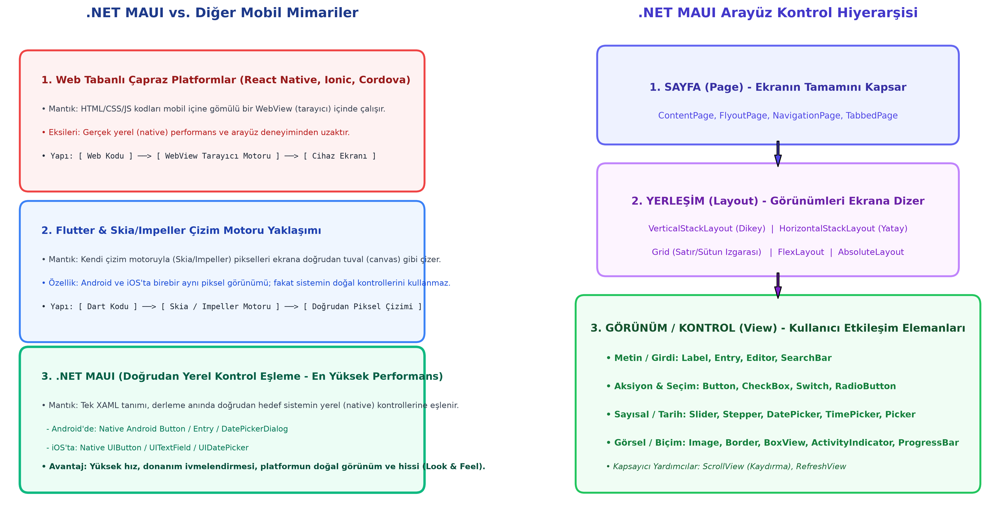

# Bölüm 01: Giriş, Çapraz Platform Mimarileri ve .NET MAUI Temelleri

---

## 🚨 HOCANIN VİZE SINAVI UYARILARI VE KRİTİK İPUÇLARI

> [!IMPORTANT]
> **Vize Sınavı Formatı ve Klasik Sınav Vurgusu:**
> * Sınav laboratuvarda bilgisayar başında değil; **kağıt üzerinde klasik yazılı sınav** formatında yapılacaktır.
> * **Mimari Karşılaştırma Sorusu:** .NET MAUI, Flutter ve Web tabanlı platformların (React Native, Ionic) çalışma prensipleri arasındaki temel farklar sınavın banko teorik sorularındandır. Özellikle MAUI'nin hedef işletim sisteminin doğal arayüz bileşenlerini doğrudan eşlemesi (Native Control Mapping) ve performans avantajı sorulur.
> * **iOS / Mac Bağımlılığı:** Windows makinede geliştirme yaparken neden doğrudan iPhone'a derleme yapılamadığı, Apple ekosisteminin API/Xcode kısıtları ve yerel ağdaki bir Mac ile "Pair to Mac" eşleşmesi mantığı sorulabilir.
> * **.NET Sürüm Politikası:** Kurumsal ve kararlı mobil projelerde neden kısa süreli STS sürümler yerine uzun süreli destek (LTS - .NET 10) sürümlerinin tercih edildiği bilinmelidir.
> * **Kontrol Hiyerarşisi:** `Sayfa (Page) -> Yerleşim (Layout) -> Görünüm (View)` üçlü katman hiyerarşisi boşluk doldurma veya klasik şematik soru olarak karşınıza gelecektir.

---

## 1. Giriş ve Dönem Planı

Mobil Cihazlar İçin Yazılım Mühendisliği dersi kapsamında, modern mobil uygulama ekosisteminin en güncel teknolojisi olan **.NET MAUI (Multi-platform App UI)** kullanılacaktır.

* **Birincil Hedef Platformlar:** Android ve iOS.
* **Geliştirme ve Test Kolaylığı:** Yerel Windows masaüstü hedefi (**WinUI 3**) hızlı önizleme ve hata ayıklama için aktif olarak kullanılır.
* **Dönem Vizyonu:** Dönem başında form, veri girişi ve görsel kontrolleriyle başlanıp; dönem ortasında oyunlaştırma (Kart Eşleştirme Oyunu vb.), dönem sonunda ise çoklu platform servisleri ve mimari kalıplar (MVVM) işlenecektir.

---

## 2. Neden .NET MAUI? (Çapraz Platform Karşılaştırması)

Mobil yazılım dünyasında tek bir kod tabanıyla çoklu platforma çıkış için üç ana yaklaşım bulunmaktadır:

```
[ Çapraz Platform Mimarileri ]
  ├── 1. Web Tabanlı Hibrit Platformlar (React Native, Cordova, Ionic) -> WebView Motoru
  ├── 2. Kendi Motoruyla Çizen Platformlar (Flutter)                  -> Skia / Impeller Tuvali
  └── 3. Yerel Bileşen Eşleyen Platformlar (.NET MAUI)               -> Doğrudan Native Eşleme
```



### A. Web Tabanlı Çapraz Platformlar (React Native, Ionic, Cordova)
* **Nasıl Çalışır?** Arka planda HTML, CSS ve JavaScript kullanarak bir web sayfası üretir. Uygulama içerisine gömülü bir `WebView` (tarayıcı penceresi) açılarak bu web sayfası kullanıcıya sunulur.
* **Dezavantajları:** Cihazın saf donanım hızlandırmasından ve işletim sisteminin gerçek arayüz bileşenlerinden uzaktır. Animasyonlarda takılmalar ve gecikmeler yaşanabilir.

### B. Kendi Çizim Motoru Olan Platformlar (Flutter & Skia/Impeller)
* **Nasıl Çalışır?** Flutter, işletim sisteminin yerel buton veya metin kutusunu kullanmaz. Bunun yerine ekranı boş bir tuval (canvas) olarak kabul eder ve Google'ın geliştirdiği Skia/Impeller grafik motoruyla pikselleri ekrana doğrudan kendi çizer.
* **Avantaj/Dezavantaj:** Android ve iOS'ta piksellerin birebir aynı görünmesini sağlar; ancak platformun doğal davranışını (Android'in Material You veya iOS'un Cupertino dinamiklerini) yerel olarak taşımaz.

### C. .NET MAUI'nin Doğrudan Yerel Bileşen Eşleme (Native Control Mapping) Üstünlüğü
* **Nasıl Çalışır?** XAML ile tek bir `<Button Text="Giriş" />` yazdığınızda:
  * Android'e derlendiğinde doğrudan Android'in saf yerel bileşeni olan `com.google.android.material.button.MaterialButton` üretilir.
  * iOS'a derlendiğinde doğrudan Apple'ın saf yerel bileşeni olan `UIButton` üretilir.
  * Windows'a derlendiğinde doğrudan WinUI 3 `Button` kontrolü üretilir.
* **Mühendislik Avantajı:** Araya yapay çizim katmanları veya web motorları sokmaz; işletim sisteminin doğal hızında, tam donanım ivmelendirmesiyle (hardware acceleration) ve %100 saf (native) arayüz deneyimiyle çalışır.

---

## 3. .NET MAUI'nin Tarihçesi ve Microsoft Ekosistemi

.NET MAUI bir gecede ortaya çıkmamış, yaklaşık 20 yıllık bir açık kaynak ve kurumsal evrimin ürünüdür:

1. **Mono / MonoDevelop:** Linux ve macOS üzerinde açık kaynaklı .NET çalıştırma projesi olarak Miguel de Icaza tarafından başlatıldı.
2. **Xamarin:** Mono projesinin ticarileşmesiyle `Xamarin.Android` ve `Xamarin.iOS` oluşturuldu. C# dili ile iOS ve Android API'lerine doğrudan erişim sağlandı.
3. **Xamarin.Forms:** Microsoft'un 2016 yılında Xamarin'i bünyesine katmasıyla, tek bir XAML arayüzü ile tüm platformları hedefleyen katman eklendi.
4. **.NET MAUI (Modern .NET):** .NET 6 ile duyurulan ve .NET 10 ile olgunlaşan MAUI, Xamarin.Forms'un modernize edilmiş halidir. Dağınık proje yapılarını tek bir projede (**Single Project**) toplamıştır.
   * **Desteklenen Platformlar:** Android, iOS, macOS (Mac Catalyst), Windows (WinUI 3), Tizen. (Topluluk desteğiyle Linux).

---

## 4. Geliştirme ve Test Ortamının Hazırlanması

### A. Gerekli Kurulumlar ve LTS Tercihi
* **Visual Studio 2022:** Installer üzerinden **".NET Multi-platform App UI geliştirme"** iş yükü (workload) kurulmalıdır.
* **Framework Sürümü: .NET 10 (LTS):**
  * **LTS (Long Term Support):** 3 yıl boyunca kararlı güvenlik ve hata düzeltme desteği sunar. Kurumsal projelerde STS (Standart / 18 aylık) sürümler yerine mutlaka LTS sürüm tercih edilir.

### B. Fiziksel Android Cihaz ile Test (En Hızlı Yöntem)
Emülatörlerin bilgisayar RAM'ini aşırı tüketmesini önlemek için derste fiziksel cihaz testi önerilmektedir:
1. Bilgisayara sadece şarj eden değil, **veri aktarımı (data)** yapabilen kaliteli bir USB kablo bağlanmalıdır.
2. **Geliştirici Seçeneklerini Açma:** *Ayarlar > Telefon Hakkında > Yazılım Bilgileri > Yapım Numarası (Build Number)* üzerine arka arkaya **7 kez** hızlıca tıklanır.
3. *Geliştirici Seçenekleri* altından **USB Hata Ayıklama (USB Debugging)** aktif edilir.
4. Ekrana gelen "Bu bilgisayara her zaman izin ver (RSA Parmak İzi)" kutusu onaylanır.
5. Visual Studio hedef cihaz listesinde telefon modeli seçilerek doğrudan F5 ile çalıştırılır.

### C. iOS Cihazlar ve Mac Bağımlılığı (Apple Kısıtları)
* Apple'ın kapalı lisanslama ve Xcode derleyici bağımlılığı nedeniyle, doğrudan Windows işletim sisteminde iOS kodları makine diline derlenemez.
* **Gerekli Yapı:** Windows makine ile aynı yerel ağda (LAN/Wi-Fi) çalışan bir **Mac cihazı (MacBook, Mac mini vb.)** bulunmalıdır.
* Visual Studio'nun **"Pair to Mac"** (Mac ile Eşleştir) aracı kullanılarak Windows'taki kodlar ağ üzerinden Mac'teki Xcode'a gönderilir, derleme orada yapılıp cihaza aktarılır.
* *(Alternatif sanal makine Hackintosh çözümleri yüksek RAM tüketimi ve yavaşlık nedeniyle profesyonel geliştirmede tercih edilmez).*

---

## 5. Proje Anatomisi ve Katmanlı Mimari

Visual Studio'da açılan bir MAUI projesinin temel omurgası şu dosyalardan oluşur:

* **`MauiProgram.cs`:** Uygulamanın giriş kapısıdır (`Main`). `CreateMauiApp()` fonksiyonu ile `MauiAppBuilder` oluşturulur; yazı tipleri (`ConfigureFonts`), bağımlılık enjeksiyonları (Dependency Injection - DI) ve servisler burada sisteme kaydedilir.
* **`App.xaml` & `App.xaml.cs`:** Uygulama düzeyindeki global stiller, renk paletleri ve tema fırçaları burada tutulur. `MainPage` olarak `AppShell`'i ayağa kaldırır.
* **`AppShell.xaml`:** Uygulamanın navigasyon hiyerarşisini, alt sekmelerini (`TabBar`) ve yan çekmece menülerini (`FlyoutItem`) yöneten modern iskelettir.
* **`MainPage.xaml` & `MainPage.xaml.cs`:**
  * **Sunum Katmanı (Presentation Layer):** `MainPage.xaml` dosyasında XAML ile kullanıcı arayüzü çizilir.
  * **İş Mantığı Katmanı (Business Layer / Code-Behind):** `MainPage.xaml.cs` dosyasında C# ile buton tıklamaları, hesaplamalar ve olaylar kodlanır.
* **`Resources/` Klasörü:**
  * `Fonts`: Uygulama yazı tipleri ve ikon fontları (`.ttf`, `.otf`).
  * `Images`: Görseller (`.png`, `.svg`, `.gif`).
  * `Styles`: CSS benzeri tema şablonları (`Colors.xaml`, `Styles.xaml`).

---

## 6. .NET MAUI Kontrol Hiyerarşisi

.NET MAUI'de ekran tasarımı 3 temel yapı taşı üzerine kurulur:

```
[ SAYFA (Page) ]
       └── [ YERLEŞİM (Layout) ]
                 └── [ GÖRÜNÜM / KONTROL (View) ]
```

1. **Sayfalar (Pages):** Ekranın tamamını yönetir. En çok kullanılanı tek bir görsel düzen barındıran **`ContentPage`**'dir. Navigasyon için `NavigationPage`, çekmece menü için `FlyoutPage` kullanılır.
2. **Yerleşimler (Layouts):** Görünümleri ekrana belli kurallarla dizen kapsayıcılardır:
   * `VerticalStackLayout`: Elemanları alt alta (dikey) dizer.
   * `HorizontalStackLayout`: Elemanları yan yana (yatay) dizer.
   * `Grid`: Satır ve sütun mantığıyla tam kontrollü tablo düzeni kurar.
3. **Görünümler (Views):** Kullanıcının doğrudan gördüğü ve dokunduğu bileşenlerdir: `Label`, `Button`, `Entry`, `Image`, `Slider`, `CheckBox` vb.
4. **Kapsayıcılar:** Ekrana sığmayan uzun içeriklerde dikey/yatay kaydırma çubuğu sunan **`ScrollView`** kontrolüdür.

---

## 7. `Label` (Etiket) Kontrolü, Tipografi ve Tasarım Psikolojisi

Ekranda salt-okunur metin göstermek için kullanılır.

### XAML Örneği:
```xml
<Label Text="Mobil Cihazlar İçin Yazılım Mühendisliği"
       FontSize="20"
       FontAttributes="Bold"
       CharacterSpacing="1.5"
       FontAutoScalingEnabled="True"
       TextColor="#1E3A8A"
       HorizontalTextAlignment="Center" />
```

### Temel Özellikler Tablosu:
| Özellik | Veri Tipi | Açıklama |
| :--- | :--- | :--- |
| `Text` | `string` | Gösterilecek metin içeriği. |
| `CharacterSpacing` | `double` | Harfler arasındaki boşluk mesafesi (Pozitif: açar, Negatif: sıkıştırır). |
| `FontAttributes` | `enum` | Yazının biçimi: `None`, `Bold`, `Italic` veya `Bold, Italic`. |
| `FontAutoScalingEnabled` | `bool` | İşletim sisteminin erişilebilirlik yazı boyutu büyütmelerine uyum sağlama. |
| `FontFamily` | `string` | Kullanılacak font ailesi adı (`MauiProgram.cs`'de tanımlanan alias). |

### Mühendislik Parantezi: Tipografi ve Renk Psikolojisi
* **Büyük Harf (Uppercase):** Kullanıcıda bağırma, agresiflik veya katı kural hissi yaratır; formlarda yalnızca kısa uyarılarda kullanılmalıdır.
* **Yuvarlak Hatlı & Küçük Harfler:** Samimiyet, erişilebilirlik ve güven hissi uyandırır (Kurumsal markaların modern logolarındaki dönüşüm gibi).
* **İtalik (Sağa Yatık):** Hız, dinamizm, sportiflik ve geleceğe yönelim algısı oluşturur.
* **Renklerin Dili:**
  * **Mavi:** Güven, bankacılık, istikrar ve kurumsallık.
  * **Yeşil:** Doğa, huzur, onay ve başarı durumu.
  * **Kırmızı:** Hata, aciliyet, tehlike ve silme eylemleri.
  * **Turuncu / Sarı:** Dinamizm, sıcaklık ve dikkat çekme.
