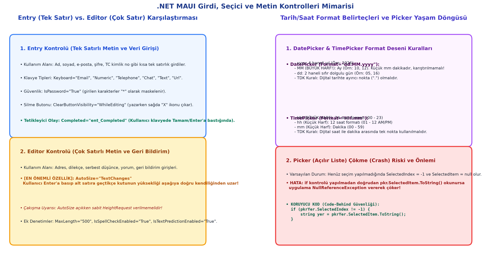

# Bölüm 02: Temel Metin, Girdi ve Etkileşim Bileşenleri (Label, Entry, Buton ve Olaylar)

---

## 🚨 HOCANIN VİZE SINAVI UYARILARI VE KRİTİK İPUÇLARI

> [!IMPORTANT]
> **Vize Sınavı Soru Tipleri ve Uyarılar:**
> * **Klasik Kağıt Sınavında Kod Yazma:** Sınavda kağıt üzerine bir kullanıcı giriş ekranı (Kullanıcı Adı, Şifre, Giriş Butonu) XAML kodunu ve bunun C# code-behind tarafındaki olay dinleyicisini (`Completed` veya `Clicked`) yazmanız istenecektir.
> * **`x:Name` Hayati Kuralı:** XAML'da tanımlanan bir kontrole C# arka plan kodundan erişebilmek için ona mutlaka `x:Name="entNumara"` şeklinde bir nesne adı verilmelidir. `Name` değil, XAML isim alanı olan `x:Name` yazılması zorunludur.
> * **`Placeholder` ve `Text` Etkileşimi:** `Placeholder` yalnızca kutu boşkendir; `Text` alanına tek bir karakter dahi girildiğinde `Placeholder` anında gizlenir.
> * **Doğru Klavye Türü Seçimi (`Keyboard`):** Kullanıcıdan veri isterken doğru klavye tipini seçmek (`Numeric`, `Email`, `Telephone` vb.) sınavda UX tasarımı puanlamasında doğrudan göz önüne alınır.
> * **`TextTransform` ve Türkçe Karakter Tuzağı:** `Uppercase` kullanılırken sistem dili İngilizce ise küçük `i` harfinin `I` harfine dönüşmesi gibi lokalizasyon tuzaklarına dikkat edilmelidir.
> * **`Justify` Hizalama Uyarısı:** `HorizontalTextAlignment="Justify"` tek satırlı `Entry` veya `Label` bileşenlerinde sağa sola yayamaz; bu nedenle varsayılan olarak sola (`Start`) yaslar.

---

## 1. Giriş ve Görsel Notların Kapsamı (7 Ekim 2026)

Bu modül, mobil uygulamalarda kullanıcıdan veri almanın ve etkileşim kurmanın temeli olan **`Entry`** bileşeninin tüm parametrelerini, `Label` ile entegrasyonunu, temel `Grid` düzenini ve C# olay yönetimini içermektedir.



---

## 2. `Entry` (Tek Satırlı Metin Girişi) Kontrolü ve Derinlemesine Nitelikleri

`Entry`, kullanıcıdan kullanıcı adı, telefon, şifre, sayı veya kısa metinler almak için kullanılan temel tek satırlı metin kutusudur.

### A. Metin, Yer Tutucu ve Renk Özellikleri
* **`Text` (`string`):** Metin kutusunun içindeki asıl veri değeridir.
* **`TextColor` (`Color`):** Girilen metnin rengidir (Örn: `TextColor="Black"`).
* **`Placeholder` (`string`):** Kutu boşken kullanıcıya ne girmesi gerektiğini hatırlatan silik yer tutucu yazıdır (Örn: `Placeholder="Lütfen adınızı giriniz"`).
* **`PlaceholderColor` (`Color`):** Yer tutucu metnin rengidir (Örn: `PlaceholderColor="Gray"`).
* **Kritik Kural:** `Text` özelliği dolu olduğunda veya kullanıcı bir karakter yazdığı anda `Placeholder` otomatik olarak gizlenir.

### B. Güvenlik, Silme ve Kısıtlamalar
* **`IsPassword` (`bool`):** `true` yapıldığında kullanıcının girdiği karakterler gizlenerek yerine yıldız (`*`) veya nokta sembolü gösterilir (Şifre ve PIN girişleri için zorunludur).
* **`ClearButtonVisibility` (`enum`):**
  * `Never` (Varsayılan): Metin kutusunun sağında silme çarpısı gösterilmez.
  * `WhileEditing`: Kullanıcı kutuya odaklanıp bir şeyler yazdığı sürece kutunun sağında tek tıkla metni silen bir "X" temizleme butonu belirir.
* **`MaxLength` (`int`):** Kullanıcının girebileceği maksimum karakter sayısıdır (Örn: TC Kimlik için `MaxLength="11"`, SMS kodu için `MaxLength="6"`).
* **`IsReadOnly` (`bool`):** `true` yapıldığında kutu salt-okunur hale gelir. Kullanıcı metni seçip kopyalayabilir ancak yeni veri yazamaz veya silemez.

### C. Klavye Türleri (`Keyboard`) ve UX Optimizasyonu
Mobilde kullanıcıya sorulan veri tipine göre doğru sanal klavyeyi açmak kullanıcı deneyimini doğrudan belirler:

| Klavye Tipi | XAML Değeri | Açılan Klavye Düzeni |
| :--- | :--- | :--- |
| **Sayısal** | `Keyboard="Numeric"` | Yalnızca 0–9 rakamları ve ondalık ayırıcı tuşları açılır. |
| **E-Posta** | `Keyboard="Email"` | `@` ve `.com` tuşlarını klavyenin ana ekranına taşır. |
| **Telefon** | `Keyboard="Telephone"` | Telefon çevirme tuş takımını (numaralar, `*`, `#`) açar. |
| **Sohbet** | `Keyboard="Chat"` | Emoji ve metin tahminini öne çıkaran klavye. |
| **Web Adresi**| `Keyboard="Url"` | `/`, `.com`, `www` tuşlarını ana ekrana ekler. |
| **Düz Metin** | `Keyboard="Text"` | Standart harf klavyesi, büyük harfle başlatma destekli. |
| **Sade** | `Keyboard="Plain"` | Hiçbir otomatik düzeltme veya tahmin içermeyen sade klavye. |

### D. Akıllı Giriş ve İmleç Denetimleri
* **`IsSpellCheckEnabled` (`bool`):** Yazım denetimi. Açık olduğunda (`True`) cihazın dahili sözlüğüne göre hatalı kelimelerin altını kırmızı tırtıklı çizgiyle çizer.
* **`IsTextPredictionEnabled` (`bool`):** Kelime tahmini. Açık olduğunda (`True`) klavyenin üst kısmında kullanıcının yazmakta olduğu kelimenin devamı için tahmin çubuğu belirir.
* **`CursorPosition` (`int`):** Metin imlecinin kaçıncı karakter indeksinde durduğunu okur veya programatik olarak ayarlar.

### E. Tipografi, Boyut ve Dönüşüm
* **`FontFamily`:** Kullanılacak font ailesi (Typeface).
* **`FontSize`:** Yazı boyutu (Piksel cinsinden, örn: `16`, `18`).
* **`FontAttributes`:** Yazı kalınlık/eğiklik durumu (`Bold`, `Italic`, `None`).
* **`FontAutoScalingEnabled` (`bool`):** Telefonun erişilebilirlik ayarlarındaki büyük yazı tercihlerine otomatik uyum sağlama durumu.
* **`TextTransform`:** Metni dinamik olarak dönüştürür:
  * `None`: Kullanıcının yazdığı gibi kalır.
  * `Uppercase`: Tüm harfleri otomatik büyük harfe çevirir.
  * `Lowercase`: Tüm harfleri otomatik küçük harfe çevirir.
  * *Mühendislik Uyarısı:* Türkçe lokalizasyonda büyük harf dönüşümünde `i` $\rightarrow$ `I` / `İ` dönüşümlerine dikkat edilmelidir.

### F. Hizalama (Alignment) Kuralları
* **`HorizontalTextAlignment`:** Yatay metin hizalaması:
  * `Start`: Sola yasla (Varsayılan).
  * `Center`: Ortala.
  * `End`: Sağa yasla (Özellikle para/sayı girişlerinde tercih edilir).
  * `Justify`: İki yana yasla. *(Önemli Kural: Tek satırlı metinlerde iki yana yayma yapılamayacağı için varsayılan olarak `Start`/sola yaslama gibi çalışır).*
* **`VerticalTextAlignment`:** Dikey metin hizalaması (`Start`, `Center`, `End`).

---

## 3. View İsimlendirme ve `x:Name` Mimarisi

XAML'da tanımlanan bir bileşene C# code-behind tarafından erişebilmek için XAML İsim Alanı (namespace) olan `x:` ön ekiyle adlandırılmalıdır:

```xml
<Entry x:Name="entNumara"
       Placeholder="Öğrenci Numaranızı Giriniz"
       Keyboard="Numeric"
       MaxLength="9" />
```

* C# tarafında bu bileşene doğrudan `entNumara` adıyla bir nesne değişkeni gibi erişilebilir:
  ```csharp
  string girilenNo = entNumara.Text;
  ```

---

## 4. `Completed` Olayı (Event) ve C# Etkileşimi

Kullanıcı `Entry` kutusuna metni yazdıktan sonra sanal klavyedeki **"Tamam" / "Enter"** tuşuna bastığında **`Completed`** olayı tetiklenir.

### XAML Tanımı:
```xml
<Entry x:Name="entAd"
       Placeholder="Adınızı giriniz..."
       Completed="entAd_Completed" />

<Label x:Name="lblAd"
       FontSize="18"
       TextColor="DarkBlue" />
```

### C# Code-Behind (`MainPage.xaml.cs`):
```csharp
private void entAd_Completed(object sender, EventArgs e)
{
    // Klavyede Enter'a basıldığı anda Entry'deki metni Label'a aktar
    lblAd.Text = entAd.Text;
}
```

---

## 5. `DisplayAlert` / `DisplayAlertAsync` ile Pop-Up Mesaj Gösterimi

Kullanıcıya bilgilendirme, uyarı veya hata mesajı göstermek için `Page` sınıfından gelen `DisplayAlert` metodu kullanılır:

```csharp
// Format: DisplayAlert(başlık, gösterilecek mesaj, kapat butonu metni)
await DisplayAlert("Bilgi", "İşleminiz başarıyla kaydedildi.", "Tamam");
```

---

## 6. Bütüncül Form Uygulaması: XAML ve Code-Behind Entegrasyonu

Derste anlatılan tüm bileşenleri (`Grid`, `Label`, `Entry`, `Button`, `DisplayAlert`) bir araya getiren klasik sınav uyumlu örnek:

### XAML (`MainPage.xaml`):
```xml
<Grid RowDefinitions="Auto, Auto, Auto, Auto"
      ColumnDefinitions="*, *"
      RowSpacing="15"
      ColumnSpacing="10"
      Padding="20">

    <!-- Başlık (İki sütunu da kaplar) -->
    <Label Grid.Row="0" Grid.Column="0" Grid.ColumnSpan="2"
           Text="Kullanıcı Kayıt Formu"
           FontSize="22"
           FontAttributes="Bold"
           HorizontalTextAlignment="Center"
           TextColor="#1E3A8A" />

    <!-- Ad Girişi -->
    <Label Grid.Row="1" Grid.Column="0"
           Text="Adınız Soyadınız:"
           VerticalOptions="Center" />
    <Entry Grid.Row="1" Grid.Column="1"
           x:Name="entAdSoyad"
           Placeholder="Örn: Yusuf Şanverdi"
           ClearButtonVisibility="WhileEditing"
           Completed="entAdSoyad_Completed" />

    <!-- Şifre Girişi -->
    <Label Grid.Row="2" Grid.Column="0"
           Text="Güvenlik Şifreniz:"
           VerticalOptions="Center" />
    <Entry Grid.Row="2" Grid.Column="1"
           x:Name="entSifre"
           Placeholder="Şifrenizi giriniz"
           IsPassword="True"
           MaxLength="12" />

    <!-- Gönder Butonu (İki sütunu da kaplar) -->
    <Button Grid.Row="3" Grid.Column="0" Grid.ColumnSpan="2"
            x:Name="btnKaydet"
            Text="Kaydı Tamamla"
            Clicked="btnKaydet_Clicked"
            BackgroundColor="#1D4ED8"
            TextColor="White" />
</Grid>
```

### C# Code-Behind (`MainPage.xaml.cs`):
```csharp
namespace DersNotlari;

public partial class MainPage : ContentPage
{
    public MainPage()
    {
        InitializeComponent();
    }

    private void entAdSoyad_Completed(object sender, EventArgs e)
    {
        // Ad girilip Enter'a basıldığında odağı doğrudan şifre kutusuna taşı
        entSifre.Focus();
    }

    private async void btnKaydet_Clicked(object sender, EventArgs e)
    {
        if (string.IsNullOrWhiteSpace(entAdSoyad.Text))
        {
            await DisplayAlert("Hata", "Lütfen adınızı ve soyadınızı boş bırakmayınız!", "Tamam");
            return;
        }

        if (string.IsNullOrWhiteSpace(entSifre.Text) || entSifre.Text.Length < 6)
        {
            await DisplayAlert("Güvenlik Uyarısı", "Şifreniz en az 6 karakter olmalıdır!", "Tekrar Dene");
            return;
        }

        string mesaj = $"Hoş geldiniz Sayın {entAdSoyad.Text}.\nKaydınız başarıyla tamamlandı.";
        await DisplayAlert("Başarılı", mesaj, "Tamam");
    }
}
```
