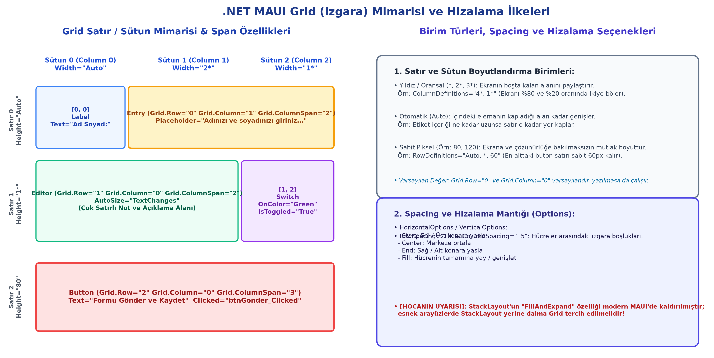

# Bölüm 03: Sayısal Seçiciler, Renk Sistemleri ve Grid Mimarisi

---

## 🚨 HOCANIN VİZE SINAVI UYARILARI VE KRİTİK İPUÇLARI

> [!IMPORTANT]
> **Vize Sınavı Odakları ve Soru Tipleri:**
> * **Sayısal Hassasiyet ve Yuvarlama Taktiği:** Slider `double` türünde çok haneli ondalıklı sayı üretir. Virgülden sonra tam 2 basamak bırakmak için uygulanan matematiksel çarpma ve yuvarlama formülü sınavda klasik hesaplama/kodlama sorusu olarak karşınıza çıkacaktır:
>   $$\text{Sonuç} = \frac{\text{Math.Round}(\text{Değer} \times 100)}{100}$$
> * **Slider ve Stepper Birlikte Kullanım Nedeni:** "Neden arayüzde hem Slider hem Stepper kullanılır?" sorusu banko sınav sorusudur. Slider dokunmatik ekranda geniş aralıkta **kaba ayar** yapar ancak parmak hassasiyetiyle tam değeri (örn: 26) tutturmak zordur; Stepper ise butonlarıyla **hassas ince ayar** sağlar. İkisinin `ValueChanged` olayıyla birbirine bağlanması mantığı bilinmelidir.
> * **`Grid` vs. `StackLayout`:** Xamarin'deki `FillAndExpand` esneme özelliği modern .NET MAUI'de kaldırıldığı için ekranı oranlayarak dolduran profesyonel tasarımlarda neden `StackLayout` yerine **`Grid`** kullanılması gerektiği sorulabilir.
> * **Button `CornerRadius` Geometrisi:** Bir butonun köşelerini tam oval/hap şekline getirmek için köşe yarıçapı değerinin buton yüksekliğinin tam yarısı ($\frac{\text{HeightRequest}}{2}$) olması gerektiği kuralı sorulur.
> * **Görsel İsimlendirme Kuralları:** `Resources/Images` altına eklenen resimlerin dosya adlarında büyük harf, Türkçe karakter ve boşluk kullanılmasının Android/iOS derleyicilerinde hata vereceği kuralı vurgulanmalıdır.

---

## 1. Slider (Kaydırıcı) Kontrolü

Kullanıcının parmağıyla veya fareyle çubuğu kaydırarak sayısal bir aralık içinden değer seçmesini sağlayan arayüz bileşenidir.

```xml
<Slider x:Name="sldNot"
        Minimum="0"
        Maximum="100"
        Value="50"
        MinimumTrackColor="Green"
        MaximumTrackColor="LightGray"
        ThumbColor="DarkGreen"
        ValueChanged="sldNot_ValueChanged" />
```

### A. Temel Özellikler ve Değer Atama Kuralları
* **Varsayılan Aralık:** Belirtilmezse varsayılan olarak `0.0` ile `1.0` arasında ondalıklı (`double`) değer üretir.
* **`Minimum` / `Maximum`:** Seçilebilecek alt ve üst sınırlardır. `Minimum` değeri daima `Maximum` değerinden küçük olmalıdır.
* **`Value`:** Kaydırıcının o anki geçerli değeridir. `Value="50"` verildiğinde imleç tam ortaya yerleşir.
* **Sınır Düzeltme Mekanizması:**
  * Eğer `Value` özelliği `Maximum` değerinden büyük verilirse, motor değeri otomatik olarak `Maximum` sınırına çeker.
  * `Minimum` değerinden küçük verilirse, otomatik olarak `Minimum` sınırına sabitlenir.
* **Görsel Özelleştirme:**
  * `MinimumTrackColor`: Geçilen (sol) çubuk rengi.
  * `MaximumTrackColor`: Kalan (sağ) çubuk rengi.
  * `ThumbColor`: Kaydırılan yuvarlak tutamaç rengi.
  * `ThumbImageSource`: Tutamaç yerine özel ikon görseli yerleştirme (`Resources/Images` altında olmalıdır).

---

## 2. Sayısal Dönüşüm ve Hassasiyet Filtreleme (`Math.Round`)

Slider çubuğu hareket ettirildiğinde arkada `67.4829103...` gibi çok basamaklı ondalık sayılar üretir. Bu sayılar ham haliyle ekranda gösterilmemeli, filtrelenmelidir:

### A. Tamsayıya Dönüştürme (Cast)
Vize/final notu gibi tam sayı gereken yerlerde açık tür dönüşümü (explicit cast) uygulanır:
```csharp
private void sldNot_ValueChanged(object sender, ValueChangedEventArgs e)
{
    int tamNot = (int)e.NewValue;
    lblNot.Text = $"Notunuz: {tamNot}";
}
```

### B. Virgülden Sonra 2 Basamak Sabitleme (GANO Taktiği)
GANO (0.00 – 4.00) gibi hassas iki basamaklı ortalamalarda:

$$
\text{FiltreliDeğer} = \frac{\text{Math.Round}(\text{e.NewValue} \times 100)}{100}
$$

```csharp
private void sldGano_ValueChanged(object sender, ValueChangedEventArgs e)
{
    // Değer 100 ile çarpılarak en yakın tamsayıya yuvarlanır, ardından tekrar 100'e bölünür
    double hassasGano = Math.Round(e.NewValue * 100) / 100;
    lblGano.Text = $"GANO: {hassasGano:F2}";
}
```

---

## 3. Dijital Renk Sistemleri ve Renk Uzayları

.NET MAUI'de renk tanımlamaları piksel altı ışık kanalları veya insan algısına göre modellenir:

```
[ Renk Sistemleri ]
  ├── RGB / RGBA   -> Ekranlar ve Donanım (Kırmızı, Yeşil, Mavi, Alpha/Opaklık)
  ├── Hexadecimal  -> Web ve XAML (#RGB, #ARGB, #RRGGBB, #AARRGGBB)
  └── HSL / HSV    -> İnsan Algısı ve Sanat (Hue/Renk Açısı, Doygunluk, Parlaklık)
```

1. **RGB (Red, Green, Blue):**
   * Ekran piksellerindeki kırmızı, yeşil ve mavi LED ışıklarının şiddetidir ($0$ - $255$ veya $0.0$ - $1.0$).
   * Üç kanalın $0$ olması **Siyah**, $255$ olması **Beyaz** oluşturur.
   * Eşit değerler grinin tonlarını verir.
   * Kırmızı + Yeşil = Sarı; Kırmızı + Mavi = Macenta; Yeşil + Mavi = Turkuaz (Cyan).
2. **Alpha (Şeffaflık):** $1.0$ veya $255$ tam opak (arkasını göstermez), $0.0$ tamamen saydamdır.
3. **Hexadecimal Kodlar:**
   * `#F00` veya `#FF0000`: Kırmızı.
   * `#80FF0000`: %50 yarı saydam kırmızı (İlk iki basamak Alpha değeridir).
4. **HSL (Hue, Saturation, Lightness):**
   * **Hue ($H$):** 0–360 derece arasındaki renk çemberidir ($0^\circ$ Kırmızı, $120^\circ$ Yeşil, $240^\circ$ Mavi).
   * **Saturation ($S$):** Rengin merkezden dışa doğru saflığı / doygunluğu.
   * **Lightness ($L$):** Rengin beyazlık / ışık şiddeti.

---

## 4. Stepper (Adımlayıcı) Kontrolü ve Slider ile Senkronizasyon

Kullanıcının `+` ve `-` butonlarına basarak değeri belirli adımlarla artırıp azaltmasını sağlayan kontroldür.

```xml
<Stepper x:Name="stpGano"
         Minimum="0"
         Maximum="4"
         Increment="0.01"
         Value="2.5"
         ValueChanged="stpGano_ValueChanged" />
```

### Slider & Stepper İkilisi (Kaba Ayar + İnce Ayar Mekanizması)
* Dar mobil ekranda parmakla Slider üzerinde tam `3.42` değerini yakalamak zordur.
* Bu sebeple kullanıcı önce Slider ile değeri hızlıca $3.40$ civarına getirir (**Kaba Ayar**); ardından Stepper'ın `+` butonuna 2 kez basarak değeri tam $3.42$ yapar (**İnce Ayar**).
* **C# Senkronizasyonu:** İki kontrolün `ValueChanged` olayında birbirlerinin `Value` değeri güncellenir.

### Dikey Konumlandırma (`Rotation`):
Stepper varsayılan olarak yataydır. Kontrolü dikey konuma getirmek için XAML'da `Rotation="-90"` veya `Rotation="90"` verilebilir.

---

## 5. Grid (Izgara) Mimarisi ile Profesyonel Yerleşim

`Grid`, mobil arayüzleri satır ve sütun matrisine bölerek ölçeklenebilir (responsive) düzen sağlayan en güçlü kapsayıcıdır.



### A. Satır ve Sütun Boyutlandırma Türleri
* **Yıldız / Oransal (`*`, `2*`, `3*`):** Ekranın boşta kalan alanını belirli oranlarda paylaştırır:
  * `ColumnDefinitions="3*, 1*"` $\implies$ Ekran genişliğinin %75'ini birinci sütuna, %25'ini ikinci sütuna verir.
* **Otomatik (`Auto`):** İçerisindeki bileşenin kapladığı alan kadar büyür/küçülür.
* **Sabit Piksel (`80`, `150`):** Ekran çözünürlüğüne bakılmaksızın mutlak boyut tanımlar (Örn: sabit başlık veya alt bar için).

### B. Hücre Konumlandırma ve Span Özellikleri
* **`Grid.Row="1"` ve `Grid.Column="0"`:** Kontrolün yerleşeceği koordinattır ($0$'dan başlar). Yazılmazsa varsayılanı $0$'dır.
* **`Grid.ColumnSpan="2"`:** Bileşenin yatayda 2 sütunu birden kaplamasını sağlar.
* **`Grid.RowSpan="2"`:** Bileşenin dikeyde 2 satırı birden kaplamasını sağlar.
* **`RowSpacing` ve `ColumnSpacing`:** Izgara çizgileri arasındaki boşluk mesafeleridir.

---

## 6. Button (Düğme) Kontrolü ve Gelişmiş Biçimlendirme

Kullanıcı etkileşimlerinin merkezindeki kontrolüdür.

```xml
<Button x:Name="btnOnayla"
        Text="Kayıt Ol"
        TextColor="White"
        BackgroundColor="#2563EB"
        HeightRequest="50"
        CornerRadius="25"
        BorderColor="#1D4ED8"
        BorderWidth="2"
        CharacterSpacing="2"
        Clicked="btnOnayla_Clicked" />
```

### A. Geometrik Şekil ve `CornerRadius` Oval Kuralı
* **Tam Oval (Hap / Kapsül) Buton:** Butonun köşelerini kusursuz ovalleştirmek için `CornerRadius` değeri buton yüksekliğinin tam yarısı ($\frac{\text{HeightRequest}}{2}$) yapılmalıdır:
  * `HeightRequest="50"` ise $\implies$ `CornerRadius="25"` olmalıdır.
  * Yarıdan büyük değerler şekli elipse kaydırır.
* **`BorderWidth` ve `BorderColor`:** Çerçeve kalınlığı ve rengi.

### B. Metin ve İkon Düzeni
* **`LineBreakMode`:** Buton metni dar alana sığmadığında ne yapılacağını belirler (`NoWrap`, `WordWrap`, `TailTruncation` - metin sonuna `...` koyma).
* **`ImageSource` & `ContentLayout`:** Butona hem ikon hem metin yerleştirirken ikisinin konumunu ayarlar:
  * `ContentLayout="Left, 10"` $\implies$ İkon solda, metin sağda ve aralarında 10px boşluk.
  * `ContentLayout="Top, 5"` $\implies$ İkon üstte, metin altta ve 5px boşluk.
