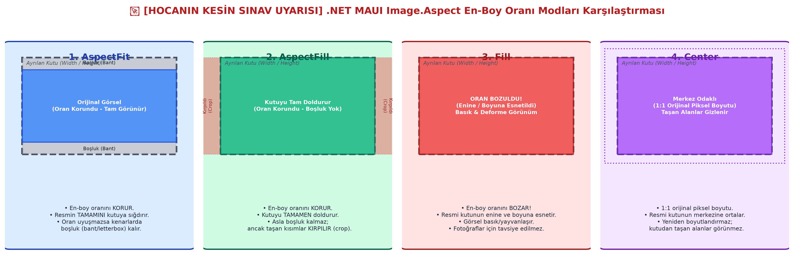

# Bölüm 04: Görsel Yönetimi, Aspect Oranları ve İkon Fontları

---

## 🚨 HOCANIN VİZE SINAVI UYARILARI VE KRİTİK İPUÇLARI

> [!IMPORTANT]
> **Vize Sınavı Odakları ve Soru Tipleri:**
> * **[HOCANIN KESİN SINAV UYARISI] `Image.Aspect` Nitelikleri:**
>   Hoca derste bu konunun sınavda **kesinlikle ve ayrıntılı olarak sorulacağını** açıkça vurgulamıştır. 4 Aspect türünün (`AspectFit`, `AspectFill`, `Fill`, `Center`) davranışı, kutuyu doldurma biçimleri, en-boy oranını koruyup korumadıkları ve hangi senaryoda tercih edilecekleri klasik yazılı soru olarak gelecektir.
>   * Şematik çizim veya vaka analizi istenebilir (Örn: "Bir haber uygulamasında manşet resminde neden `AspectFill` kullanılır?", "Bir e-ticaret uygulamasında ürün fotoğrafında neden `AspectFit` tercih edilir?").
> * **Dosya Adlandırma ve Derleme Kuralları:** `Resources/Images` klasörüne eklenen resim dosyalarının adlarında büyük harf, Türkçe karakter (`ı, ö, ü, ş, ç, ğ`) veya boşluk bulunması durumunda Android ve iOS derleyicilerinin (Unix tabanlı dosya sistemleri gereği) projeyi derleyemeyeceği kuralı bilinmelidir.
> * **Animasyonlu GIF Yönetimi:** `IsAnimationPlaying` özelliği ve C# tarafında tek satırda toggle yapılması mantığı (`img.IsAnimationPlaying = !img.IsAnimationPlaying;`) kodlama sorusu olarak çıkabilir.
> * **Performans Bayrağı (`IsOpaque`):** Saydamlık (alpha) barındırmayan görsellerde neden `IsOpaque="True"` verilmesi gerektiği ve bunun render motorundaki alpha blending yükünü nasıl hafiflettiği sorulabilir.

---

## 1. Görsel Formatları: Vektörel (SVG) ve Raster Karşılaştırması

Mobil ekranların piksel yoğunluğu (PPI / FHD+, 2K, QHD) monitörlerden çok daha yüksektir. Bu yüzden doğru format seçimi görsel netliğini ve bellek performansını belirler:

| Format Türü | Format Adı | Özellikler ve Kullanım Senaryosu |
| :--- | :--- | :--- |
| **Vektörel (Vector)** | **SVG** | Çizgi ve matematiksel eğrilerle tanımlanır. Çözünürlükten bağımsızdır; ne kadar büyütülürse büyütülsün pikselleşme ve kalite kaybı **asla yaşanmaz**. .NET MAUI logolarda, uygulama ikonlarında ve açılış (splash) ekranlarında SVG'yi öncelikli tutar. |
| **Piksel Tabanlı (Raster)** | **PNG** | Taşınabilir ağ grafiğidir (Portable Network Graphics). Saydam (transparan/alpha) arka planı destekler. Kalitelidir ancak ölçek büyütüldüğünde pikselleşir. |
| **Piksel Tabanlı (Raster)** | **JPEG / JPG** | Yüksek sıkıştırma sunan fotoğraflar için ideal kayıplı formattır. **Saydam arka planı desteklemez.** |
| **Piksel Tabanlı (Raster)** | **GIF** | Hareketli/animasyonlu görselleri ve saydamlığı destekler. Maksimum 256 renk paletiyle sınırlıdır. |
| **Modern Web** | **WebP** | Google'ın geliştirdiği hem yüksek sıkıştırma hem saydamlık sunan hafif formattır. |

---

## 2. Görsellerin Projeye Eklenmesi ve Kritik Adlandırma Standartları

1. **Klasör Konumu:** Görseller proje içinde `Resources/Images` altına yerleştirilir.
   ```xml
   <!-- Doğrudan dosya adıyla çağrılır -->
   <Image Source="galatasaray_logo.png" />
   ```
2. **Kritik İsimlendirme Kuralları (Android & iOS Derleme Hatasını Önleme):**
   * Dosya adları **tamamen küçük harf** olmalıdır.
   * Kesinlikle **Türkçe karakter** (`ç, ğ, ı, ö, ş, ü`) içermemelidir.
   * **Boşluk** veya özel işaret kullanılmamalı, kelimeler alt çizgi (`_`) ile ayrılmalıdır (Örn: `fb_logo.png`, `super_lig_2026.svg`).
3. **Yeniden Derleme (Rebuild) Şartı:** Projeye yeni bir görsel eklendiğinde Hot Reload tek başına yetmez; uygulamanın durdurulup yeniden derlenmesi (**Rebuild**) gerekir.

---

## 3. `Image.Aspect` (En-Boy Oranı Yönetimi) - Kapsamlı Analiz

Bir resmin kendisine tahsis edilen alana (`WidthRequest` ve `HeightRequest`) nasıl uyarlanacağını `Aspect` özelliği belirler.



### A. 4 Aspect Türünün Derinlemesine İncelenmesi:

#### 1. `AspectFit` (En-Boy Oranını Korur - Tam Sığdırır)
* **Davranış:** Resmin en-boy oranını (aspect ratio) kesinlikle korur.
* **Sonuç:** Görselin **tamamı** kutunun içine sığdırılır.
* **Dezavantaj:** Eğer resmin en-boy oranı ile kutunun en-boy oranı uyuşmuyorsa, kutunun kenarlarında boşluk (bant/letterbox) kalır.
* **Kullanım Yeri:** E-ticaret ürün fotoğrafları, teknik çizimler, logolar (görselin hiçbir detayının kaybolmaması gereken yerler).

#### 2. `AspectFill` (En-Boy Oranını Korur - Kutuyu Doldurur)
* **Davranış:** Resmin en-boy oranını kesinlikle korur.
* **Sonuç:** Kutunun tamamını boşluk bırakmaksızın doldurur.
* **Dezavantaj:** Kutu dolduktan sonra resmin kutunun dışına taşan kısımları **kırpılır (crop edilir)** ve görünmez.
* **Kullanım Yeri:** Manşet haber kartları, kullanıcı profil arka planları, galeri küçük resimleri (ekranda beyaz/gri boşluk kalmaması gereken şık tasarımlar).

#### 3. `Fill` (En-Boy Oranını BOZAR! - Esnetir)
* **Davranış:** Resmin en-boy oranını **korumaz**.
* **Sonuç:** Resmi kutunun genişliğine ve yüksekliğine zorla esnetir.
* **Dezavantaj:** Görsel basık, yayvan veya sündürülmüş bir hal alır; insan yüzleri ve fotoğraflar deforme olur.
* **Kullanım Yeri:** Sadece soyut desenler veya arka plan renk geçiş blokları için uygundur; gerçek fotoğraflar için **asla önerilmez**.

#### 4. `Center` (1:1 Orijinal Piksel Boyutu)
* **Davranış:** Resmi ne büyütür ne küçültür; orijinal piksel boyutunda kutunun tam ortasına yerleştirir.
* **Sonuç:** Resim kutudan büyükse dışarı taşan kısımlar gizlenir; resim küçükse etrafında geniş boşluklar kalır.

---

## 4. Animasyonlu GIF Kullanımı ve `IsAnimationPlaying`

.NET MAUI, üçüncü parti hiçbir eklentiye ihtiyaç duymadan animasyonlu GIF'leri doğrudan oynatabilir:

### XAML Tanımı:
```xml
<Image x:Name="imgAnimasyon"
       Source="yukleniyor_anime.gif"
       IsAnimationPlaying="True"
       HeightRequest="200"
       WidthRequest="200"
       Aspect="AspectFit" />

<Button x:Name="btnDurum"
        Text="Durdur"
        Clicked="btnDurum_Clicked" />
```

### C# ile Tek Satırda Toggle Kontrolü:
```csharp
private void btnDurum_Clicked(object sender, EventArgs e)
{
    // Animasyon durumunu tersine çevir (true ise false, false ise true)
    imgAnimasyon.IsAnimationPlaying = !imgAnimasyon.IsAnimationPlaying;

    // Buton metnini dinamik güncelle
    btnDurum.Text = imgAnimasyon.IsAnimationPlaying ? "Durdur" : "Oynat";
}
```

---

## 5. Web Görselleri ve `IsLoading` Özelliği

Uzak sunucudan (`https://...`) resim yüklenirken indirme durumunu denetlemek için salt-okunur **`IsLoading`** (`bool`) özelliği kullanılır:

* Bir `ActivityIndicator` (döner halka) kontrolünün `IsRunning` ve `IsVisible` özellikleri `Image.IsLoading` değerine bağlanır.
* Görsel sunucudan inerken ekranda çark döner; indirme tamamlanıp `IsLoading = false` olduğunda çark otomatik kapanır ve görsel ekranda belirir.

---

## 6. C# ile Çalışma Zamanında (Runtime) Dinamik Resim Değiştirme

Dinamik olarak bir butona tıklandığında resmi diziden sırayla değiştirmek için `ImageSource.FromFile(...)` yöntemi ve modülo (`%`) işlemi kullanılır:

```csharp
public partial class MainPage : ContentPage
{
    // Resources/Images altındaki görseller
    private readonly string[] _takimLogolari = { "galatasaray.png", "fenerbahce.png", "besiktas.png", "trabzonspor.png" };
    private int _aktifIndeks = 0;

    public MainPage()
    {
        InitializeComponent();
    }

    private void btnSonrakiLogo_Clicked(object sender, EventArgs e)
    {
        // Sayaç değerini dizi sınırları içinde döngüye sokmak için mod alma
        _aktifIndeks = (_aktifIndeks + 1) % _takimLogolari.Length;

        // Görsel kaynağını dinamik güncelle
        imgKadro.Source = ImageSource.FromFile(_takimLogolari[_aktifIndeks]);
    }
}
```

---

## 7. Özel Yazı Tipleri ve İkon Fontları (Font Icons)

Uygulama içine yüzlerce PNG resmi gömmek yerine vektörel ikon kütüphaneleri (FontAwesome, Ionicons vb.) yazı tipi (`.ttf`) olarak projeye eklenir:

1. **Konum:** Font dosyası (`ionicons.ttf`) `Resources/Fonts` klasörüne kopyalanır.
2. **Kayıt (`MauiProgram.cs`):**
   ```csharp
   builder
       .UseMauiApp<App>()
       .ConfigureFonts(fonts =>
       {
           fonts.AddFont("OpenSans-Regular.ttf", "OpenSansRegular");
           fonts.AddFont("ionicons.ttf", "IonIcons"); // Alias adı
       });
   ```
3. **XAML'da İkon Olarak Kullanım (`FontImageSource`):**
   İkon glif (glyph) kodu XAML'da `&#x....;` formatında verilir:
   ```xml
   <Image>
       <Image.Source>
           <FontImageSource FontFamily="IonIcons"
                            Glyph="&#xf10a;"
                            Color="DarkBlue"
                            Size="36" />
       </Image.Source>
   </Image>
   ```

---

## 8. Performans İpucu: `IsOpaque` Özelliği

* **`IsOpaque` (`bool`):** Varsayılanı `false`'tur.
* Eğer kullanılan görselin kesinlikle saydamlık (alpha kanalı) içermediği biliniyorsa `IsOpaque="True"` yapılmalıdır.
* Bu sayede GPU çizim motoru pikselleri arka planla harmanlama (alpha blending) yükünden kurtulur ve liste kaydırma performansı belirgin şekilde artar.
