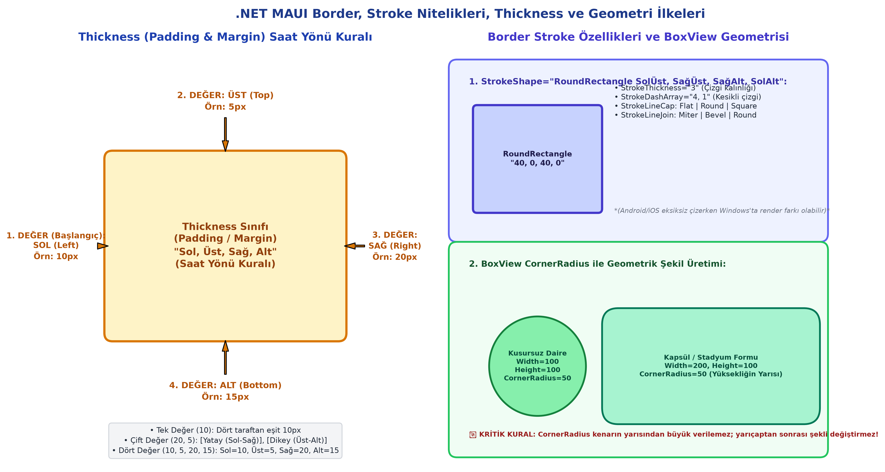

# Bölüm 05: Gelişmiş Arayüz Elemanları (Border, Stroke, BoxView, Seçim Kontrolleri)

---

## 🚨 HOCANIN VİZE SINAVI UYARILARI VE KRİTİK İPUÇLARI

> [!IMPORTANT]
> **Vize Sınavı Odakları ve Soru Tipleri:**
> * **`Thickness` Saat Yönü Kuralı:** `Padding="10, 5, 20, 15"` verildiğinde hangi sayının hangi kenarı temsil ettiği sınavın en popüler klasik sorularındandır:
>   * 1. Değer: **Sol (Left)**
>   * 2. Değer: **Üst (Top)**
>   * 3. Değer: **Sağ (Right)**
>   * 4. Değer: **Alt (Bottom)**
> * **`BoxView` ile Kusursuz Daire Üretme Formülü:** Kenar uzunlukları verilen bir `BoxView` bileşenini kusursuz bir daireye (circle) dönüştürmek için `CornerRadius` değerinin kenar uzunluğunun tam yarısı ($R = \frac{\text{Kenar}}{2}$) olması gerektiği matematiksel kuralı sorulur. Kenarın yarısından büyük değer verilmesinin şekli değiştirmeyeceği vurgulanmalıdır.
> * **`CheckBox` Mimari Kısıtı (Tuzak Soru):** .NET MAUI'de `CheckBox` kontrolünün doğrudan kendi üzerinde bir `Text` / başlık özelliği **yoktur**. Açıklama metni için yanına mutlaka bir `Label` eklenmeli ve ikisi `Grid` içine alınmalıdır.
> * **`ActivityIndicator` Otomatik Gizlenme Davranışı:** `IsRunning = false` yapıldığında kontrolün ekranda otomatik olarak gizlendiği; geliştiricinin ayrıca `IsVisible = false` yazmasına gerek olmadığı bilinmelidir.
> * **.NET MAUI Derleme Hataları:** Paket çakışmalarında veya Mono çalışma zamanı kilitlenmelerinde `bin` ve `obj` klasörlerinin silinip Rebuild yapılması çözümü sorulabilir.

---

## 1. Ergonomi, Donanım ve Derleme / Cache Çözümleri

* **Karpal Tünel Sendromu ve Dikey Fare:** Mobil yazılımcıların uzun süreli çalışma sağlığı için bilek hareketini dirseğe devreden ergonomik/dikey fareler tendon sıkışmalarını önler.
* **Derleme / Cache Hataları Çözüm Reçetesi:**
  Visual Studio'da temel sınıfların (`ContentPage`, `VerticalStackLayout` vb.) tanınmaması veya Mono runtime dağıtım hatalarında:
  1. Visual Studio kapatılır.
  2. Proje dizinindeki **`bin`** ve **`obj`** klasörleri tamamen silinir.
  3. Visual Studio açılarak **Build > Rebuild Solution** adımı uygulanır.

---

## 2. `ActivityIndicator` (Etkinlik / Yükleniyor Göstergesi)

Arka planda yürütülen uzun işlemlerde (veritabanı sorgusu, internetten indirme) kullanıcının cihazın donduğunu sanmasını önleyen döner halkadır (spinner).

```xml
<ActivityIndicator x:Name="indicatorBekle"
                   Color="#2563EB"
                   IsRunning="True" />
```

* **`IsRunning` (`bool`):** Animasyonun aktifliğini belirler.
  * `true`: Gösterge döner ve görünürdür.
  * `false`: Gösterge durur ve **ekranda otomatik olarak gizlenir**. Ekstra `IsVisible` yazılmasına gerek yoktur.
* **`Color`:** Göstergenin rengidir (Renk adı, Hex veya Alpha Hex).

---

## 3. `Border` (Çerçeve) Kontrolü ve Gelişmiş `Stroke` Mimarisi

İçerisindeki herhangi bir görseli, metni veya düzeni çevreleyen, köşe yarıçaplarını ve kenarlık çizgilerini biçimlendiren kapsayıcıdır.



```xml
<Border Stroke="#1E3A8A"
        StrokeThickness="3"
        StrokeShape="RoundRectangle 40, 0, 40, 0"
        StrokeDashArray="4, 1"
        Padding="15">
    <Label Text="Özel Tasarım Kart İçeriği"
           FontSize="16" />
</Border>
```

### A. Gelişmiş Kenarlık Nitelikleri Tablosu:
| Özellik | Tanım ve Kurallar |
| :--- | :--- |
| **`Stroke`** | Çerçeve çizgisinin fırça/renk tanımıdır (`Stroke="DarkRed"`). |
| **`StrokeThickness`** | Çizgi kalınlığıdır (piksel cinsinden, örn: `StrokeThickness="3"`). |
| **`StrokeShape`** | Çerçevenin formudur: `Rectangle` veya `RoundRectangle SolÜst, SağÜst, SağAlt, SolAlt`. 4 köşe için bağımsız yarıçap verilebilir (Örn: `RoundRectangle 40,0,40,0`). |
| **`StrokeDashArray`** | Kesikli/noktalı çizgi desenidir. Çizgi boyu ve boşluk boyu çiftler halinde yazılır (Örn: `4, 1` teknik çizgi deseni; `1, 1` eşit noktalı). |
| **`StrokeDashOffset`** | Kesikli çizgi deseninin başladığı piksel ofset kaydırmasıdır. |
| **`StrokeLineCap`** | Çizgilerin bitiş uç biçimidir: `Flat` (düz), `Round` (yuvarlak), `Square` (kare). |
| **`StrokeLineJoin`** | Köşelerin birleşim geometrisidir: `Miter` (sivri), `Bevel` (pah kırılmış), `Round` (yuvarlatılmış). |

---

## 4. `Thickness` Mantığı (Saat Yönü Kuralı)

`Padding` ve `Margin` boşluk değerleri `Thickness` sınıfından türetilir:

1. **Tek Değer (`10`):** Dört kenardan da eşit 10px boşluk bırakır.
2. **İki Değer (`20, 5`):** `[Yatay (Sol-Sağ)], [Dikey (Üst-Alt)]`.
3. **Dört Değer (`10, 5, 20, 15`):** Sol kenardan başlar ve **saat yönünde** ilerler:
   * **1. Değer:** Sol (Left) = 10px
   * **2. Değer:** Üst (Top) = 5px
   * **3. Değer:** Sağ (Right) = 20px
   * **4. Değer:** Alt (Bottom) = 15px

---

## 5. `BoxView` (Kutu / Çizim) Kontrolü ve Geometrik Şekil Üretimi

Ekrana renkli bir blok, ayırıcı çizgi veya geometrik şekil koymak için kullanılan temel çizim bileşenidir.

### A. Boyut Zorunluluğu
`BoxView` bileşenine `HeightRequest` ve `WidthRequest` değerleri **açıkça verilmezse ekranda görünmez**.

### B. Geometri Formülleri
* **Kusursuz Daire (Circle):**
  Kutu bir kare olmalıdır ($WidthRequest = HeightRequest$). `CornerRadius` değeri kenarın tam yarısı ($R = \frac{\text{Kenar}}{2}$) yapıldığında kusursuz bir daire elde edilir:
  ```xml
  <BoxView WidthRequest="100"
           HeightRequest="100"
           CornerRadius="50"
           Color="#10B981" />
  ```
* **Kapsül / Stadyum Formu:**
  Genişlik yükseklikten büyükse ($200 \times 100$) ve `CornerRadius` yüksekliğin yarısı ($50$) verilirse uçları tam yuvarlak yatay bir kapsül elde edilir.
* **Üst Sınır Kuralı:** `CornerRadius` değerini kenarın yarısından daha büyük yapmak şekli daha fazla değiştirmez; yarıçaptan sonrası işlevsizdir.

---

## 6. `CheckBox` (Onay Kutusu) Kontrolü

İki durumlu mantıksal (`true` / `false`) seçim bileşenidir.

```xml
<Grid ColumnDefinitions="Auto, *" ColumnSpacing="10">
    <CheckBox Grid.Column="0"
              x:Name="chkOnay"
              IsChecked="False"
              CheckedChanged="chkOnay_CheckedChanged" />
    <Label Grid.Column="1"
           Text="Kullanım şartlarını ve KVKK metnini okudum, onaylıyorum."
           VerticalOptions="Center" />
</Grid>
```

* **Etiket Kısıtı:** Kendi üzerinde metin özelliği bulunmadığından yanına mutlaka bir `Label` konulmalıdır.
* **C# ile Dinamik Renk Değişimi (`CheckedChanged`):**
  ```csharp
  private void chkOnay_CheckedChanged(object sender, CheckedChangedEventArgs e)
  {
      if (sender is CheckBox chk)
      {
          // İşaretli ise Yeşil, işaretsiz ise Kırmızı renk ata
          chk.Color = chk.IsChecked ? Color.FromRgb(0, 192, 0) : Color.FromRgb(255, 0, 0);
      }
  }
  ```

---

## 7. `Switch` (Açma / Kapama Anahtarı) Kontrolü

Mobilde kaydırmalı anahtar görünümüne sahip seçim bileşenidir.

```xml
<Switch x:Name="swtBildirim"
        IsToggled="True"
        OnColor="ForestGreen"
        OffColor="Silver"
        ThumbColor="White" />
```

* **XAML Renk Esnekliği:** `CheckBox`'ın aksine `Switch` renkleri (`OnColor`, `OffColor`, `ThumbColor`) C# koduna gerek kalmadan doğrudan XAML üzerinden kolayca tanımlanabilir.
* **Grid ile Hizalama:** Genellikle sol sütuna açıklama metni (`Label`), sağ sütuna (`Width="Auto"` veya `1*`) `Switch` yerleştirilerek ekran genişliğine göre esnek ve modern bir ayarlar menüsü düzeni kurulur.
