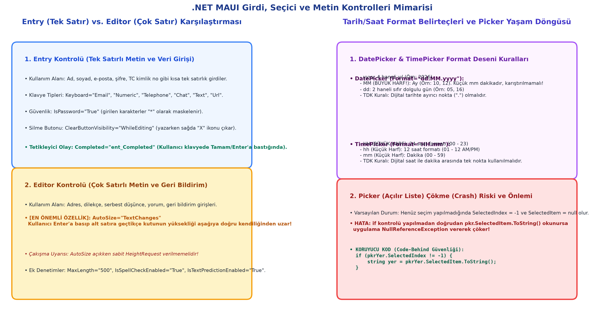

# Bölüm 06: Tarih/Saat Seçiciler, Açılır Listeler ve Çok Satırlı Editör

---

## 🚨 HOCANIN VİZE SINAVI UYARILARI VE KRİTİK İPUÇLARI

> [!IMPORTANT]
> **Vize Sınavı Odakları ve Soru Tipleri:**
> * **Vize Sınavı Formatı:** Hoca sınavın laboratuvarda bilgisayar başında değil; amfide/sınıfta **kağıt üzerinde klasik yazılı sınav** olarak yapılacağını netleştirmiştir. Kağıda elle XAML ve C# code-behind yazılacaktır.
> * **Tarih ve Saat Format Belirteçleri (Büyük/Küçük Harf Tuzağı):**
>   * `DatePicker`'da Ay için mutlaka **büyük `MM`** kullanılmalıdır; küçük `mm` saatin dakikasını (minute) temsil eder.
>   * `TimePicker`'da 24 saatlik format için **büyük `HH`**, 12 saatlik (AM/PM) format için **küçük `hh`** kullanılır.
>   * TDK ve yerel standartlara göre ayırıcı olarak tire veya iki nokta yerine **tek nokta (`.`)** tercih edilmelidir (`Format="dd.MM.yyyy"` ve `Format="HH.mm"`).
> * **`Picker` Çökme (Crash / NullReference) Riski:** Kullanıcı listeden bir seçim yapmadığında `SelectedIndex` değeri **`-1`** olur ve `SelectedItem` **`null`** döner. Eğer kodda doğrudan `.ToString()` çağrılırsa uygulama çöker. Sınavda bu denetimin `if (pkr.SelectedIndex != -1)` şeklinde yazılması zorunludur.
> * **`Editor.AutoSize` Davranışı:** `Editor` bileşeninin en can alıcı özelliği olan `AutoSize="TextChanges"` niteliğinin ne işe yaradığı (kullanıcı Enter'a bastıkça kutunun otomatik olarak aşağıya uzaması) ve bu özellik açıkken sabit `HeightRequest` verilmemesi kuralı sorulacaktır.
> * **`Entry` vs. `Editor`:** Tek satırlı veri (Ad, şifre, TC) için `Entry`, çok satırlı veri (Adres, serbest yorum, dilekçe) için `Editor` kullanımı karşılaştırılacaktır.

---

## 1. .NET MAUI Kontrol Ekosistemi Genel Haritası

İlerleyen haftalarda ve final müfredatında işlenecek genel kontrol mimarisi:

* **Veri Koleksiyonları:** `CollectionView`, `ListView`, `TableView`, `CarouselView` (veri dizilerini ve modelleri ekranda listeleyen bileşenler).
* **İlerleme ve Seçim:** `ProgressBar` (işlem yüzdesi), `RadioButton` (tekil seçim radyo butonları).
* **Kapsayıcılar:** `RefreshView` (çek-yenile / pull-to-refresh), `ScrollView` (kaydırma penceresi), `SwipeView` (sağa/sola kaydırınca buton açma), `TwoPaneView` (katlanabilir çift ekran).
* **Web:** `WebView` (web sayfası gömme).

---

## 2. `DatePicker` (Tarih Seçici) Kontrolü

Mobil işletim sisteminin yerel (native) takvim tekerleğini veya açılır takvim penceresini tetikleyen bileşendir.



```xml
<DatePicker x:Name="dtpTarih"
            MinimumDate="2026/12/15"
            MaximumDate="2026/12/29"
            Date="2026/12/16"
            Format="dd.MM.yyyy"
            FontSize="18"
            TextColor="#1E3A8A"
            Opened="dtpTarih_Opened"
            Closed="dtpTarih_Closed"
            DateSelected="dtpTarih_DateSelected" />
```

### A. Tarih Sınırları ve Varsayılan Değerler
* **`MinimumDate`:** Seçilebilecek alt sınır tarihtir.
* **`MaximumDate`:** Seçilebilecek üst sınır tarihtir.
  * *Varsayılan Aralık:* Kısıtlama verilmezse varsayılan aralık **1 Ocak 1900** ile **31 Aralık 2100** arasıdır.
  * *Mühendislik Senaryosu:* +18 yaş sınırı olan bir uygulamada doğum tarihi alınırken `MaximumDate`, bugünden tam 18 yıl öncesine (`DateTime.Today.AddYears(-18)`) sabitlenmelidir.
* **`Date`:** Takvim açıldığında seçili duran varsayılan tarihtir (Tarih yazımında karmaşayı önlemek için büyükten küçüğe `Yıl/Ay/Gün` biçimi önerilir).

### B. Format Belirleme Kuralları
* **`yyyy`:** 4 haneli yıl (`2026`).
* **`MM` (BÜYÜK HARF):** 2 haneli sıfır dolgulu ay (`01`, `12`). *(Küçük `mm` dakika ile karıştırılmamalıdır)*.
* **`dd`:** 2 haneli sıfır dolgulu gün (`05`, `28`).
* **Format Deseni:** `Format="dd.MM.yyyy"` şeklinde tanımlanır.

### C. Tetiklenen Olaylar (Events)
* **`Opened`:** Takvim açılır penceresi ekrana geldiğinde tetiklenir.
* **`Closed`:** Kullanıcı pencereyi kapattığında tetiklenir (tarih seçilse de seçilmese de çalışır).
* **`DateSelected`:** Kullanıcı yeni bir tarih seçip onayladığında tetiklenir.

---

## 3. `TimePicker` (Saat Seçici) Kontrolü

Kullanıcının zaman (saat ve dakika) seçmesini sağlayan yerel saat kadranı veya tekerlek kontrolüdür.

```xml
<TimePicker x:Name="tmpSaat"
            Time="09:15:00"
            Format="HH.mm"
            FontSize="18"
            TextColor="#1E3A8A" />
```

### A. Temel Özellikler ve Format Kuralları
* **`Time` (`TimeSpan`):** Seçilen zamanı `TimeSpan` türünden döndürür veya varsayılan saati belirler.
* **Format Belirteçleri:**
  * **`HH` (BÜYÜK HARF):** 24 saatlik askeri/uluslararası saat formatıdır (`00` – `23`).
  * **`hh` (Küçük Harf):** 12 saatlik AM/PM saat formatıdır (`01` – `12`).
  * **`mm` (Küçük Harf):** Dakikayı temsil eder (`00` – `59`).
  * *TDK Standardı:* Dijital saat yazımlarında iki nokta yerine **tek nokta (`.`)** kullanımı esastır (`Format="HH.mm"`).

---

## 4. `Picker` (Açılır Liste / Dropdown / ComboBox)

Kullanıcıya belirli seçenekler arasından tek bir tercih yaptırmak için kullanılır.

### A. XAML İçerisinde Statik Dizi Tanımlama (`x:Array`)
Veri kaynağı henüz veritabanına veya modele bağlanmamışken XAML içinde statik liste şu şekilde kurulur:

```xml
<Picker x:Name="pkrYer"
        Title="Lütfen sunum yerini seçiniz..."
        TitleColor="Gray"
        FontSize="16"
        HorizontalTextAlignment="Center">
    <Picker.ItemsSource>
        <x:Array Type="{x:Type x:String}">
            <x:String>Bilgisayar Laboratuvarı</x:String>
            <x:String>Büyük Amfi</x:String>
            <x:String>Konferans Salonu</x:String>
        </x:Array>
    </Picker.ItemsSource>
</Picker>
```

### B. Seçim Değerleri ve Çökme (Crash) Riski
* **`Title`:** Liste açılmadan önce ekranda silik olarak duran yer tutucu ipucu metnidir.
* **`SelectedItem`:** Seçilen nesneyi (`object`) döndürür.
* **`SelectedIndex`:** Seçili elemanın $0$'dan başlayan sıra numarasıdır.
* **🚨 KRİTİK GÜVENLİK KODU:**
  Eğer kullanıcı henüz bir seçim yapmamışsa `SelectedIndex` değeri **`-1`** ve `SelectedItem` **`null`** olur. Doğrudan okunmaya çalışılırsa uygulama çöker. Bu sebeple daima kontrol edilmelidir:
  ```csharp
  if (pkrYer.SelectedIndex != -1)
  {
      string secilenYer = pkrYer.SelectedItem.ToString();
      int siraNo = pkrYer.SelectedIndex;
  }
  else
  {
      await DisplayAlert("Uyarı", "Lütfen bir seçim yapınız!", "Tamam");
  }
  ```

---

## 5. `Editor` (Çok Satırlı Metin Girişi) Kontrolü

Adres, serbest yorum, dilekçe, açıklama gibi uzun metinlerin girildiği editördür.

```xml
<Editor x:Name="edtDusunceler"
        Placeholder="Lütfen geri bildirimlerinizi buraya yazınız..."
        PlaceholderColor="Navy"
        FontSize="16"
        AutoSize="TextChanges"
        MaxLength="1000"
        IsSpellCheckEnabled="True"
        IsTextPredictionEnabled="True"
        Keyboard="Chat" />
```

### A. En Kritik Özellik: `AutoSize="TextChanges"`
* **Varsayılan Durum (`Disabled`):** Editör sabit bir yükseklikte kalır, satırlar çoğaldıkça kutu içinde kaydırma (scroll) oluşur.
* **`AutoSize="TextChanges"`:** **Kullanıcı her Enter tuşuna basıp yeni satıra geçtikçe veya metin uzadıkça, editörün dikey yüksekliği aşağıya doğru kendiliğinden uzar.**
* *Mühendislik Uyarısı:* `AutoSize="TextChanges"` açıkken kutunun dikey uzamasını engellememek için sabit `HeightRequest` verilmemelidir!

---

## 6. Sınıf İçi Kapsamlı Proje: "Proje Sunumu Oylama ve Geri Bildirim Formu"

Tüm bu girdi kontrollerini bir araya getiren, hata denetimli tam sayfa mimarisi:

### XAML (`MainPage.xaml`):
```xml
<ScrollView>
    <VerticalStackLayout Spacing="15" Padding="20">

        <Label Text="Ders Projesi Sunum Oylama Paneli"
               FontSize="22"
               FontAttributes="Bold"
               TextColor="#1E3A8A"
               HorizontalTextAlignment="Center" />

        <!-- 1. Tarih Seçici -->
        <Label Text="Sunum Tarihi Seçiniz:" FontAttributes="Bold" />
        <DatePicker x:Name="dtpTarih"
                    Date="2026/12/20"
                    MinimumDate="2026/12/15"
                    MaximumDate="2026/12/30"
                    Format="dd.MM.yyyy"
                    FontSize="16"
                    TextColor="#1D4ED8" />

        <!-- 2. Saat Seçici -->
        <Label Text="Sunum Saati Seçiniz:" FontAttributes="Bold" />
        <TimePicker x:Name="tmpSaat"
                    Time="10:00:00"
                    Format="HH.mm"
                    FontSize="16"
                    TextColor="#1D4ED8" />

        <!-- 3. Yer Seçici (Picker) -->
        <Label Text="Sunum Yeri Seçiniz:" FontAttributes="Bold" />
        <Picker x:Name="pkrYer"
                Title="Lütfen bir salon seçiniz..."
                FontSize="16">
            <Picker.ItemsSource>
                <x:Array Type="{x:Type x:String}">
                    <x:String>Yazılım Laboratuvarı 1</x:String>
                    <x:String>Mühendislik Amfisi 2</x:String>
                    <x:String>Merkezi Konferans Salonu</x:String>
                </x:Array>
            </Picker.ItemsSource>
        </Picker>

        <!-- 4. Çok Satırlı Açıklama (Editor) -->
        <Label Text="Proje Hakkındaki Görüşleriniz:" FontAttributes="Bold" />
        <Editor x:Name="edtYorum"
                Placeholder="Düşüncelerinizi buraya yazabilirsiniz..."
                AutoSize="TextChanges"
                MaxLength="500"
                FontSize="15" />

        <!-- Gönder Butonu -->
        <Button x:Name="btnGonder"
                Text="Oylamayı Kaydet"
                Clicked="btnGonder_Clicked"
                BackgroundColor="#1E40AF"
                TextColor="White"
                HeightRequest="50"
                CornerRadius="25"
                Margin="0, 15, 0, 0" />

    </VerticalStackLayout>
</ScrollView>
```

### C# Code-Behind (`MainPage.xaml.cs`):
```csharp
namespace MobilDers06;

public partial class MainPage : ContentPage
{
    public MainPage()
    {
        InitializeComponent();
    }

    private async void btnGonder_Clicked(object sender, EventArgs e)
    {
        // 1. Tarih ve Saat Okuma
        string secilenTarih = dtpTarih.Date.ToString("dd.MM.yyyy");
        string secilenSaat = tmpSaat.Time.ToString(@"hh\:mm");

        // 2. Picker Seçim Kontrolü (Crash Önleme)
        if (pkrYer.SelectedIndex == -1)
        {
            await DisplayAlert("Eksik Bilgi", "Lütfen bir sunum salonu seçiniz!", "Tamam");
            pkrYer.Focus();
            return;
        }
        string secilenYer = pkrYer.SelectedItem.ToString();

        // 3. Editor Metin Kontrolü
        string yorum = string.IsNullOrWhiteSpace(edtYorum.Text) ? "Belirtilmedi" : edtYorum.Text;

        // 4. Sonuç Özeti
        string ozetMesaj = $"Tarih: {secilenTarih}\n" +
                           $"Saat: {secilenSaat}\n" +
                           $"Yer: {secilenYer}\n" +
                           $"Görüş: {yorum}";

        await DisplayAlert("Oyunuz Kaydedildi", ozetMesaj, "Harika");
    }
}
```
