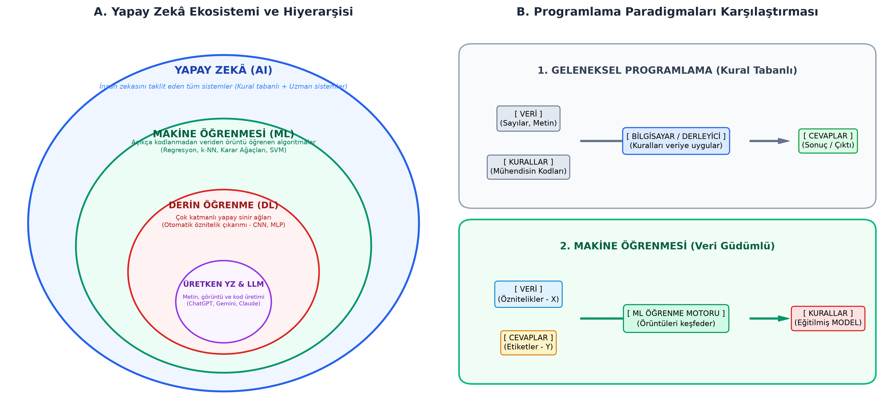

# Bölüm 01: Yapay Zekâya Giriş, Tarihçe ve Temel Paradigmalar

---

## 🚨 HOCANIN VİZE SINAVI UYARILARI VE KRİTİK İPUÇLARI

> [!IMPORTANT]
> **Ders Sorumlusu: Dr. Seda Bayat Tosun**
> * **Sınav Formatı ve Soru Sayısı:** Vize sınavı bilgisayar başında kod yazma şeklinde **değildir**. Test (çoktan seçmeli) formatında yaklaşık **20 soru** olarak planlanmıştır. Kod yazımı kesinlikle sorulmayacaktır.
> * **Sorumluluk Kapsamı:** Sadece **ilk 8-9 haftanın** konularından sorumlusunuz.
> * **Zorluk Düzeyi:** Sınav "A, B, C deyip takır takır geçilecek" kadar basit olmayacak; kavramların ardındaki mimari mantığı, neden-sonuç ilişkilerini ve temel matematiksel hesapları ölçen **orta-şekerli, düşündürücü** bir test olacaktır.
> * **Kesin Çıkacak Teorik Konular:**
>   - **Turing Testi:** 1950 Alan Turing "Makineler düşünebilir mi?", taklit oyunu mantığı.
>   - **YZ Hiyerarşisi:** $YZ \supset ML \supset DL \supset Üretken\ YZ$ iç içe küme ilişkisi.
>   - **Geleneksel Programlama vs. Makine Öğrenmesi:** Girdiler ve çıktıların yer değiştirmesi.
>   - **Derin Öğrenmeyi Başlatan 3 Etken:** Büyük Veri, GPU'lar (paralel matris çarpımı), Algoritmik Gelişmeler (ReLU, optimizasyon).
>   - **Mitchell'in ML Tanımı:** Görev ($T$), Deneyim ($E$), Performans Ölçütü ($P$) üçlüsü.
>   - **PEAS Modeli:** Performans ($P$), Ortam/Environment ($E$), Eyleyiciler/Actuators ($A$), Algılayıcılar/Sensors ($S$).
>   - **Veri Gizliliği ve İnsan Faktörü:** "Fiş hâlâ bizim elimizde" prensibi.

---

## 1. Yapay Zekânın Tanımı ve "Zekâ" Kavramı

Zekâ; akıl yürütme, problem çözme, karar verme, genelleme yapma ve deneyimlerden öğrenerek yeni durumlara uyum sağlama yeteneğidir. 

**Yapay Zekâ (Artificial Intelligence - AI):** İnsan zekâsına özgü bu bilişsel işlevleri algoritmalar, matematiksel modeller ve bilgisayar sistemleri aracılığıyla taklit etme bilimidir.

Russell ve Norvig (*Artificial Intelligence: A Modern Approach*) yapay zekâ yaklaşımlarını 4 temel boyutta sınıflandırır:
1. **İnsan Gibi Düşünen Sistemler:** Bilişsel modelleme ve insan beyninin düşünce süreçlerinin taklidi.
2. **İnsan Gibi Davranan Sistemler:** Turing Testi yaklaşımı (dışarıdan bakıldığında insandan ayırt edilemeyen davranış).
3. **Akılcı (Rasyonel) Düşünen Sistemler:** Mantık kuralları, çıkarım mekanizmaları (*Laws of Thought*).
4. **Akılcı (Rasyonel) Davranan Sistemler:** Rasyonel Ajan (Rational Agent) yaklaşımı; verilen hedefe ulaşmak için beklenen başarıyı maksimize eden eylemleri seçme.

---

## 2. Turing Testi: Makineler Düşünebilir mi?

1950 yılında İngiliz matematikçi ve bilgisayar biliminin babası **Alan Turing**, *"Computing Machinery and Intelligence"* başlıklı çığır açıcı makalesinde şu soruyu sormuştur: **"Makineler düşünebilir mi?"**

Düşünmenin soyut ve felsefi tanımıyla vakit kaybetmek yerine operasyonel bir kriter önermiştir: **Taklit Oyunu (The Imitation Game / Turing Testi)**.

```
       [ Sorgulayıcı (C) - İnsan Hakem ]
                    │
         ┌──────────┴──────────┐
         │ (Yazılı İletişim)   │
         ▼                     ▼
    [ Oda A: İnsan ]     [ Oda B: Makine (YZ) ]
```

* **Testin Kuralı:** Sorgulayıcı (insan hakem), görmediği iki ayrı oda ile yalnızca klavye/ekran üzerinden yazılı metinle iletişim kurar. Taraflardan biri insan, diğeri yapay zekâ programıdır.
* **Başarı Kriteri:** Eğer sorgulayıcı, aldığı cevaplara bakarak hangisinin insan hangisinin makine olduğunu istatistiksel olarak güvenilir bir biçimde ayırt edemiyorsa (%50 rastgele tahmin seviyesine düşüyorsa), makine **Turing Testi'ni geçmiş ve düşünebilme yetisine sahip kabul edilir**.

---

## 3. Yapay Zekâ Türleri: Dar, Genel ve Süper YZ

| Tür | İngilizce Karşılığı | Açıklama ve Kapsam | Günümüzdeki Durumu |
| :--- | :--- | :--- | :--- |
| **Dar (Zayıf) YZ** | *Narrow / Weak AI* | Yalnızca tanımlanmış tek bir görevde veya dar bir problem alanında uzmanlaşmış sistemlerdir. Başka bir alana akıl yürütemez. | **GÜNÜMÜZDE MEVCUT.** (Satranç motorları, AlphaGo, yüz tanıma, spam filtresi, otonom sürüş şerit takibi). |
| **Genel (Güçlü) YZ** | *General / Strong AI (AGI)* | İnsan zihni gibi farklı disiplinlerde öğrenebilen, edindiği bilgiyi yeni problemlere transfer edebilen ve bağımsız akıl yürüten sistemler. | **GELİŞTİRİLME AŞAMASINDA.** (Çok modlu LLM'ler ve otonom yazılım ajanları AGI'ye giden köprüdür). |
| **Süper YZ** | *Superintelligence (ASI)* | İnsan beyninin bilimsel, sanatsal, yaratıcı ve pratik zekâsını her alanda katbekat aşan varsayımsal zekâ seviyesi. | **VARSAYIMSAL / TEORİK.** Felsefi ve etik güvenlik tartışmalarının odağıdır. |

---

## 4. Yapay Zekâ Ekosisteminin Hiyerarşisi

Yapay zekâ, makine öğrenmesi ve derin öğrenme kavramları eş anlamlı değildir; birbirini kapsayan iç içe kümelerden oluşur.



1. **Yapay Zekâ (AI - En Geniş Küme):** Kural tabanlı uzman sistemler (*expert systems*), mantıksal arama algoritmaları ($A^*$, Minimax) ve öğrenen tüm yaklaşımları kapsar.
2. **Makine Öğrenmesi (ML - Alt Küme):** Açık kurallar yazılmadan, algoritmaların doğrudan verilerden istatistiksel örüntüleri öğrenerek kendini geliştirdiği alandır.
3. **Derin Öğrenme (DL - ML'nin Alt Kümesi):** Çok katmanlı yapay sinir ağlarını (Artificial Neural Networks) kullanan yaklaşımdır. Ham veriden (piksel, ses dalgası) **kendi kendine hiyerarşik öznitelik çıkarımı (representation learning)** yapar.
4. **Üretken YZ ve LLM (GenAI - DL'nin Çekirdeği):** Yalnızca sınıflandırma veya tahminle yetinmeyip, sıfırdan yeni ve özgün metin, görsel, ses ve kod üreten derin üretken mimarilerdir (Transformer, GPT, Gemini, Claude, Diffusion modelleri).

---

## 5. Geleneksel Programlama ile Makine Öğrenmesi Arasındaki Paradigma Farkı

* **Geleneksel Yazılım Geliştirme (Kural Tabanlı Yaklaşım):**
  $$\text{Veri} + \text{Kurallar (Mühendisin Kodladığı Mantık)} \implies \text{Cevaplar}$$
  * Mühendis tüm olasılıkları, kenar durumları (*edge cases*) zihninde kurgulamak ve `if-else` bloklarıyla yazmak zorundadır.
  * *Neden Tıkandı?* Spam filtreleme veya kedi tanıma probleminde trilyonlarca varyasyon vardır. Dolandırıcılar kelimeyi değiştirdiğinde (`b.e.d.a.v.a`) kural çöker.

* **Makine Öğrenmesi Yaklaşımı (Veri Güdümlü Yaklaşım):**
  $$\text{Veri} + \text{Cevaplar (Etiketler / Doğru Çıktılar)} \implies \text{Kurallar (Eğitilmiş Model)}$$
  * Mühendis kuralları elle yazmaz. Veri ve etiketler algoritmaya verilir; algoritma verideki istatistiksel bağıntıları optimize ederek kuralları (ağırlıkları ve bias değerlerini) kendi keşfeder.

---

## 6. Tom Mitchell'in Makine Öğrenmesi Tanımı

Makine öğrenmesi literatürünün en saygın matematiksel tanımı 1997 yılında Tom Mitchell tarafından yapılmıştır:

> **Mitchell Tanımı:**
> Bir bilgisayar programının bir **$T$ görevler kümesindeki** başarımı, **$P$ performans ölçütü** ile ölçüldüğünde; eğer programın bu görevlerdeki başarımı geçmiş **$E$ deneyimleri** ile artıyorsa, bu program öğreniyor demektir.

$$\text{Öğrenme} \iff \text{Deneyim (E) arttıkça Görevdeki (T) Başarım (P) artar.}$$

### Sınavda Çıkabilecek Örnek Mitchell Eşleştirmeleri:

1. **E-Posta Spam Filtresi:**
   * **Görev ($T$):** Gelen yeni bir e-postayı "Spam" veya "Normal (Ham)" olarak sınıflandırmak.
   * **Deneyim ($E$):** Kullanıcıların geçmişte spam olarak işaretlediği binlerce etiketli e-posta veritabanı.
   * **Performans ($P$):** Doğru sınıflandırılan e-postaların yüzdesi (Doğruluk / Accuracy veya F1 Skoru).

2. **Dama / Satranç Oynayan Yapay Zekâ:**
   * **Görev ($T$):** Dama tahtasında bir sonraki en iyi hamleyi oynamak.
   * **Deneyim ($E$):** Programın kendi kendine oynadığı veya geçmişte oynanmış milyonlarca maç kaydı.
   * **Performans ($P$):** Rakiplere karşı kazanılan maçların yüzdesi.

---

## 7. Ajan, Çevre ve PEAS Modeli

Yapay zekâda bir **Ajan (Agent)**; çevresini **algılayıcılar (sensors)** yardımıyla algılayan ve **eyleyiciler (actuators)** yardımıyla çevre üzerinde eylemlerde bulunan bir varlıktır.

Bir ajanın tasarımı **PEAS** kısaltmasıyla incelenir:

| Bileşen | Anlamı | Otonom Taksi Örneği | Tıbbi Teşhis Sistemi Örneği |
| :--- | :--- | :--- | :--- |
| **P** (*Performance*) | **Performans Ölçütü** | Güvenlik, hız, yolcu konforu, yakıt tasarrufu, trafik cezası yememe. | Doğru teşhis oranı, maliyetin azlığı, yanlış alarmın düşüklüğü. |
| **E** (*Environment*) | **Ortam / Çevre** | Şehir içi yollar, yayalar, diğer araçlar, hava ve ışık koşulları. | Hasta, hastane personeli, laboratuvar sonuçları, tıbbi geçmiş. |
| **A** (*Actuators*) | **Eyleyiciler** | Direksiyon, gaz pedalı, fren, vites, sinyal lambaları, korna. | Ekran çıktısı (reçete önerisi), test istem formu, alarm zili. |
| **S** (*Sensors*) | **Algılayıcılar** | Kameralar, LiDAR, Radar, ultrasonik sensörler, GPS, hız göstergesi. | Klavye girdisi, kan tahlili cihazı sinyali, röntgen/MR tarayıcısı. |

---

## 8. Derin Öğrenme Devrimini Mümkün Kılan Üç Temel Etken

1980'lerden beri yapay sinir ağlarının teorisi bilinmesine rağmen derin öğrenmenin 2012'den (AlexNet) itibaren patlamasının arkasında 3 somut itici güç yatar:

1. **Büyük Veri (Big Data):** İnternet, akıllı cihazlar ve dijitalleşme sayesinde modelleri eğitebilecek milyonlarca etiketli veri (örneğin 14 milyon etiketli görsel barındıran ImageNet) elde edildi.
2. **Hesaplama Gücü ve GPU'lar (Hardware Acceleration):** Grafik işlem birimleri (NVIDIA GPU'ları), binlerce çekirdeğiyle yapay sinir ağlarının temelini oluşturan **paralel matris çarpımlarını** CPU'lara kıyasla yüzlerce kat hızlı gerçekleştirerek haftalar süren eğitimleri saatlere indirdi.
3. **Algoritmik İlerlemeler:** Kaybolan gradyan sorununu çözen **ReLU aktivasyon fonksiyonu**, aşırı öğrenmeyi engelleyen **Dropout**, ağırlık normalizasyon teknikleri ve adaptif optimizasyon algoritmaları (Adam, RMSProp).

---

## 9. Yapay Zekâda Veri Gizliliği, İnsan Faktörü ve Mühendislik Sorumluluğu

> [!NOTE]
> **Dr. Seda Bayat Tosun'un Dersteki Vurgusu:**
> "LLM sistemlerine girdiğiniz promptlar, projeler ve mahrem veriler arka planda RLHF (insan geri bildirimiyle takviyeli öğrenme) ekipleri ve veri denetçileri tarafından incelenip puanlanabilir. Tam bir veri gizliliği varsayımıyla hareket edilmemelidir.
> Ancak unutmayın: **Fiş hâlâ bizim elimizdedir.** Bu sistemlerin mimarisini çizen, veri kümesini temizleyen, modelin hata payını denetleyen ve emniyet sınırlarını çizen biz bilgisayar ve yazılım mühendisleriyiz. Yapay zekâyı tüm düşünme yetinizi devredeceğiniz bir büyücü değil; işinizi hızlandıran bir **asistan** olarak konumlandırmalısınız."

---

## 10. Özet ve Modül Kontrol Listesi

- [x] Alan Turing, Turing Testi ve Taklit Oyunu mantığını kavradım.
- [x] Dar (Weak), Genel (Strong/AGI) ve Süper (ASI) yapay zekâ ayrımını biliyorum.
- [x] $YZ \supset ML \supset DL \supset Üretken\ YZ$ hiyerarşisini ve kümelerin işlevini öğrendim.
- [x] Geleneksel programlama ($Veri + Kural \rightarrow Cevap$) ile ML ($Veri + Cevap \rightarrow Model$) arasındaki farkı açıklayabiliyorum.
- [x] Mitchell tanımındaki Görev ($T$), Deneyim ($E$) ve Performans ($P$) bileşenlerini eşleştirebiliyorum.
- [x] PEAS modelini otonom sistemlere uygulayabiliyorum.
- [x] Derin öğrenme devriminin 3 temel ayağını (Veri, GPU, Algoritma) ezberledim.
