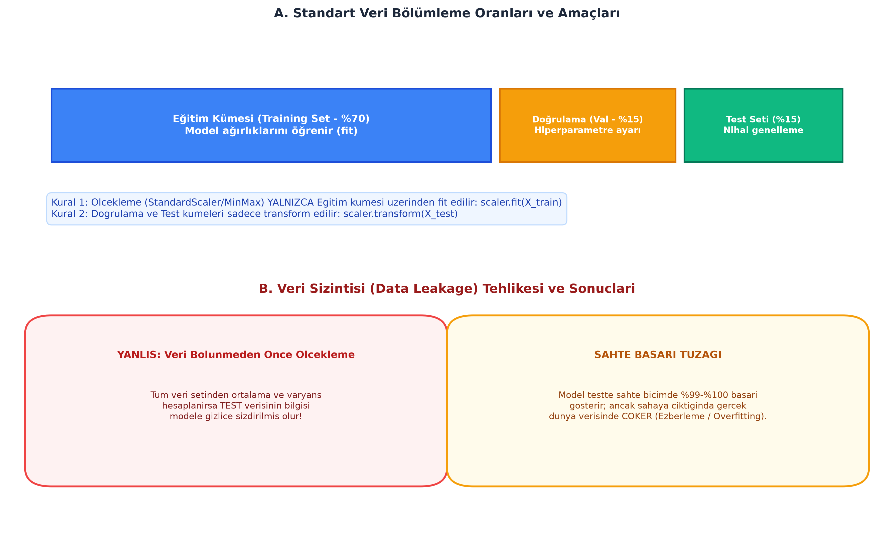

# Bölüm 02: Makine Öğrenmesinin Temelleri, Yaşam Döngüsü ve Veri Ön İşleme

---

## 🚨 HOCANIN VİZE SINAVI UYARILARI VE KRİTİK İPUÇLARI

> [!IMPORTANT]
> **Vize Sınavı Odak Noktaları:**
> * **Öğrenme Türü Eşleştirme Sorusu:** Verilen senaryonun Denetimli (Sınıflandırma/Regresyon), Denetimsiz (Kümeleme) mi yoksa Pekiştirmeli mi olduğu sorulur.
> * **Veri Bölümleme ve Görevleri:** Eğitim (%70), Doğrulama (%15), Test (%15) kümelerinin rolleri.
> * **BANKO SORU - Veri Sızıntısı (Data Leakage):** Veri bölünmeden önce tüm veri setine ölçekleme (StandardScaler/MinMaxScaler) veya medyan doldurma uygulanması klasik bir veri sızıntısıdır. Modelin test verisinin ortalamasını gizlice öğrenip sınavda sahte %99 başarı göstermesine yol açar.
> * **Sayısal Normalizasyon Sorusu:** $x' = \frac{x - x_{min}}{x_{max} - x_{min}}$ formülü ile elle hesaplama sorulabilir (Örn: $x_{min}=20, x_{max}=80, x=35 \implies x'=0.25$).
> * **Label Encoding vs. One-Hot Encoding:** Şehir isimlerine 0, 1, 2 verildiğinde ortaya çıkan yapay büyüklük-küçüklük sıralaması tuzağı.

---

## 1. Makine Öğrenmesi Yöntemleri ve Taksonomisi

Makine öğrenmesi algoritmaları, verinin etiketlenme biçimine ve öğrenme mekanizmasına göre 4 ana kategoride incelenir:

```
[ Makine Öğrenmesi Yöntemleri ]
  ├── 1. Denetimli Öğrenme (Supervised Learning)   -> Etiketler (y) MEVCUTTUR
  │     ├── A. Sınıflandırma (Classification)       -> Kesikli / Kategorik çıktı (0/1, Kedi/Köpek)
  │     └── B. Regresyon (Regression)               -> Sürekli / Sayısal çıktı (Fiyat, Sıcaklık)
  ├── 2. Denetimsiz Öğrenme (Unsupervised Learning) -> Etiket YOKTUR, örüntü aranır
  │     ├── A. Kümeleme (Clustering)                -> K-Means, DBSCAN
  │     └── B. Boyut İndirgeme (Dim. Reduction)     -> PCA (Principal Component Analysis)
  ├── 3. Pekiştirmeli Öğrenme (Reinforcement)       -> Ajan, Çevre, Ödül/Ceza (RLHF, AlphaGo)
  └── 4. Yarı / Öz Denetimli Öğrenme (Self-Supervised) -> Az etiketli + çok etiketsiz veri
```

### A. Denetimli Öğrenme (Supervised Learning)
Sisteme girdi öznitelikleri ($X$) ile birlikte doğru hedef etiketler ($y$) verilir. Model $f(X) \approx y$ fonksiyonunu öğrenir.
* **Sınıflandırma:** Çıktı kesikli sınıflardır (Kanser var/yok, Spam/Normal, Kredi verilebilir/verilemez).
* **Regresyon:** Çıktı sürekli sayısal bir skalerdir (İstanbul'da 100 $m^2$ bir evin kira bedeli, hisse senedi kapanış fiyatı).

### B. Denetimsiz Öğrenme (Unsupervised Learning)
Veri setinde hiçbir hedef etiket ($y$) yoktur; yalnızca öznitelikler ($X$) mevcuttur. Algoritma verideki doğal gruplanmaları, anomalileri veya gizli yapıları bulur.
* **Kümeleme (Clustering):** Müşteri segmentasyonu (harcama alışkanlıklarına göre müşterileri 3 gruba ayırma).
* **Boyut İndirgeme (Dimensionality Reduction):** 100 farklı özniteliği, en yüksek varyansı koruyarak 2 veya 3 temel bileşene indirgeme (PCA).

### C. Pekiştirmeli Öğrenme (Reinforcement Learning - RL)
Bir **Ajan (Agent)**, belirli bir **Ortamda (Environment)** eylemlerde bulunur. Hedefe yaklaştıran doğru hareketler için **Ödül (+)**, hatalı hareketler için **Ceza (-)** alır. Deneme-yanılma yoluyla kümülatif ödülü maksimize eden politikayı (*Policy*) öğrenir.
* **Kullanım Alanları:** Otonom araç park etme, robotik kol kontrolü, satranç/Go oyunları, LLM'lerin insan geri bildirimiyle hizalanması (**RLHF**).

---

## 2. Bir Makine Öğrenmesi Projesinin Yaşam Döngüsü

1. **Problemin Tanımlanması ve Hedefin Belirlenmesi:** İş probleminin sınıflandırma, regresyon veya kümeleme olarak formüle edilmesi.
2. **Veri Toplama ve İnceleme:** Eksik değerlerin, aykırı değerlerin (outliers) tespiti.
3. **Veri Bölümleme (Train / Validation / Test):** *Veri sızıntısını engellemek için tüm ön işleme adımlarından önce yapılmalıdır!*
4. **Veri Ön İşleme ve Öznitelik Mühendisliği:** Eksik verilerin doldurulması, ölçekleme, kodlama.
5. **Model Eğitimi (Training):** Uygun algoritmanın seçilmesi ve eğitim kümesinde ağırlıkların optimizasyonu.
6. **Model Doğrulama ve Hiperparametre Ayarı (Validation):** Öğrenme oranı, derinlik, katsayı ayarları.
7. **Nihai Test ve Değerlendirme (Testing):** Modelin gerçek hayattaki performansının tarafsız ölçümü.
8. **Yayına Alma (Deployment) ve İzleme (Monitoring):** Model kayması (Data/Concept Drift) kontrolü.

---

## 3. Veri Bölümleme ve Veri Sızıntısı (Data Leakage) Tehlikesi



### A. Veri Bölümleme Standartları

* **Eğitim Kümesi (Training Set - %70-80):** Modelin öğrenilebilir parametrelerini (ağırlık $w$ ve bias $b$) optimize ettiği ana veri kümesidir.
* **Doğrulama Kümesi (Validation Set - %10-15):** Hiperparametre optimizasyonu (örneğin k-NN'deki $k$ değeri, öğrenme oranı, katman sayısı) ve aşırı öğrenmeyi izlemek için kullanılır.
* **Test Kümesi (Test Set - %15-20):** Modelin geliştirme sürecinde **asla görmediği**, yalnızca proje sonunda nihai raporlama için tek seferlik kullanılan bağımsız kümedir.

### B. Veri Sızıntısı (Data Leakage) Nedir?

> [!CAUTION]
> **En Büyük Mühendislik Hatası:**
> Eğer test kümesine ait istatistiksel bilgiler (ortalama, standart sapma, en büyük/en küçük değer veya hedef etiket bilgisi) eğitim sürecine sızarsa buna **Veri Sızıntısı (Data Leakage)** denir.

* **Tipik Sızıntı Senaryosu:** Bir mühendisin veriyi bölmeden önce tüm veri setine `StandardScaler().fit_transform(X)` uygulamasıdır. Test kümesinin ortalaması ve varyansı eğitim kümesine sızdığı için model testte sahte olarak %99-%100 doğruluk verir. Ancak model sahaya (canlıya) alındığında gerçek dünyada **büyük bir başarısızlıkla çöker**.
* **Altın Kural:**
  ```python
  # DOĞRU İŞ AKIŞI:
  scaler = StandardScaler()
  X_train_scaled = scaler.fit_transform(X_train)  # SADECE TRAIN'DEN ÖĞREN!
  X_val_scaled = scaler.transform(X_val)          # SADECE DÖNÜŞTÜR
  X_test_scaled = scaler.transform(X_test)        # SADECE DÖNÜŞTÜR
  ```

---

## 4. Aşırı Öğrenme (Overfitting) ve Eksik Öğrenme (Underfitting)

| Durum | Belirti | Neden | Çözüm Yolları |
| :--- | :--- | :--- | :--- |
| **Eksik Öğrenme (Underfitting)** | Hem Eğitim Hatası YÜKSEK, hem Test Hatası YÜKSEK. | Model verideki örüntüyü yakalayamayacak kadar basittir (Yüksek Yanlılık / High Bias). | Modeli karmaşıklaştırmak, yeni öznitelikler eklemek, eğitimi uzatmak. |
| **İdeal Öğrenme (Good Fit)** | Eğitim Hatası DÜŞÜK, Test Hatası DÜŞÜK. | Model verideki gerçek örüntüyü genellemiştir. | İdeal durum; model korunur. |
| **Aşırı Öğrenme (Overfitting)** | Eğitim Hatası ÇOK DÜŞÜK (%99-100), Test Hatası ÇOK YÜKSEK. | Model eğitim verisindeki rastgele gürültüyü ezberlemiştir (Yüksek Varyans / High Variance). | Daha fazla veri toplamak, **Veri Artırma (Data Augmentation)**, **Dropout**, **Erken Durdurma (Early Stopping)**, L1/L2 Regülarizasyon. |

---

## 5. Veri Ön İşleme (Data Preprocessing) Teknikleri

### A. Eksik Verilerin Doldurulması (Imputation)
Veri setinde `NaN` / boş değerler bulunması durumunda satır silmek yerine doldurma tercih edilir:
* **Sayısal Değişkenler:**
  * **Ortalama (Mean):** Normal dağılıma sahip verilerde kullanılır.
  * **Medyan (Ortanca):** Aykırı değerler (*outliers*) içeren çarpık dağılımlarda tercih edilir (Örn: Maaş verisinde birkaç kişinin 1 milyon TL kazanması ortalamayı bozar, medyan kararlıdır).
* **Kategorik Değişkenler:**
  * **Mod (En Sık Tekrar Eden Değer):** En yaygın sınıfla doldurulur.

### B. Öznitelik Ölçekleme (Feature Scaling)
Mesafe temelli algoritmalar (k-NN, K-Means, SVM) ve gradyan inişi kullanan yapay sinir ağları büyük sayısal aralığa sahip özniteliklerin baskısı altında kalır (Örn: Yaş: 20-60 aralığında iken Gelir: 10.000-100.000 TL aralığındadır).

1. **Min-Maks Normalizasyonu (Min-Max Scaling):** Veriyi $[0, 1]$ aralığına sıkıştırır:
   $$x' = \frac{x - x_{min}}{x_{max} - x_{min}}$$
   * *Örnek Sınav Sorusu:* Bir öznitelikte $x_{min} = 20$, $x_{max} = 80$ ise $x = 35$ değerinin normalize edilmiş hali:
     $$x' = \frac{35 - 20}{80 - 20} = \frac{15}{60} = 0.25$$

2. **Standardizasyon (Z-Skoru / Standard Scaling):** Verinin ortalamasını 0, standart sapmasını 1 yapar:
   $$z = \frac{x - \mu}{\sigma}$$
   * Aykırı değerlere karşı min-maks normalizasyonuna göre çok daha dirençlidir.

### C. Kategorik Verilerin Kodlanması (Encoding)

1. **Etiket Kodlama (Label Encoding):**
   * Her kategoriye rastgele bir tamsayı atar: `Kırmızı = 0, Yeşil = 1, Mavi = 2`.
   * **BÜYÜK TUZAK:** Nominal (sırasız) değişkenlerde matematiksel model `Mavi (2) > Kırmızı (0)` şeklinde yapay bir büyüklük veya sıralama ilişkisi varsayar. Yalnızca doğal sıralaması olan ordinal verilerde (Örn: `İlkokul=0, Lise=1, Üniversite=2`) kullanılmalıdır.
2. **One-Hot Encoding (Bire Bir Kodlama):**
   * Her benzersiz kategori için ayrı bir ikili (binary) sütun açar.
   * `[Kırmızı, Yeşil, Mavi]` $\implies$ Kırmızı: `[1, 0, 0]`, Yeşil: `[0, 1, 0]`, Mavi: `[0, 0, 1]`.
   * Kategoriler arasında yapay sıralama yaratmaz; nominal veriler için en doğru yöntemdir.

---

## 6. Özet ve Modül Kontrol Listesi

- [x] Denetimli (Sınıflandırma/Regresyon), Denetimsiz (Kümeleme/Boyut İndirgeme) ve Pekiştirmeli öğrenmeyi ayırt edebiliyorum.
- [x] Veri bölümleme oranlarını (%70 Train, %15 Val, %15 Test) ve amaçlarını biliyorum.
- [x] Veri Sızıntısının (Data Leakage) mekanizmasını ve nasıl önleneceğini öğrendim.
- [x] Aşırı Öğrenme (Overfitting) ile Eksik Öğrenme (Underfitting) arasındaki farkı ve çözümlerini biliyorum.
- [x] Min-Maks normalizasyonu ($x' = \frac{x - x_{min}}{x_{max} - x_{min}}$) formülüyle elle hesaplama yapabiliyorum.
- [x] Label Encoding'in yapay sıralama tuzağını ve One-Hot Encoding'in neden tercih edildiğini kavradım.
