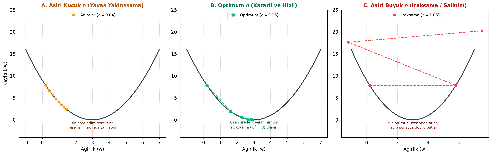

# Bölüm 03: Doğrusal Regresyon, Kayıp Fonksiyonları ve Gradyan İnişi

---

## 🚨 HOCANIN VİZE SINAVI UYARILARI VE KRİTİK İPUÇLARI

> [!IMPORTANT]
> **Vize Sınavı Odak Noktaları:**
> * **Doğrusal Regresyon Modeli:** $\hat{y} = wx + b$ doğrusu, artık (residual) kavramı ($e_i = y_i - \hat{y}_i$).
> * **Kayıp Fonksiyonları:** Ortalama Kare Hata (MSE - Mean Squared Error) ve Ortalama Mutlak Hata (MAE) farkı. MSE'nin hataların karesini aldığı için aykırı değerleri (büyük hataları) çok daha sert cezalandırdığı sorulabilir.
> * **$R^2$ Belirlilik Katsayısı:** $R^2 = 1 - \frac{SSE}{SST}$ formülü. Sınav sorusu: **"$R^2 = 0$ bulunması ne anlama gelir?"** $\implies$ Modelin hiçbir bağıntı öğrenemediği, her örneğe hedef değişkenin genel ortalamasını ($\bar{y}$) atamaktan daha iyi tahmin yapamadığı anlamına gelir.
> * **SAYISAL SORU - Gradyan İniş Adımı:**
>   $$w_{yeni} = w_{eski} - \eta \frac{\partial L}{\partial w}$$
>   Örnek: $L(w) = w^2$, $w_0 = 4$, $\eta = 0.25$ ise:
>   $$\frac{\partial L}{\partial w} = 2w = 2(4) = 8 \implies w_1 = 4 - (0.25 \times 8) = 4 - 2 = 2$$
> * **Öğrenme Oranı ($\eta$ - Learning Rate) Davranışları:** Çok küçük, ideal ve çok büyük (ıraksama/patlama) durumları şematik olarak sorulur.

---

## 1. Basit Doğrusal Regresyon Mimarisi

Doğrusal regresyon, bir veya daha fazla bağımsız girdi değişkeni ($x$) ile sürekli bir bağımlı hedef değişken ($y$) arasındaki doğrusal ilişkiyi modelleyen temel denetimli öğrenme yöntemidir.

$$\hat{y} = w x + b$$

* $x$: Girdi özniteliği (Örn: Evin metrekaresi)
* $w$: Eğim / Ağırlık (*Weight / Slope*)
* $b$: Kesen / Bias (*Intercept*)
* $\hat{y}$: Modelin ürettiği tahmin değeri

### Artık (Residual) ve Hata Kavramı
Her bir veri noktası için modelin tahmini ile gerçek değer arasındaki farka **artık (residual)** denir:
$$e_i = y_i - \hat{y}_i$$

---

## 2. Kayıp Fonksiyonları (Loss Functions)

Modelin başarısı, tüm veri kümesindeki artıkların büyüklüğünü ölçen bir kayıp fonksiyonu ile hesaplanır.

### A. Ortalama Kare Hata (MSE - Mean Squared Error)
En yaygın kullanılan regresyon kayıp fonksiyonudur:
$$MSE = \frac{1}{N} \sum_{i=1}^{N} (y_i - \hat{y}_i)^2$$

* **Mühendislik Özelliği:** Hataların karesi alındığı için:
  1. Hataların negatif ve pozitif olması birbirini sıfırlamaz.
  2. **Büyük hataları aşırı derecede cezalandırır.** Örneğin 1 birimlik hata 1 ceza puanı getirirken, 10 birimlik hata 100 ceza puanı getirir.
  3. Matematiksel olarak türevi her noktada pürüzsüz ve süreklidir; bu nedenle gradyan inişi için mükemmeldir.

### B. Kök Ortalama Kare Hata (RMSE)
$$RMSE = \sqrt{MSE} = \sqrt{\frac{1}{N} \sum_{i=1}^{N} (y_i - \hat{y}_i)^2}$$
* MSE'nin karekökü alınarak birim hedef değişkenin orijinal birimine (TL, kg, metre) geri döndürülür.

### C. Ortalama Mutlak Hata (MAE - Mean Absolute Error)
$$MAE = \frac{1}{N} \sum_{i=1}^{N} |y_i - \hat{y}_i|$$
* Aykırı değerlere (*outliers*) karşı MSE'ye göre çok daha dayanıklıdır (robust).

---

## 3. Regresyon Modelinin Değerlendirilmesi: $R^2$ Skoru

Bir regresyon modelinin verideki varyansın yüzde kaçını açıkladığını gösteren normalize metriğe **Belirlilik Katsayısı ($R^2$ Skoru)** denir:

$$R^2 = 1 - \frac{SSE}{SST} = 1 - \frac{\sum (y_i - \hat{y}_i)^2}{\sum (y_i - \bar{y})^2}$$

* $SSE$ (*Sum of Squared Errors*): Modelin yaptığı hataların kareler toplamı.
* $SST$ (*Total Sum of Squares*): Hedef değişkenin ortalamasına ($\bar{y}$) göre toplam varyansı.

### $R^2$ Değerlerinin Yorumlanması:
* **$R^2 = 1.0$:** Mükemmel model; tüm noktalar doğrunun üzerindedir, hata sıfırdır.
* **$R^2 = 0.85$:** Model, hedef değişkendeki değişimin %85'ini açıklamaktadır.
* **$R^2 = 0.0$:** Model, herhangi bir girdi özniteliğini kullanmadan doğrudan hedefin ortalamasını ($\bar{y}$) tahmin etmekten daha iyi bir tahmin yapamamaktadır.
* **$R^2 < 0.0$:** Model o kadar kötüdür ki, basit bir ortalama tahmininden bile daha büyük hata üretmektedir.

---

## 4. Gradyan İnişi (Gradient Descent) Optimizasyonu

En iyi doğruyu bulmak; MSE kayıp fonksiyonunu ($L(w, b)$) minimum yapan en uygun $w$ ve $b$ değerlerini bulmak demektir. Bu arama **Gradyan İnişi** algoritmasıyla gerçekleştirilir.

### Temel Güncelleme Kuralı:
$$w_{t+1} = w_t - \eta \frac{\partial L}{\partial w}$$

* $w_t$: Mevcut ağırlık değeri.
* $\eta$ (*Eta*): **Öğrenme Oranı (Learning Rate)**; her adımda ne kadar büyük bir adım atılacağını belirleyen en kritik hiperparametredir.
* $\frac{\partial L}{\partial w}$: Kayıp fonksiyonunun o noktadaki türevi (eğimi). Eğim pozitifse ağırlık küçültülür, negatifse ağırlık büyütülür; yani daima çukurun (minimumun) tabanına doğru adım atılır.

---

## 5. Öğrenme Oranının ($\eta$) Davranış Analizi

1. **Aşırı Küçük Öğrenme Oranı ($\eta = 0.0001$):**
   * Model tabana doğru çok minik adımlarla ilerler.
   * Eğitim inanılmaz derecede yavaşlar, binlerce epoch sürer.
   * Derin ve düzensiz yüzeylerde yerel minimumlarda (*local minima*) veya plato bölgelerinde takılı kalabilir.
2. **Optimum Öğrenme Oranı ($\eta = 0.01 - 0.1$):**
   * Model her adımda kararlı ve hızlı bir biçimde küresel minimuma ($w^*$) yakınsar.
3. **Aşırı Büyük Öğrenme Oranı ($\eta = 1.5$):**
   * Adım boyu çukurun genişliğinden büyük olduğu için model minimumun üzerinden karşı yamaca atlar (overshooting).
   * Salınım yapar ve adımdan adıma kayıp değeri küçülmek yerine **sonsuza doğru patlar (ıraksama / divergence)**.

---

## 6. Gradyanı Hesaplama Yöntemleri: Batch, Mini-Batch ve SGD

| Tür | Bir Adımda İşlenen Örnek Sayısı | Avantajları | Dezavantajları |
| :--- | :--- | :--- | :--- |
| **Toplu Gradyan İnişi (Batch GD)** | Tüm veri seti ($N$ örneğin tamamı) | Kararlı ve gürültüsüz gradyan adımı atar. | Büyük veri setlerinde belleğe sığmaz, her adım çok yavaştır. |
| **Stokastik Gradyan İnişi (SGD)** | Yalnızca 1 tek örnek | Çok hızlıdır, yerel minimumlardan gürültü sayesinde kolayca zıplayıp kurtulabilir. | Gradyan çok dalgalıdır (zig-zag çizer), tam minimumda sabit durmakta zorlanır. |
| **Mini-Yığın Gradyan İnişi (Mini-Batch GD)** | Küçük yığınlar (Örn: 16, 32, 64, 128) | **Modern derin öğrenmenin endüstri standardıdır.** GPU'nun paralel işlem gücünü tam kullanır, hem kararlı hem hızlıdır. | Batch Size hiperparametresinin optimize edilmesini gerektirir. |

---

## 7. Özet ve Modül Kontrol Listesi

- [x] Doğrusal regresyon modelinin ($\hat{y} = wx + b$) bileşenlerini ve artık tanımını biliyorum.
- [x] MSE, RMSE ve MAE kayıp fonksiyonları arasındaki farkı ve MSE'nin aykırı değerleri neden sert cezalandırdığını anladım.
- [x] $R^2 = 0$ skorunun "ortalama tahmini kadar başarısız" anlamına geldiğini öğrendim.
- [x] $w_{t+1} = w_t - \eta \frac{\partial L}{\partial w}$ formülü ile tek adımlık sayısal güncellemeyi elle yapabiliyorum.
- [x] Öğrenme oranının küçük, optimum ve aşırı büyük olma senaryolarını ayırt edebiliyorum.
- [x] Batch GD, SGD ve Mini-Batch GD karşılaştırmasını kavradım.
