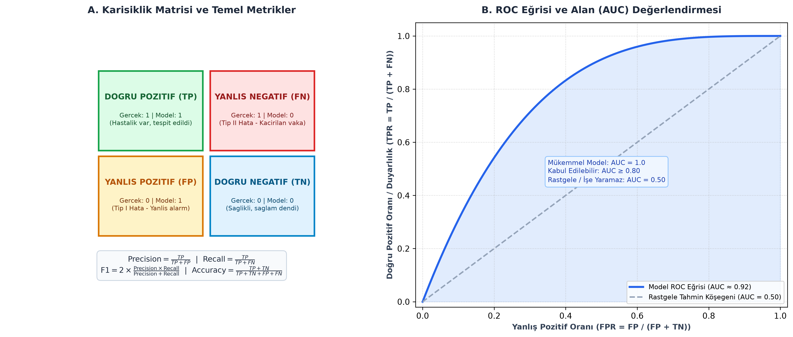

# Bölüm 05: Model Değerlendirme Metrikleri, ROC/AUC ve Kümeleme

---

## 🚨 HOCANIN VİZE SINAVI UYARILARI VE KRİTİK İPUÇLARI

> [!IMPORTANT]
> **Vize Sınavı Odak Noktaları:**
> * **BANKO SORU - Karışıklık Matrisi Hesaplaması:**
>   - $Kesinlik\ (Precision) = \frac{TP}{TP + FP}$
>   - $Duyarlılık\ (Recall) = \frac{TP}{TP + FN}$
>   - $F1-Skoru = 2 \times \frac{Precision \times Recall}{Precision + Recall}$
>   - $Doğruluk\ (Accuracy) = \frac{TP + TN}{TP + TN + FP + FN}$
>   - *Slaytlardaki Sayısal Soru:* $TP=30, FP=10, FN=20, TN=140$ ise:
>     - $Kesinlik = \frac{30}{30 + 10} = \frac{30}{40} = \mathbf{0.75}$
>     - $Duyarlılık = \frac{30}{30 + 20} = \frac{30}{50} = \mathbf{0.60}$
> * **Hangi Hata Daha Maliyetli / Tehlikeli?**
>   - **Kanser / Medikal Teşhis:** Yanlış Negatif (FN) ölümcüldür; hasta kanserdir ama "temizsin" denip eve yollanır. Bu yüzden **Duyarlılık (Recall)** en üst seviyeye çıkarılmalıdır.
>   - **Spam Filtresi:** Yanlış Pozitif (FP) kabul edilemez; önemli bir iş teklifi veya sınav maili spam klasörüne düşüp kaçırılır. Bu yüzden **Kesinlik (Precision)** yüksek tutulmalıdır.
> * **ROC Eğrisi ve AUC (Alan) Değeri:**
>   - Sınav Sorusu: **"Bir modelin AUC değeri 0.5 olarak ölçülmüştür. Bu ne anlama gelir?"** $\implies$ Modelin sınıfları **rastgele tahminden (yazı-tura atmaktan) daha iyi ayıramadığı** anlamına gelir.
> * **k-Means Kümeleme:** Ata $\rightarrow$ Güncelle $\rightarrow$ Tekrarla adımları; en uygun küme sayısının ($k$) belirlenmesinde **Dirsek Yöntemi (Elbow Method)** ve **Siluet Skoru**.

---

## 1. Karışıklık Matrisi (Confusion Matrix)

Dengesiz veri setlerinde (Örn: 990 sağlıklı, 10 kanserli hasta) tek başına "Doğruluk" (Accuracy) metriği yanıltıcıdır. Modeli hiç eğitmeden herkese "Sağlıklı" diyen bir sistem %99 doğruluk verir ama 10 kanserli hastanın tamamını kaçırır (**Doğruluk Paradoksu**). Bu nedenle değerlendirme **Karışıklık Matrisi** üzerinden yapılır.



| | Model Pozitif Tahmin Etti (1) | Model Negatif Tahmin Etti (0) |
| :--- | :---: | :---: |
| **Gerçek Pozitif (1)** | **TP (Doğru Pozitif)**<br>*Hastalık var, tespit edildi.* | **FN (Yanlış Negatif / Tip II Hata)**<br>*Hastalık var, sağlıklı dendi (Kaçırıldı).* |
| **Gerçek Negatif (0)** | **FP (Yanlış Pozitif / Tip I Hata)**<br>*Hastalık yok, hasta dendi (Yanlış alarm).* | **TN (Doğru Negatif)**<br>*Hastalık yok, temiz dendi.* |

---

## 2. Temel Sınıflandırma Metrikleri ve Formülleri

### A. Doğruluk (Accuracy)
Modelin tüm tahminleri içinde doğru bildiği örneklerin oranıdır:
$$\text{Accuracy} = \frac{TP + TN}{TP + TN + FP + FN}$$

### B. Kesinlik (Precision)
Modelin "Pozitif" dediği tahminlerin ne kadarının gerçekten pozitif olduğunu gösterir:
$$\text{Precision} = \frac{TP}{TP + FP}$$
* *"Model pozitif dediğinde ona ne kadar güvenebilirim?"*

### C. Duyarlılık (Recall / Sensitivity)
Gerçekte pozitif olan tüm vakaların model tarafından ne kadarının başarıyla yakalandığını gösterir:
$$\text{Recall} = \frac{TP}{TP + FN}$$
* *"Evrendeki gerçek hastaların yüzde kaçını yakalayabildim?"*

### D. F1-Skoru (Harmonik Ortalama)
Kesinlik ve duyarlılık genellikle birbiriyle çelişir (eşik düşürüldüğünde Recall artarken Precision düşer). İkisi arasındaki dengeyi ölçmek için **harmonik ortalama** kullanılır:
$$F1 = 2 \times \frac{\text{Precision} \times \text{Recall}}{\text{Precision} + \text{Recall}}$$
* Aritmetik ortalama yerine harmonik ortalama kullanılmasının sebebi; metriklerden biri aşırı düşükse (Örn: $Precision=0.9$, $Recall=0.1$) genel skoru sert biçimde aşağı çekerek mühendisi uyarmasıdır.

---

## 3. ROC Eğrisi ve AUC (Area Under Curve)

* **ROC Eğrisi (Receiver Operating Characteristic):** Karar eşiği $\tau$ 0'dan 1'e kadar değiştirilirken; her eşik için hesaplanan **Doğru Pozitif Oranı (TPR = Recall)** ile **Yanlış Pozitif Oranı ($FPR = \frac{FP}{FP + TN}$)** arasındaki ilişkiyi gösteren grafiktir.
* **AUC (Eğri Altında Kalan Alan):** Modelin pozitif bir örneğe negatif bir örnekten daha yüksek olasılık verme yeteneğini tek bir skaler ile özetler:
  * **$AUC = 1.0$:** Mükemmel model; sınıflar birbirinden kusursuzca ayrılmıştır.
  * **$AUC \ge 0.85$:** Çok başarılı model.
  * **$AUC = 0.50$:** **Rastgele Tahmin (Yazı-Tura).** Model hiçbir özniteliği ayırt edememektedir (Köşegen çizgi).
  * **$AUC < 0.50$:** Model etiketleri ters tahmin etmektedir (0 ile 1 ters çevrilirse $1-AUC$ elde edilir).

---

## 4. k-Katlı Çapraz Doğrulama (k-Fold Cross Validation)

Veri setinin kısıtlı olduğu durumlarda rastgele tek bir train/test ayrımının getireceği şans faktörünü ortadan kaldırmak için kullanılır:

```
Tüm Veri Kümesi: [==================================================]
Kat 1: [ TEST ] [ TRAIN ] [ TRAIN ] [ TRAIN ] [ TRAIN ] -> Doğruluk 1
Kat 2: [ TRAIN ] [ TEST ] [ TRAIN ] [ TRAIN ] [ TRAIN ] -> Doğruluk 2
Kat 3: [ TRAIN ] [ TRAIN ] [ TEST ] [ TRAIN ] [ TRAIN ] -> Doğruluk 3
Kat 4: [ TRAIN ] [ TRAIN ] [ TRAIN ] [ TEST ] [ TRAIN ] -> Doğruluk 4
Kat 5: [ TRAIN ] [ TRAIN ] [ TRAIN ] [ TRAIN ] [ TEST ] -> Doğruluk 5
                                               Nihai Skor = Ortalama (1..5) ± Standart Sapma
```

1. Veri seti $k$ adet eşit parçaya bölünür (genellikle $k=5$ veya $k=10$).
2. Her adımda 1 parça test, kalan $k-1$ parça eğitim için kullanılır.
3. $k$ adım tamamlandıktan sonra $k$ farklı doğruluk skorunun ortalaması ve standart sapması raporlanır.

---

## 5. Hatanın Kaynakları: Yanlılık-Varyans Dengesi ve Düzenlileştirme

Toplam Genelleme Hatası 3 bileşenden oluşur:
$$\text{Toplam Hata} = \text{Yanlılık}^2 (\text{Bias}^2) + \text{Varyans} (\text{Variance}) + \text{İndirgenemez Gürültü} (\sigma^2)$$

* **Yüksek Yanlılık (Underfitting):** Model çok basittir, eğitim verisini bile öğrenemez.
* **Yüksek Varyans (Overfitting):** Model aşırı karmaşıktır, eğitim verisindeki gürültüyü ezberler.

### L1 ve L2 Düzenlileştirme (Regularization):
Kayıp fonksiyonuna ağırlıkların büyüklüğünü cezalandıran bir terim eklenir:
1. **L1 Düzenlileştirme (Lasso):** Cezalandırma mutlak değerdir ($\lambda \sum |w_i|$). Gereksiz özniteliklerin ağırlıklarını **tam olarak sıfır** yaparak seyrek (sparse) modeller üretir; yani **otomatik öznitelik seçimi** yapar.
2. **L2 Düzenlileştirme (Ridge / Weight Decay):** Cezalandırma kareler toplamıdır ($\lambda \sum w_i^2$). Ağırlıkları sıfıra yaklaştırır ama tam sıfır yapmaz; tüm katsayıları küçük tutarak modelin aşırı uçlara tepki vermesini engeller.

---

## 6. Denetimsiz Öğrenme: K-Means Kümeleme

Etiketlerin bulunmadığı veri kümelerinde örnekleri benzerliklerine göre $k$ adet kümeye ayıran popüler iteratif algoritmadır.

### Algoritmanın 3 Temel Adımı:
1. **Başlatma:** Uzayda rastgele $k$ adet merkez noktası (centroid) seçilir.
2. **Ata (Assignment):** Her veri noktası, Öklid mesafesine göre kendisine en yakın merkeze atanır.
3. **Güncelle (Update):** Her kümenin yeni merkezi, o kümeye atanan tüm noktaların ortalaması (ağırlık merkezi) olarak yeniden hesaplanır.
4. Merkezlerin konumu değişmeyene kadar (yakınsayana kadar) 2. ve 3. adımlar tekrarlanır.

### En Uygun $k$ Sayısının Seçimi:
* **Dirsek Yöntemi (Elbow Method):** Farklı $k$ değerleri için Küme İçi Kareler Toplamı (WCSS / Inertia) çizilir. Eğrinin büküldüğü, yani hata düşüşünün yavaşladığı "dirsek" noktası en uygun $k$ değeri olarak seçilir.
* **Siluet Skoru (Silhouette Score):** Bir noktanın kendi kümesine olan yakınlığı ile komşu kümelere olan uzaklığını kıyaslar ($-1$ ile $+1$ arasındadır; $+1$'e yakın değerler kümelerin çok iyi ayrıldığını gösterir).

---

## 7. Özet ve Modül Kontrol Listesi

- [x] Karışıklık matrisinde TP, TN, FP ve FN kavramlarını ayırt edebiliyorum.
- [x] Precision, Recall, F1 ve Accuracy formüllerini biliyorum ve sayısal soruyu çözebiliyorum.
- [x] Medikal teşhiste Recall'un, spam filtresinde Precision'ın neden öncelikli olduğunu anladım.
- [x] $AUC = 0.5$ değerinin "rastgele tahmin" anlamına geldiğini öğrendim.
- [x] k-Katlı Çapraz Doğrulamanın amacını ve varyans raporlamasını biliyorum.
- [x] L1'in öznitelik seçtiğini (katsayıları sıfırladığını), L2'nin ise katsayıları küçülttüğünü kavradım.
- [x] K-Means algoritmasının Ata-Güncelle döngüsünü ve Dirsek Yöntemini biliyorum.
