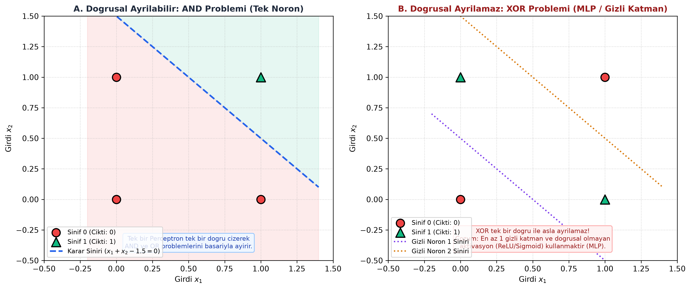

# Bölüm 06: Yapay Sinir Ağları (YSA), Perceptron ve Çok Katmanlı Algılayıcı (MLP)

---

## 🚨 HOCANIN VİZE SINAVI UYARILARI VE KRİTİK İPUÇLARI

> [!IMPORTANT]
> **Vize Sınavı Odak Noktaları:**
> * **Biyolojik ve Yapay Nöron Eşleşmesi:**
>   - Girdiler ($x_i$) $\leftrightarrow$ Dendritler (Gelen sinyaller)
>   - Ağırlıklar ($w_i$) $\leftrightarrow$ Sinapslar (Bağlantı gücü)
>   - Toplam ($z = \sum w_i x_i + b$) $\leftrightarrow$ Hücre Gövdesi (Soma)
>   - Aktivasyon Fonksiyonu ($a = f(z)$) $\leftrightarrow$ Akson (Ateşleme eşiği)
> * **SAYISAL SORU - Tek Nöron Çıktısı Hesabı (Slaytlardan):**
>   - Girdiler: $x = [2, -1, 3]$
>   - Ağırlıklar: $w = [0.5, 1, -0.5]$, Bias: $b = 1$
>   - Aktivasyon: ReLU
>   - *Çözüm:*
>     $$z = (0.5 \times 2) + (1 \times -1) + (-0.5 \times 3) + 1 = 1 - 1 - 1.5 + 1 = -0.5$$
>     $$\text{Çıktı} = \text{ReLU}(-0.5) = \max(0, -0.5) = \mathbf{0}$$
> * **XOR Problemi ve Tarihsel Önemi:** Tek katmanlı Perceptron'un doğrusal olmayan XOR problemini ayıramadığı Minsky ve Papert (1969) tarafından ispatlanmış ve 1. Yapay Zekâ Kışı'na yol açmıştır. Çözüm: **Gizli Katman (Hidden Layer) ve Doğrusal Olmayan Aktivasyon** içeren MLP mimarisidir.
> * **SAYISAL SORU - Tam Bağlantılı (Dense) Katman Parametre Sayısı:**
>   - Soru: 100 nöronlu bir katmandan 50 nöronlu tam bağlı katmana geçişte kaç öğrenilebilir parametre vardır?
>   - *Formül:* $\text{Parametre} = (\text{Girdi Nöron} \times \text{Çıktı Nöron}) + \text{Çıktı Bias}$
>   - *Hesap:* $(100 \times 50) + 50 = 5000 + 50 = \mathbf{5050}$
> * **Doğrusal Olmayan Aktivasyon Fonksiyonu Neden Zorunludur?** Eğer aktivasyon konulmazsa, 100 katman üst üste konsa bile matris çarpımlarının birleşimi tek bir doğrusal katmana indirgenir.

---

## 1. Biyolojik Nörondan Yapay Nörona

Biyolojik sinir sisteminde milyarlarca nöron birbirine sinapslarla bağlıdır. Bir nöron komşularından gelen elektriksel potansiyeller belirli bir eşiği aştığında aksondan yeni bir sinyal ateşler.

Yapay nöron (McCulloch-Pitts ve Rosenblatt modeli) bu biyolojik yapıyı matematiksel olarak modeller:

```
  x1 ──(w1)──┐
  x2 ──(w2)──┼──> [ TOPLAMA: z = Σ(wi·xi) + b ] ──> [ AKTİVASYON: a = f(z) ] ──> Çıktı (y)
  ...        │
  xn ──(wn)──┘
   b ──(1)───┘
```

1. **Ağırlıklı Toplam (Ön Aktivasyon - $z$):**
   $$z = \sum_{i=1}^{D} w_i x_i + b = \mathbf{w}^T \mathbf{x} + b$$
2. **Aktivasyon Fonksiyonu ($a$):**
   $$a = f(z)$$

---

## 2. Rosenblatt Perceptron Modeli ve XOR Problemi

1958'de Frank Rosenblatt tarafından geliştirilen **Perceptron**, basamak fonksiyonu kullanan tek nöronlu en ilkel sınıflandırıcıdır:

$$f(z) = \begin{cases} 1, & z \ge 0 \\ 0, & z < 0 \end{cases}$$



### A. Doğrusal Ayrılabilirlik (AND ve OR Kapıları)
Perceptron, 2 boyutlu uzayda tek bir düz doğru ($w_1 x_1 + w_2 x_2 + b = 0$) çizerek sınıfları ikiye ayırır.
* **AND Kapısı:** Yalnızca $(1, 1)$ için çıktı 1; $(0, 0), (0, 1), (1, 0)$ için 0'dır. Tek bir doğru ile başarıyla ayrılır.

### B. Minsky & Papert (1969) ve XOR Çıkmazı
* **XOR (Özel VEYA) Kapısı:** Girdiler farklıysa 1 ($(0, 1)$ ve $(1, 0)$), girdiler aynıysa 0 ($(0, 0)$ ve $(1, 1)$) üretir.
* Düzlemde bu dört nokta çapraz konumlandığı için **tek bir düz doğru ile 1'leri 0'lardan ayırmak matematiksel olarak imkânsızdır (Doğrusal Ayrılamaz - Linearly Non-Separable)**.
* Bu kısıt literatürde yapay sinir ağlarına olan fon desteğini kesmiş ve 10 yıldan uzun süren "Yapay Zekâ Kışı"na neden olmuştur.
* **Çözüm:** Araya en az bir **Gizli Katman (Hidden Layer)** eklemek ve doğrusal olmayan aktivasyon fonksiyonları kullanmaktır (**Çok Katmanlı Algılayıcı - MLP**).

---

## 3. Doğrusal Olmayan Aktivasyon Fonksiyonları

Neden aktivasyon fonksiyonu kullanmak zorundayız?
Eğer aktivasyon fonksiyonu doğrusal olsaydı ($f(z) = z$):
$$\mathbf{h}_1 = \mathbf{W}_1 \mathbf{x} + \mathbf{b}_1$$
$$\hat{\mathbf{y}} = \mathbf{W}_2 \mathbf{h}_1 + \mathbf{b}_2 = \mathbf{W}_2 (\mathbf{W}_1 \mathbf{x} + \mathbf{b}_1) + \mathbf{b}_2 = (\mathbf{W}_2 \mathbf{W}_1)\mathbf{x} + (\mathbf{W}_2 \mathbf{b}_1 + \mathbf{b}_2) = \mathbf{W}' \mathbf{x} + \mathbf{b}'$$
Görüldüğü üzere iki matrisin çarpımı yine tek bir matristir. **100 gizli katman da koysanız ağ tek bir basit doğrusal regresyona çöker!** Ağa karmaşık kıvrımlı karar sınırları kazandıran unsur doğrusal olmayan aktivasyonlardır.

| Fonksiyon | Formül | Çıktı Aralığı | Özellikleri ve Kullanım Yeri |
| :--- | :---: | :---: | :--- |
| **Sigmoid** | $\sigma(z) = \frac{1}{1 + e^{-z}}$ | $(0, 1)$ | İkili sınıflandırma çıkış katmanında olasılık üretir. Derin ağların gizli katmanlarında gradyan kaybolmasına yol açtığı için terk edilmiştir. |
| **Tanh** | $\tanh(z) = \frac{e^z - e^{-z}}{e^z + e^{-z}}$ | $(-1, 1)$ | Sıfır merkezlidir (*zero-centered*). RNN'lerde yaygındır. |
| **ReLU** | $\max(0, z)$ | $[0, +\infty)$ | **Modern derin öğrenmenin varsayılan aktivasyonudur.** Pozitif bölgede türevi sabittir (1), gradyan kaybolmasını çözer, negatifleri sıfırlayarak seyreklik sağlar ve hesaplaması son derece hızlıdır. |
| **Leaky ReLU** | $\max(\alpha z, z)$ ($\alpha \approx 0.01$) | $(-\infty, +\infty)$ | ReLU'nun negatif bölgede nöronun tamamen ölmesi (*dying ReLU*) sorununu küçük bir eğimle çözer. |

---

## 4. Çok Katmanlı Algılayıcı (MLP) Mimarisi ve İleri Yayılım

Bir MLP mimarisi tipik olarak 3 tür katmandan oluşur:
1. **Girdi Katmanı (Input Layer):** Ham öznitelikleri taşır ($D$ nöron).
2. **Gizli Katmanlar (Hidden Layers):** Öznitelikleri dönüştürür, soyut temsiller öğrenir.
3. **Çıktı Katmanı (Output Layer):** Hedef sınıfları veya regresyon değerini tahmin eder.

```
[ Girdi: X (D) ] ──> [ Gizli 1 (H1) ] ──> [ Gizli 2 (H2) ] ──> [ Çıktı Katmanı (K) ]
```

### Katman Katman İleri Yayılım Formülasyonu:
$$\mathbf{z}^{[1]} = \mathbf{W}^{[1]} \mathbf{x} + \mathbf{b}^{[1]} \implies \mathbf{a}^{[1]} = \text{ReLU}(\mathbf{z}^{[1]})$$
$$\mathbf{z}^{[2]} = \mathbf{W}^{[2]} \mathbf{a}^{[1]} + \mathbf{b}^{[2]} \implies \hat{\mathbf{y}} = \text{Softmax}(\mathbf{z}^{[2]})$$

---

## 5. Öğrenilebilir Parametre Sayısı Hesabı

Vizede tam bağlantılı (Dense) bir katmanın parametre sayısı garanti sorulardan biridir:

$$\text{Öğrenilebilir Parametre Sayısı} = (N_{girdi} \times N_{çıkış}) + N_{çıkış} = N_{çıkış} \times (N_{girdi} + 1)$$

### Örnek Soru ve Çözüm:
* **Girdi:** 784 öznitelik (MNIST $28\times28$ piksel)
* **Gizli Katman:** 128 nöron
* **Çıkış Katmanı:** 10 sınıf
1. Katman 1 (Girdi $\rightarrow$ Gizli):
   $$\text{Parametre}_1 = (784 \times 128) + 128 = 100.352 + 128 = 100.480$$
2. Katman 2 (Gizli $\rightarrow$ Çıkış):
   $$\text{Parametre}_2 = (128 \times 10) + 10 = 1.280 + 10 = 1.290$$
* **Ağın Toplam Parametresi:** $100.480 + 1.290 = \mathbf{101.770}$

---

## 6. Problem Türüne Göre Çıkış Katmanı ve Kayıp Fonksiyonu Eşleşmesi

| Problem Türü | Çıkış Nöron Sayısı | Çıkış Katmanı Aktivasyonu | Uygun Kayıp Fonksiyonu |
| :--- | :---: | :---: | :--- |
| **Regresyon** | 1 (veya $M$) | Doğrusal (Aktivasyonsuz / `None`) | Ortalama Kare Hata (MSE) |
| **İkili Sınıflandırma** | 1 | **Sigmoid** | İkili Çapraz Entropi (BCE) |
| **Çok Sınıflı (Multiclass)** | $K$ (Sınıf Sayısı) | **Softmax** | Kategorik Çapraz Entropi (CCE) |
| **Çok Etiketli (Multilabel)** | $K$ (Her biri bağımsız) | **Sigmoid** (Her çıkışa) | İkili Çapraz Entropi (BCE) |

---

## 7. Özet ve Modül Kontrol Listesi

- [x] Biyolojik nöron ile yapay nöron bileşenlerini (dendrit, sinaps, soma, akson) eşleştirebiliyorum.
- [x] Verilen girdi, ağırlık ve bias için ReLU çıktısını adım adım hesaplayabiliyorum.
- [x] XOR probleminin tek katmanlı Perceptron ile neden çözülemediğini ve MLP'nin çözümünü biliyorum.
- [x] Doğrusal olmayan aktivasyon fonksiyonlarının (ReLU) neden zorunlu olduğunu açıklayabiliyorum.
- [x] Tam bağlantılı katmanlarda parametre sayısını ($N_{in} \times N_{out} + N_{out}$) hesaplayabiliyorum.
- [x] Problem türüne göre Sigmoid vs Softmax çıkış katmanı tercihlerini ezberledim.
