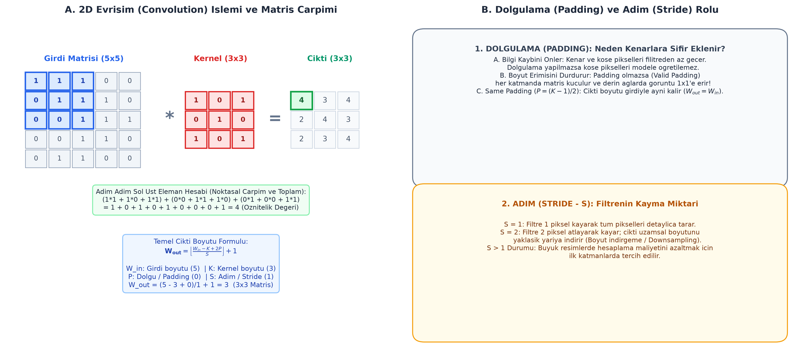

# Bölüm 08: Görüntü İşlemenin Temelleri, Filtreler ve 2D Evrişim

---

## 🚨 HOCANIN VİZE SINAVI UYARILARI VE KRİTİK İPUÇLARI

> [!IMPORTANT]
> **Vize Sınavı Odak Noktaları:**
> * **HOCANIN DERSTE SORDUĞU SORU 1: Dijital Görüntü ve Renk Kanalları:**
>   - Bilgisayarlar dijital bir görüntüyü nasıl algılarlar?
>   - *Cevap:* Piksel matrisleri olarak algılarlar. Her piksel 0 (tam siyah) ile 255 (tam beyaz) arasında bir parlaklık değerine sahiptir.
>   - Gri tonlamalı (*grayscale*) görüntüler **tek kanallı** ($H \times W \times 1$), RGB görüntüler ise Kırmızı, Yeşil ve Mavi olmak üzere **3 kanallıdır** ($H \times W \times 3$).
> * **SAYISAL SORU - Sıkıştırılmamış Görüntü Bellek Hesabı (Slaytlardan):**
>   - Soru: $640 \times 480$ çözünürlüklü, kanal başına 8 bitlik sıkıştırılmamış bir RGB görüntü kaç bayt yer kaplar?
>   - *Formül:* $\text{Bellek} = \text{Genişlik} \times \text{Yükseklik} \times \text{Kanal Sayısı} \times \text{Bayt/Kanal}$
>   - *Hesap:* $640 \times 480 \times 3 \times 1\text{ bayt} = \mathbf{921.600\text{ Bayt}} \approx 900\text{ KB}$
> * **Hangi Gürültüye Hangi Filtre? (BANKO TEST SORUSU):**
>   - Görüntüde rastgele siyah-beyaz noktalar (**Tuz-Biber Gürültüsü / Salt-and-Pepper Noise**) varsa, kenarları en iyi koruyarak bu gürültüyü temizleyen filtre **MEDYAN FİLTRESİDİR**. Ortalama filtresi kenarları bulanıklaştırır ve aykırı değerlerden etkilenir; medyan ise ortanca değeri seçtiği için 0 ve 255 aykırı değerlerini tamamen yok eder.
> * **Histogram Sıkışması ve Çözümü:**
>   - Sınav Sorusu: Bir görüntünün histogramı 100–140 aralığına sıkışmışsa bu ne anlama gelir ve ne yapılmalıdır?
>   - *Cevap:* Görüntünün **kontrastı düşüktür (soluk ve mattır)**; **Histogram Eşitleme (Histogram Equalization)** uygulanmalıdır.
> * **Sobel ve Kenar Tespiti:**
>   - Kenar; parlaklıktaki ani sıçramadır (uzamsal türev). Dikey kenarları bulmak için $G_x$, yatay kenarlar için $G_y$ Sobel çekirdeği kullanılır.
> * **CNN'e Köprü:** Klasik görüntü işlemede çekirdekler (Sobel, Gauss) **insan mühendis tarafından elle tasarlanır**; CNN'de ise bu çekirdekler **veriden kendi kendine öğrenilir**.

---

## 1. Dijital Görüntü Temsili ve Sayısal Matrisler

Dijital bir görüntü, iki boyutlu bir uzamsal koordinat düzleminde ($x, y$) tanımlanmış piksellerden oluşan sayısal bir matristir.

* **Çözünürlük:** Yatay ve dikey piksel sayısıdır ($W \times H$). Örneğin $1920 \times 1080$ Full HD görüntüde yaklaşık 2 milyon piksel bulunur.
* **Bit Derinliği:** Her bir pikselin alabileceği renk tonu çeşitliliğidir. Standart dijital görüntülerde her kanal 8 bittir ($2^8 = 256$ farklı değer $\implies [0, 255]$).

```
   [0: Tam Siyah] ──────────── [128: Orta Gri] ──────────── [255: Tam Beyaz]
```

### Renk Uzayları:
1. **Gri Ton (*Grayscale*):** Yalnızca ışık şiddetini (parlaklık) gösteren tek kanallı matristir ($H \times W \times 1$).
2. **RGB (Kırmızı, Yeşil, Mavi):** İnsan gözünün koni hücrelerini taklit eden 3 kanallı toplamsal renk modelidir ($H \times W \times 3$).
3. **HSV (Hue, Saturation, Value):** Rengin özünü (Hue - Ton), saflığını (Saturation - Doygunluk) ve parlaklığını (Value - Parlaklık) birbirinden ayırır. Robotik görme ve nesne takibinde ışık değişimlerinden etkilenmediği için RGB'ye tercih edilir.

---

## 2. Nokta İşlemleri, Histogram ve Eşikleme

### A. Histogram Nedir?
Histogram; bir görüntüdeki piksellerin ton dağılımını (0 ile 255 arasındaki hangi parlaklık değerinden kaç adet piksel bulunduğunu) gösteren frekans grafiğidir.

* Pikseller sol tarafa (0'a) yığılmışsa: **Aşırı karanlık / az pozlanmış**.
* Pikseller sağ tarafa (255'e) yığılmışsa: **Aşırı aydınlık / patlamış**.
* Pikseller dar bir aralığa sıkışmışsa (Örn: 100-140): **Düşük kontrastlı / soluk**.

### B. Histogram Eşitleme (Histogram Equalization)
Kümülatif dağılım fonksiyonu (CDF) kullanarak dar bir aralığa sıkışmış piksel değerlerini $[0, 255]$ aralığına homojen biçimde yayma işlemidir. Gizli detayları ve kenarları belirginleştirir.

### C. Eşikleme (Thresholding) ve Otsu Yöntemi
Gri tonlamalı görüntüyü ikili (binary - siyah/beyaz) maskeye dönüştürmek için bir eşik ($\tau$) belirlenir:
$$g(x, y) = \begin{cases} 255, & f(x, y) \ge \tau \\ 0, & f(x, y) < \tau \end{cases}$$
* **Otsu Eşikleme Yöntemi:** Eşiği insan tahminine bırakmaz; arka plan ile ön plan sınıfları arasındaki varyansı (*between-class variance*) maksimize eden en ideal eşik değerini histogramdan otomatik olarak hesaplar.

---

## 3. Uzamsal 2D Evrişim (Spatial Convolution)

Evrişim işlemi; küçük bir çekirdek matrisin (kernel / filtre) görüntü üzerinde kaydırılarak her konumda piksellerle noktasal çarpılıp toplanmasıdır.



### Matematiksel Adım:
$3\times3$ bir çekirdeğin görüntünün bir bölgesine uygulanması:
$$\text{Çıktı} = \sum_{i=-1}^{1} \sum_{j=-1}^{1} I(x+i, y+j) \cdot K(i, j)$$

---

## 4. Klasik Filtreler ve Gürültü Temizleme

| Filtre Türü | Matris Yapısı (Örnek) | Çalışma Mantığı ve Kullanım Amacı |
| :--- | :---: | :--- |
| **Ortalama (Box Blur)** | $\frac{1}{9}\begin{bmatrix} 1&1&1\\1&1&1\\1&1&1 \end{bmatrix}$ | Komşuluktaki 9 pikselin aritmetik ortalamasını alır. Görüntüyü yumuşatır; ancak kenarları da bulanıklaştırır. |
| **Gauss Filtresi (Gaussian Blur)** | Merkez ağırlıklı çan eğrisi | Merkeze yakın piksellere daha çok, uzak piksellere daha az ağırlık verir. Doğal ve pürüzsüz yumuşatma sağlar. |
| **Medyan Filtresi** | Doğrusal olmayan (sıralama) | Penceredeki pikselleri küçükten büyüğe sıralar ve **ortanca değeri** merkeze yazar. **Tuz-biber gürültüsünü kenarları bozmadan yok eden en etkili filtredir.** |
| **Keskinleştirme (Sharpening)** | $\begin{bmatrix} 0&-1&0\\ -1&5&-1\\ 0&-1&0 \end{bmatrix}$ | Merkezin ağırlığını artırıp kenarları çıkararak yüksek frekanslı detayları ve hatları keskinleştirir. |

---

## 5. Kenar Tespiti (Edge Detection) ve Sobel Operatörü

Kenar; görüntüdeki parlaklığın uzamsal olarak aniden değiştiği (türevin sıçrama yaptığı) sınırlardır.

### Sobel Operatörleri:
Görüntünün $x$ ve $y$ eksenlerindeki gradyanlarını (türevlerini) hesaplamak için kullanılır:
$$G_x = \begin{bmatrix} -1 & 0 & +1 \\ -2 & 0 & +2 \\ -1 & 0 & +1 \end{bmatrix} \quad (\text{Dikey Kenarlar}), \qquad G_y = \begin{bmatrix} -1 & -2 & -1 \\ 0 & 0 & 0 \\ +1 & +2 & +1 \end{bmatrix} \quad (\text{Yatay Kenarlar})$$

* **Gradyan Büyüklüğü (Kenar Şiddeti):**
  $$G = \sqrt{G_x^2 + G_y^2}$$
* **Gradyan Yönü (Açı):**
  $$\theta = \arctan\left(\frac{G_y}{G_x}\right)$$

### Canny Kenar Algoritmasının 4 Aşaması:
Modern bilgisayarlı görünün en popüler kenar algoritması olan Canny şu 4 adımla çalışır:
1. **Gauss Filtreleme:** Gürültü kaynaklı sahte kenarları engellemek için görüntü yumuşatılır.
2. **Gradyan Hesabı:** Sobel ile $G$ şiddeti ve $\theta$ yönü çıkarılır.
3. **Maksimum Olmayanları Bastırma (Non-Maximum Suppression - NMS):** Kalın kenarlar gradyan yönü boyunca taranarak yalnızca yerel tepe noktaları korunur, kenarlar **1 piksel kalınlığa inceltilir**.
4. **Histerezis ile Çift Eşikleme:** İki eşik kullanılır ($T_{yüksek}$ ve $T_{düşük}$). Yüksek eşiği aşanlar "kesin kenar", iki eşik arasında kalanlar yalnızca kesin bir kenara bağlıysa "kenar" kabul edilir, diğerleri atılır.

---

## 6. Morfolojik İşlemler (Morphology)

İkili (siyah-beyaz) görüntülerde nesne şekillerini düzeltmek için kullanılır:
* **Aşınma (Erosion):** Nesnenin sınırlarını 1 piksel eritir. Küçük beyaz gürültü noktalarını tamamen siler.
* **Genişleme (Dilation):** Nesnenin sınırlarını 1 piksel genişletir. Nesne içindeki delikleri ve çatlakları kapatır.

---

## 7. Geleneksel Görüntü İşlemeden CNN'e Evrimsel Köprü

| Kriter | Geleneksel Görüntü İşleme | Evrişimli Sinir Ağları (CNN) |
| :--- | :--- | :--- |
| **Filtrelerin / Çekirdeklerin Tasarımı** | İnsan mühendis tarafından elle formüle edilir (Sobel, Canny, Gauss). | Rastgele başlatılır ve eğitim sırasında gradyan inişi ile **veriden otomatik öğrenilir**. |
| **Öznitelik Çıkarımı** | Elle çıkarılır (HOG, SIFT, renk histogramı). | Katman katman derinleştikçe hiyerarşik olarak **uçtan uca modelin kendisi öğrenir**. |
| **Uyum Yeteneği** | Işık, açı ve arka plan değişimlerinde kırılganlaşır. | Milyonlarca veriyle eğitildiğinde öteleme ve açı değişimlerine karşı son derece dayanıklıdır. |

---

## 8. Özet ve Modül Kontrol Listesi

- [x] Dijital görüntünün piksel matrisi yapısını ve RGB kanal derinliğini biliyorum.
- [x] Sıkıştırılmamış görüntü bellek boyutunu ($W \times H \times C \times bayt$) hesaplayabiliyorum.
- [x] Tuz-biber gürültüsünde neden Medyan filtresinin kullanıldığını öğrendim.
- [x] Histogram eşitlemenin kontrastı nasıl artırdığını kavradım.
- [x] 2D evrişimin kayan pencere mantığını ve matris çarpımını uygulayabiliyorum.
- [x] Sobel $G_x$ ve $G_y$ çekirdeklerinin dikey ve yatay kenarları nasıl bulduğunu biliyorum.
- [x] Canny algoritmasının 4 temel aşamasını (NMS ve Çift Eşikleme dahil) ezberledim.
- [x] Elle tasarlanan filtrelerden CNN'in öğrenilen filtrelerine geçiş felsefesini kavradım.
