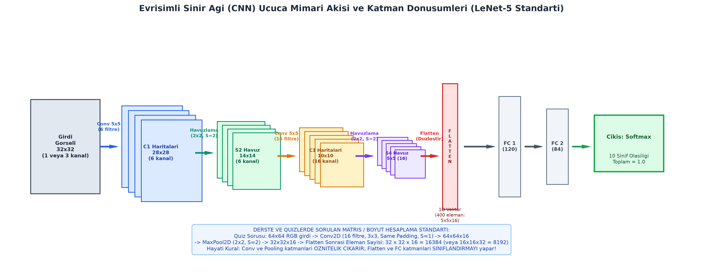
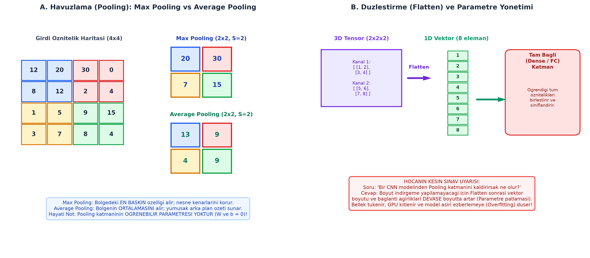

# Bölüm 09: Evrişimli Sinir Ağları (CNN) Mimarisi ve Katman Hesaplamaları

---

## 🚨 HOCANIN VİZE SINAVI UYARILARI VE KRİTİK İPUÇLARI

> [!IMPORTANT]
> **Vize Sınavı Odak Noktaları:**
> * **HOCANIN DERSTE SORDUĞU SORU: Neden Klasik MLP Değil de CNN?**
>   - *Parametre Patlaması:* $224 \times 224 \times 3$ boyutundaki bir resmi klasik tam bağlantılı ağa bağlarsanız tek bir katmanda **150 milyondan fazla parametre** oluşur; donanım kilitlenir.
>   - *Uzamsal Yapının Kaybı:* MLP resmi tek boyuta açtığı için piksellerin alt-üst ve sağ-sol komşuluk ilişkisi kaybolur.
>   - *CNN'in 3 Çözümü:* **Yerel Bağlantı (Local Receptive Field)**, **Ağırlık Paylaşımı (Weight Sharing)** ve **Öteleme Değişmezliği (Translation Invariance)**.
> * **HOCANIN KESİN SINAV MATRİS / BOYUT FORMÜLÜ:**
>   $$W_{çıkış} = \left\lfloor \frac{W_{girdi} - K + 2P}{S} \right\rfloor + 1$$
>   *Örnek:* $64 \times 64 \times 3$ girdiye $3 \times 3$ filtre ($K=3$), dolgu $P=1$ ve adım $S=1$ ile 16 filtre uygulanırsa çıktı boyutu:
>   $$W_{çıkış} = \frac{64 - 3 + 2(1)}{1} + 1 = 64 \implies \mathbf{64 \times 64 \times 16}$$
> * **HOCANIN DERSTE SORDUĞU SORU: Pooling Katmanını Kaldırırsak Ne Olur?**
>   - *Cevap:* Boyut indirgeme yapılamayacağı için Flatten sonrası nöron sayısı ve parametreler devasa boyutta artar. Bellek ve hesaplama maliyeti fırlar, model aşırı öğrenmeye (Overfitting) düşer.
>   - *Tuzak:* **Pooling katmanının ÖĞRENİLEBİLİR PARAMETRESİ YOKTUR (0 parametre)** ve kanal sayısını **ASLA DEĞİŞTİRMEZ**.
> * **HOCANIN QUIZ SORUSU (Dersteki Hesap):**
>   - $64 \times 64$ RGB resim $\rightarrow$ Conv2D (16 filtre, $3\times3$, Same Pad) $\rightarrow 64\times64\times16$
>   - $\rightarrow$ MaxPool2D ($2\times2$, $S=2$) $\rightarrow 32\times32\times16$
>   - $\rightarrow$ Flatten sonrası özellik sayısı: $32 \times 32 \times 16 = \mathbf{16.384}$ (veya $16\times16\times32 = \mathbf{8.192}$).
> * **HOCANIN DERSTE SORDUĞU SORU: CNN Sadece Resimlerde mi Kullanılır?**
>   - *Cevap:* **HAYIR!** Ses dalgalarının frekans-zaman grafiği olan **Mel-spektrogramları** çıkarılarak ses tanımada, 1D biyomedikal sinyallerde (EKG/EEG) ve videolarda (3D CNN) aktif olarak kullanılır.

---

## 1. Neden Klasik MLP Değil de CNN?

Klasik Yapay Sinir Ağları (MLP), tablo verilerinde çok başarılı olmasına rağmen dijital görüntüler karşısında iki temel nedenden ötürü çöker:

1. **Parametre Patlaması (*Curse of Dimensionality*):**
   * $224 \times 224$ çözünürlüğünde RGB bir resim $224 \times 224 \times 3 = 150.528$ sayısal girdi demektir.
   * Bu girdiyi ilk gizli katmandaki yalnızca 1.000 nörona tam bağlarsanız ($150.528 \times 1000$): **Yaklaşık 150 milyon ağırlık** gerekir.
   * Bu durum belleği tüketir, GPU'yu kilitler ve eğitim verisinin ezberlenmesine (aşırı öğrenmeye) yol açar.
2. **Uzamsal Bilginin (*Spatial Locality*) Kaybı:**
   * Klasik ağ resmin matris yapısını bozup tek bir vektöre (vektörize) dönüştürür. Bir pikselin komşu piksellerle olan mesafesi kaybolur. Sol üst köşedeki bir kediyi tanıyan MLP, kedi sağ alt köşeye kaydığında onu tanıyamaz.

### CNN Bu Sorunu 3 İlkeyle Çözer:
1. **Yerel Bağlantı (*Local Receptive Field*):** Her nöron tüm görüntüye değil; yalnızca $3\times3$ veya $5\times5$'lik küçük bir yerel pencereye bağlanır.
2. **Ağırlık Paylaşımı (*Weight Sharing*):** Aynı filtre tüm görüntü üzerinde kaydırılarak gezdirilir. Bir kenar bulucu filtre sol üstte de, sağ altta da aynı ağırlıkları ($3 \times 3 = 9$ parametre) kullanır. Parametre sayısı yüz milyonlardan birkaç bine iner!
3. **Öteleme Eşdeğerliği / Değişmezliği (*Translation Invariance*):** Nesne görüntünün neresinde olursa olsun filtre tarafından başarıyla yakalanır.

---

## 2. Evrişim Katmanı (Convolution Layer) ve Temel Hiperparametreler



### A. Filtre Boyutu (Kernel Size - $K$)
Genellikle tek sayılardan ($3\times3$, $5\times5$, $7\times7$) seçilir. Tek sayı seçilmesinin sebebi simetrik bir merkez piksele sahip olmasıdır. Modern mimarilerde en yaygın kullanılanı $3\times3$'tür.

### B. Adım (Stride - $S$)
Filtrenin her adımda kaç piksel kayacağını belirler:
* $S = 1$: Filtre piksel piksel kayar; tüm detaylar taranır.
* $S = 2$: Filtre ikişer piksel atlar; çıktı boyutunu yarı yarıya küçültür (downsampling).

### C. Dolgulama (Padding - $P$)
Evrişim işlemi piksellerin kenarlarını ortadaki piksellere göre daha az tarar ve her katmanda matris küçülür. Bunu önlemek için görüntünün etrafına sıfırlardan oluşan bir çerçeve eklenir (*Zero Padding*).
1. **Valid Padding ($P = 0$):** Dolgu yapılmaz. Matris her katmanda küçülür: $W_{out} = W_{in} - K + 1$.
2. **Same Padding ($P = \frac{K-1}{2}$):** $S=1$ iken çıktı boyutu girdi boyutuna eşit kalır ($W_{out} = W_{in}$). $3\times3$ filtre için $P=1$, $5\times5$ filtre için $P=2$ eklenir.

---

## 3. Matematiksel Çıktı Boyutu ve Parametre Formülleri

### 1. Çıktı Uzamsal Boyutu Formülü:
$$W_{çıkış} = \left\lfloor \frac{W_{girdi} - K + 2P}{S} \right\rfloor + 1$$
$$H_{çıkış} = \left\lfloor \frac{H_{girdi} - K + 2P}{S} \right\rfloor + 1$$
* **Çıktı Kanal Sayısı:** Uygulanan **filtre sayısına ($C_{out}$)** doğrudan eşittir.

### 2. Öğrenilebilir Parametre Sayısı Formülü:
$$\text{Toplam Parametre} = (K_w \times K_h \times C_{in} + 1) \times C_{out}$$
* $+1$ terimi her filtreye ait bias ($b$) değeridir.

#### Örnek Sınav Hesabı:
* **Girdi:** $32 \times 32 \times 3$ (3 kanallı RGB)
* **Katman:** 16 adet $3\times3$ filtre, $P=1, S=1$
1. **Çıktı Boyutu:**
   $$W_{out} = \frac{32 - 3 + 2(1)}{1} + 1 = 32 \implies \mathbf{32 \times 32 \times 16}$$
2. **Parametre Sayısı:**
   $$\text{Parametre} = (3 \times 3 \times 3 + 1) \times 16 = (27 + 1) \times 16 = 28 \times 16 = \mathbf{448}$$

---

## 4. Havuzlama Katmanı (Pooling Layer)



Evrişimden çıkan öznitelik haritalarının uzamsal çözünürlüğünü azaltarak hesaplama yükünü hafifletir:

1. **Maksimum Havuzlama (Max Pooling):**
   * Seçilen pencere (genellikle $2\times2, S=2$) içindeki **en büyük piksel değerini** alır.
   * En parlak ve en baskın özellikleri (kenar, köşe) korur.
2. **Ortalama Havuzlama (Average Pooling):**
   * Penceredeki değerlerin **aritmetik ortalamasını** alır. Arka plan ve genel doku özetlerinde kullanılır.
3. **Global Ortalama Havuzlama (Global Average Pooling - GAP):**
   * Tüm öznitelik haritasının (örneğin $7\times7$'lik kanalın) tek bir ortalamasını alarak 1 sayıya indirger. Modern mimarilerde klasik Flatten yerine tercih edilerek parametre sayısını devasa oranda düşürür.

### Havuzlamanın Altın Kuralları:
* **Öğrenilebilir Parametresi YOKTUR.** Filtre ağırlığı veya bias barındırmaz (Parametre = 0).
* **Kanal Sayısını DEĞİŞTİRMEZ.** Her kanala ayrı ayrı uygulanır ($H \times W \times C \implies \frac{H}{2} \times \frac{W}{2} \times C$).

---

## 5. Düzleştirme (Flatten) ve Tam Bağlantılı (Dense) Katmanlar

1. **Flatten (Düzleştirme) Katmanı:**
   * Evrişim ve havuzlama katmanlarından çıkan çok boyutlu öznitelik tensörünü ($H \times W \times C$) tek boyutlu bir sütun vektörüne açar.
   * *Amaç:* Çıkarılan öznitelikleri sınıflandırma yapacak olan tam bağlantılı katmanlara uygun girdi formatına getirmektir.
2. **Tam Bağlantılı (Fully Connected / Dense) Katman:**
   * Düzleştirilmiş vektördeki tüm öznitelikleri birbiriyle çapraz bağlar.
   * Öznitelikleri birleştirerek nihai sınıf kararlarını oluşturur.
3. **Çıkış Katmanı (Softmax / Sigmoid):**
   * Çok sınıflı problemlerde her sınıfın gerçekleşme olasılığını üretir ($\sum P = 1.0$).

---

## 6. Örnek Mimari: LeNet-5 (1998 - Yann LeCun)

Derin öğrenme tarihinin el yazısı rakam tanıma (MNIST) için geliştirilen ilk başarılı evrişimsel mimarisidir:

| Katman | Türü | Girdi Boyutu | İşlem / Filtre | Çıktı Boyutu | Parametre Sayısı |
| :--- | :--- | :---: | :--- | :---: | :---: |
| **Girdi** | Resim | $32 \times 32 \times 1$ | - | $32 \times 32 \times 1$ | 0 |
| **C1** | Conv2D | $32 \times 32 \times 1$ | 6 adet $5\times5$, $S=1, P=0$ | $28 \times 28 \times 6$ | $(5\times5\times1 + 1)\times6 = 156$ |
| **S2** | AvgPool | $28 \times 28 \times 6$ | $2\times2$, $S=2$ | $14 \times 14 \times 6$ | 0 |
| **C3** | Conv2D | $14 \times 14 \times 6$ | 16 adet $5\times5$, $S=1, P=0$ | $10 \times 10 \times 16$ | $(5\times5\times6 + 1)\times16 = 2.416^*$ |
| **S4** | AvgPool | $10 \times 10 \times 16$ | $2\times2$, $S=2$ | $5 \times 5 \times 16$ | 0 |
| **Flatten** | Düzleştir | $5 \times 5 \times 16$ | Vektöre dönüştürme | 400 | 0 |
| **F5** | Dense | 400 | 120 nöron | 120 | $(400 \times 120) + 120 = 48.120$ |
| **F6** | Dense | 120 | 84 nöron | 84 | $(120 \times 84) + 84 = 10.164$ |
| **Çıktı** | Softmax | 84 | 10 sınıf (0..9) | 10 | $(84 \times 10) + 10 = 850$ |

---

## 7. Öznitelik Hiyerarşisi ve Alıcı Alan (Receptive Field)

Bir CNN mimarisinde derinleştikçe öğrenilen özniteliklerin niteliği hiyerarşik olarak değişir:

```
[ Girdi ] ──> [ İlk Katmanlar ] ──> [ Orta Katmanlar ] ──> [ Derin Katmanlar ]
             (Kenar, Çizgi, Renk)    (Doku, Şekil, Eğri)     (Göz, Burun, Pati / Nesne)
```

* **Alıcı Alan (*Receptive Field*):** Bir nöronun orijinal girdi görüntüsünde "gördüğü" veya etkilendiği piksel alanının büyüklüğüdür. İlk katmanlarda nöron yalnızca $3\times3$ piksellik bir alanı görürken; art arda gelen evrişim ve havuzlamalar sayesinde derin katmandaki tek bir nöron resmin tamamını ($224\times224$) kapsayan bir alıcı alana ulaşır.
* **Kedinin Farklı Açılardan Tanınabilmesi:** CNN kedinin tüm gövdesini bir blok olarak ezberlemez; kulak, bıyık, pati gibi öznitelikleri hiyerarşik olarak soyutlar. Nesne sağa, sola dönse veya farklı ışıkta çekilse bile öznitelik bileşenleri yakalandığı için model %95+ doğrulukla tanımayı başarır.

---

## 8. CNN'in Farklı Veri Tiplerinde Kullanımı

CNN sadece iki boyutlu RGB fotoğraflarla sınırlı değildir:
1. **Ses ve Konuşma Tanıma:** Ses dalgasının Fourier dönüşümüyle frekans-zaman grafiği olan **Mel-spektrogramı (Mel-Spectrogram)** üretilir. Bu spektrogram 2D bir ısı haritası (resim) gibi CNN'e verilerek ses sınıflandırılır.
2. **1D Biyomedikal Sinyaller:** EKG (kalp) ve EEG (beyin) sinyalleri 1D-CNN filtreleriyle taranarak ritim bozuklukları teşhis edilir.
3. **Video Sınıflandırma:** Zaman boyutunu da içeren ardışık kareler **3D-CNN** filtreleriyle taranarak eylemler (koşma, zıplama) tespit edilir.

---

## 9. Özet ve Modül Kontrol Listesi

- [x] Klasik MLP'nin parametre patlaması ve uzamsal kayıp kısıtlarını ezberledim.
- [x] CNN'in yerel bağlantı, ağırlık paylaşımı ve öteleme değişmezliği çözümlerini kavradım.
- [x] Çıktı boyutu ($W_{out} = \lfloor \frac{W - K + 2P}{S} \rfloor + 1$) formülünü ezbere uygulayabiliyorum.
- [x] Conv katmanında parametre sayısını ($(K_w K_h C_{in} + 1) \times C_{out}$) hesaplayabiliyorum.
- [x] Max Pooling ile Average Pooling farkını ve pooling katmanının 0 parametresi olduğunu biliyorum.
- [x] Pooling kaldırıldığında parametre patlaması ve overfitting yaşanacağını anladım.
- [x] Flatten katmanının tensörü vektöre açtığını ve dersteki quiz hesabını (16.384 / 8.192) çözebiliyorum.
- [x] LeNet-5 mimarisinin katman akışını biliyorum.
- [x] CNN'in ses spektrogramlarında ve medikal sinyallerde de kullanıldığını öğrendim.
